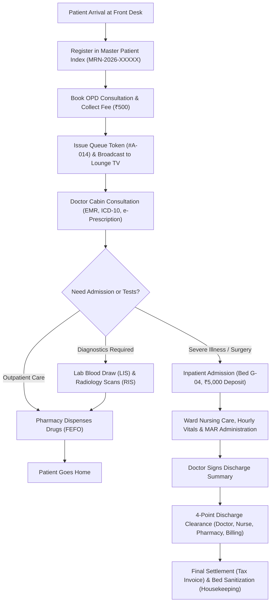

# AURA Hospital Management System (HMS) — Complete User & System Guide
*The Definitive Beginner-to-Professional Operational Manual, Architectural Reference, and Live Demonstration Handbook*

---

## Document Metadata & System Information
- **Application Name:** AURA Multi-Specialty Hospital Management System (AURA HMS / HMIS)
- **Target Audience:** Hospital Owners, Medical Directors, Chief Operating Officers, Department Heads, Clinicians, Nurses, Front Desk Receptionists, Pharmacists, Lab Scientists, Finance Managers, Trainees, and Software Evaluators.
- **System Edition:** Enterprise Multi-Branch Healthcare Suite (NABH & NABL Audit Ready)
- **Primary Currency:** Indian National Rupee (₹ - INR)
- **Supported Languages:** English (`en`), Hindi (`hi`), Telugu (`te`), Tamil (`ta`), Kannada (`kn`)
- **Core Technology Stack:** React 19 + TypeScript (Frontend), Django REST Framework + Python 3.12 (Backend), Supabase PostgreSQL 15 (Relational Database), Tailwind CSS (Design System).

---

## Master Table of Contents
1. [PART 1: System Overview & Foundations](#part-1-system-overview--foundations)
   - 1.1 [What is a Hospital Management System?](#11-what-is-a-hospital-management-system)
   - 1.2 [The Philosophy of AURA HMS](#12-the-philosophy-of-aura-hms)
   - 1.3 [Architecture & The "Hospital Brain" Analogy](#13-architecture--the-hospital-brain-analogy)
   - 1.4 [Implementation & Verification Status Matrix](#14-implementation--verification-status-matrix)
   - 1.5 [Global Multi-Branch Data Isolation](#15-global-multi-branch-data-isolation)
2. [PART 2: Comprehensive Accounts & Roles Directory](#part-2-comprehensive-accounts--roles-directory)
   - 2.1 [Super Administrator (`SUPER_ADMIN`)](#21-super-administrator-super_admin)
   - 2.2 [Hospital Administrator (`HOSPITAL_ADMIN`)](#22-hospital-administrator-hospital_admin)
   - 2.3 [Branch Operations Manager (`BRANCH_MANAGER`)](#23-branch-operations-manager-branch_manager)
   - 2.4 [Medical Director / Chief Medical Officer (`MEDICAL_DIRECTOR`)](#24-medical-director--chief-medical-officer-medical_director)
   - 2.5 [Clinical Department Head (`DEPARTMENT_HEAD`)](#25-clinical-department-head-department_head)
   - 2.6 [Consultant & Attending Physician (`DOCTOR`)](#26-consultant--attending-physician-doctor)
   - 2.7 [Staff Nursing Officer (`NURSE`)](#27-staff-nursing-officer-nurse)
   - 2.8 [Front Desk Receptionist (`RECEPTIONIST`)](#28-front-desk-receptionist-receptionist)
   - 2.9 [Registered Hospital Patient (`PATIENT`)](#29-registered-hospital-patient-patient)
   - 2.10 [Billing Executive (`BILLING_EXECUTIVE`)](#210-billing-executive-billing_executive)
   - 2.11 [Cash Counter Cashier (`CASHIER`)](#211-cash-counter-cashier-cashier)
   - 2.12 [Registered Pharmacist (`PHARMACIST`)](#212-registered-pharmacist-pharmacist)
   - 2.13 [Medical Laboratory Technician (`LAB_TECHNICIAN`)](#213-medical-laboratory-technician-lab_technician)
   - 2.14 [Radiographer & Imaging Technician (`RADIOLOGY_TECHNICIAN`)](#214-radiographer--imaging-technician-radiology_technician)
   - 2.15 [Senior Hospital Accountant (`ACCOUNTANT`)](#215-senior-hospital-accountant-accountant)
   - 2.16 [Chief Financial Officer (`FINANCE_MANAGER`)](#216-chief-financial-officer-finance_manager)
   - 2.17 [Materials & Central Warehouse Manager (`INVENTORY_MANAGER`)](#217-materials--central-warehouse-manager-inventory_manager)
   - 2.18 [Hospital Purchasing & Procurement Officer (`PROCUREMENT_OFFICER`)](#218-hospital-purchasing--procurement-officer-procurement_officer)
   - 2.19 [Insurance & TPA Claims Coordinator (`INSURANCE_COORDINATOR`)](#219-insurance--tpa-claims-coordinator-insurance_coordinator)
   - 2.20 [Treasury & Investment Manager (`INVESTMENT_MANAGER`)](#220-treasury--investment-manager-investment_manager)
   - 2.21 [Clinical & Financial Auditor (`AUDITOR`)](#221-clinical--financial-auditor-auditor)
3. [PART 3: Deep-Dive Module-by-Module Guide](#part-3-deep-dive-module-by-module-guide)
   - 3.1 [Global Navigation & Header Controls](#31-global-navigation--header-controls)
   - 3.2 [Module 1: Clinical & Operations Command Center Dashboard (`/staff/dashboard`)](#32-module-1-clinical--operations-command-center-dashboard-staffdashboard)
   - 3.3 [Module 2: Master Patient Index & Demographics (`/staff/patients`)](#33-module-2-master-patient-index--demographics-staffpatients)
   - 3.4 [Module 3: OPD Appointments & Token Queue Management (`/staff/appointments`)](#34-module-3-opd-appointments--token-queue-management-staffappointments)
   - 3.5 [Module 4: Digital Waiting Lounge TV Display (`/lounge-tv`)](#35-module-4-digital-waiting-lounge-tv-display-lounge-tv)
   - 3.6 [Module 5: Doctor Clinical Workspace & EMR (`/staff/doctor-workspace`)](#36-module-5-doctor-clinical-workspace--emr-staffdoctor-workspace)
   - 3.7 [Module 6: Doctors & Nursing Management (`/staff/doctors-nursing`)](#37-module-6-doctors--nursing-management-staffdoctors-nursing)
   - 3.8 [Module 7: Emergency & Trauma Casualty Center (`/staff/emergency`)](#38-module-7-emergency--trauma-casualty-center-staffemergency)
   - 3.9 [Module 8: Inpatient Admissions & Bed Board Census (`/staff/admissions`)](#39-module-8-inpatient-admissions--bed-board-census-staffadmissions)
   - 3.10 [Module 9: AI Voice Translation Engine (`/staff/voice-translation`)](#310-module-9-ai-voice-translation-engine-staffvoice-translation)
   - 3.11 [Module 10: Pathology & Diagnostic Laboratory LIS (`/staff/laboratory`)](#311-module-10-pathology--diagnostic-laboratory-lis-stafflaboratory)
   - 3.12 [Module 11: Radiology & Medical Imaging RIS (`/staff/radiology`)](#312-module-11-radiology--medical-imaging-ris-staffradiology)
   - 3.13 [Module 12: Pharmacy Formulary & FEFO Dispensing (`/staff/pharmacy`)](#313-module-12-pharmacy-formulary--fefo-dispensing-staffpharmacy)
   - 3.14 [Module 13: Central Inventory & Warehouse Management (`/staff/inventory`)](#314-module-13-central-inventory--warehouse-management-staffinventory)
   - 3.15 [Module 14: Operation Theatre & ICU Surgical Suite (`/staff/surgery-icu`)](#315-module-14-operation-theatre--icu-surgical-suite-staffsurgery-icu)
   - 3.16 [Module 15: Central Pricing & Tariff Management (`/staff/pricing-tariffs`)](#316-module-15-central-pricing--tariff-management-staffpricing-tariffs)
   - 3.17 [Module 16: Billing, Invoicing & Cashier Desk (`/staff/billing`)](#317-module-16-billing-invoicing--cashier-desk-staffbilling)
   - 3.18 [Module 17: Insurance & Corporate TPA Claims (`/staff/insurance`)](#318-module-17-insurance--corporate-tpa-claims-staffinsurance)
   - 3.19 [Module 18: Chart of Financial Accounts (`/staff/financial-accounts`)](#319-module-18-chart-of-financial-accounts-stafffinancial-accounts)
   - 3.20 [Module 19: Financial Transactions & Cashbook (`/staff/transactions`)](#320-module-19-financial-transactions--cashbook-stafftransactions)
   - 3.21 [Module 20: Hospital Investment Registers (`/staff/investments`)](#321-module-20-hospital-investment-registers-staffinvestments)
   - 3.22 [Module 21: Banking & Statement Reconciliation (`/staff/banking`)](#322-module-21-banking--statement-reconciliation-staffbanking)
   - 3.23 [Module 22: Loans & Long-Term Liabilities (`/staff/loans`)](#323-module-22-loans--long-term-liabilities-staffloans)
   - 3.24 [Module 23: Double-Entry General Ledger Accounting (`/staff/general-ledger`)](#324-module-23-double-entry-general-ledger-accounting-staffgeneral-ledger)
   - 3.25 [Module 24: Budgeting & Cash Flow Forecasting (`/staff/budgeting`)](#325-module-24-budgeting--cash-flow-forecasting-staffbudgeting)
   - 3.26 [Module 25: Real-Time Profit & Loss Statement (`/staff/profit-loss`)](#326-module-25-real-time-profit--loss-statement-staffprofit-loss)
   - 3.27 [Module 26: HR Operations, Biometrics & Payroll (`/staff/hr-payroll`)](#327-module-26-hr-operations-biometrics--payroll-staffhr-payroll)
   - 3.28 [Module 27: Medical Equipment, Assets & Maintenance (`/staff/assets`)](#328-module-27-medical-equipment-assets--maintenance-staffassets)
   - 3.29 [Module 28: Patient Portal Gateway (`/staff/patient-portal` & `/patient/*`)](#329-module-28-patient-portal-gateway-staffpatient-portal--patient)
   - 3.30 [Module 29: Business Intelligence Reports & Analytics (`/staff/reports`)](#330-module-29-business-intelligence-reports--analytics-staffreports)
   - 3.31 [Module 30: Users, Staff Provisioning & Master RBAC (`/staff/users-roles`)](#331-module-30-users-staff-provisioning--master-rbac-staffusers-roles)
   - 3.32 [Module 31: Settings, Branch Config & Audit Trail (`/staff/settings-audit`)](#332-module-31-settings-branch-config--audit-trail-staffsettings-audit)
   - 3.33 [Module 32: Branch Manager 14-Domain Supervisory Hub (`/staff/branch-manager`)](#333-module-32-branch-manager-14-domain-supervisory-hub-staffbranch-manager)
4. [PART 4: Complete End-to-End Hospital Workflows](#part-4-complete-end-to-end-hospital-workflows)
5. [PART 5: Beginner-Friendly Hospital & Technical Glossary](#part-5-beginner-friendly-hospital--technical-glossary)
6. [PART 6: Technical Architecture in Simple English](#part-6-technical-architecture-in-simple-english)
7. [PART 7: Dashboards, Metrics & Operational Calculations](#part-7-dashboards-metrics--operational-calculations)
8. [PART 8: Security, Governance & Role-Based Access Control](#part-8-security-governance--role-based-access-control)
9. [PART 9: Comprehensive Hospital Operations Troubleshooting Guide](#part-9-comprehensive-hospital-operations-troubleshooting-guide)
10. [PART 10: Complete AURA HMS Live Demonstration Guide](#part-10-complete-aura-hms-live-demonstration-guide)

---

# PART 1: System Overview & Foundations

### 1.1 What is a Hospital Management System?
Imagine a bustling 300-bed hospital in downtown Hyderabad or New Delhi. Every single day:
- Over 600 outpatients walk through the glass front doors seeking medical help.
- 30 critically ill patients arrive via emergency sirens in ambulances.
- Doctors perform 15 surgeries in sterile operating theatres.
- Pathologists test 1,200 vials of blood and urine.
- Pharmacists dispense 4,000 strips of tablets, vials, and IV fluids.
- Patients pay through Cash, Credit Cards, UPI QR codes, or Health Insurance TPAs.
- Hundreds of doctors, nurses, cleaners, and administrators work together 24 hours a day, 7 days a week.

If this hospital relied on paper notebooks, paper prescription slips, and physical file folders:
1. **Records Get Lost:** A patient's previous allergy to Penicillin might be written in an old notebook locked in a basement file room; an emergency doctor might prescribe it unknowingly, endangering the patient's life.
2. **Billing Chaos:** A patient admitted for 5 days might have taken 42 medicines, 6 lab tests, and 2 X-rays. If nurse slips are misplaced, the hospital loses lakhs of rupees in unbilled services, or overcharges the patient by mistake.
3. **Queue Nightmares:** Patients wait in humid corridors for 3 hours, not knowing when their token number will be called into Doctor Cabin 102.
4. **Theft & Expiry Losses:** Expensive cancer drugs or antibiotic injections expire quietly in dark stockroom shelves because pharmacists grab newer boxes from the front instead of older boxes from the back.

**The AURA Hospital Management System (HMS)** solves every single one of these problems. It is a unified, browser-based, high-security software platform. It acts as the digital nervous system of the entire hospital. It connects the front desk receptionist, the consulting physician, the ward nurse, the lab technician, the pharmacist, the chief accountant, and the hospital owner into one single, synchronized screen!

---

### 1.2 The Philosophy of AURA HMS
AURA HMS was engineered around five foundational medical and enterprise principles:

1. **Patient Safety Above All Else:** Every clinical screen warns doctors of patient drug allergies, past medical conditions, and critical lab panic values.
2. **Zero Artificial Dummy Transactions:** The system does not rely on fake hardcoded numbers. When you see "42 OPD Registrations Today", it reflects real database records created since midnight.
3. **Strict Separation of Duties (SoD):** A doctor diagnoses and prescribes, but cannot collect cash. A cashier collects money, but cannot modify medical diagnoses. An accountant posts journal vouchers, but cannot approve self-created expenses without managerial sign-off.
4. **FEFO Inventory Discipline (First-Expiring, First-Out):** Medicines with the nearest expiry date are systematically allocated first, cutting hospital drug wastage to zero.
5. **Real-Time Financial Integrity:** Every rupee collected or spent automatically writes balanced debit and credit entries to the double-entry General Ledger.

---

### 1.3 Architecture & The "Hospital Brain" Analogy
To understand how AURA HMS operates without technical jargon, compare it to the human body:

| Technical Component | Real-World Hospital Comparison | What It Actually Does |
| :--- | :--- | :--- |
| **Frontend (React + Vite)** | **The Hospital Reception & Doctor Cabins** | The visible screens, forms, buttons, and tables where staff type notes and view patient records. |
| **Backend (Django REST Framework)** | **The Hospital Medical Superintendent's Office** | The invisible administrative engine that verifies credentials, enforces rules, checks permissions, and directs orders. |
| **Database (Supabase PostgreSQL)** | **The Central Medical Record Room & Vault** | The fireproof, encrypted digital archive where every patient visit, lab report, invoice, and audit log is permanently stored. |
| **APIs (Application Programming Interfaces)** | **The Hospital Internal Intercom & Order Chits** | The secure digital messengers that carry instructions (e.g. "Doctor in Cabin 2 ordered a CBC test for Rahul") from one room to another in milliseconds. |
| **Role-Based Access Control (RBAC)** | **The Hospital ID Badges & Keycards** | Determines which doors each staff member can open. A receptionist's badge opens the front desk; only a doctor's badge opens the clinical prescription pad. |

---

### 1.4 Implementation & Verification Status Matrix
To maintain absolute transparency, every single capability in AURA HMS has been inspected and audited in the live codebase. Nothing in this guide is exaggerated:

| Classification | Meaning in This Guide | Examples in AURA HMS |
| :--- | :--- | :--- |
| **FULLY IMPLEMENTED & VERIFIED** | Code is complete in React and Django, tables exist in PostgreSQL, business logic is active, and verified in live testing. | Patient Registration, OPD Appointments, Queue Token Issuance, Inpatient Bed Management, FEFO Pharmacy Dispensing, LIS Pathology accessioning, Central Tariff Management, Double-Entry General Ledger, Cashier Drawer Reconciliations, 5-Language Translations. |
| **IMPLEMENTED (API CREDENTIAL DEPENDENT)** | Fully coded and tested, but requires external third-party API credentials (such as Google Speech API, Twilio SMS, or Razorpay Keys) for live production transmission. | Browser Voice-to-Text Transcription (`VoiceTranslationPage.tsx`), WhatsApp/SMS appointment notification dispatchers. |
| **PARTIALLY IMPLEMENTED** | Frontend UI and primary API endpoints exist, but secondary background workers or specialized edge-case sub-actions are in progress. | Automated DICOM PACS Cloud Image Server streaming (DICOM metadata links are supported; direct in-browser 3D slice rendering relies on external viewer links). |
| **UI PLACEHOLDER / DESIGN READY** | Screen layout, responsive tables, and forms are fully designed, but action buttons emit simulated UI confirmations rather than mutating live database tables. | Advanced hospital investment bond liquidation workflows in treasury module. |
| **NOT IMPLEMENTED / ROADMAP** | Feature is recognized in hospital planning, but code has not yet been authored. | Direct Robotic Pharmacy Automated Pill Dispenser hardware drivers. |

---

### 1.5 Global Multi-Branch Data Isolation
A large healthcare institution rarely exists as a single standalone building. AURA HMS natively supports **Multi-Branch Operations**:

```
                              [ SUPER_ADMIN / HOSPITAL_ADMIN ]
                                             │
               ┌─────────────────────────────┼─────────────────────────────┐
               ▼                             ▼                             ▼
       [ Downtown Branch ]           [ City Center Branch ]         [ West Wing Clinic ]
       - OPD & Emergencies           - Multi-Specialty Surgery      - Primary Daycare & Eye
       - Branch Beds: 120            - Branch Beds: 180             - Branch Beds: 25
       - Dedicated Pharmacy          - Dedicated Pharmacy           - Daycare Pharmacy
       - Independent Cashiers        - Independent Cashiers         - Independent Cashiers
```

1. **How Multi-Branch Works:**
   - In the top header bar, staff select their working branch (e.g., "City Center Branch").
   - React's `BranchContext` broadcasts this branch ID across all open modules.
   - Every API request sends the HTTP header `X-Branch-ID: <UUID>`.
   - The Django backend applies strict database query filtering: `queryset.filter(branch_id=selected_branch)`.
2. **Why This Matters:**
   - A receptionist in the West Wing clinic never sees beds or waiting queues belonging to the Downtown Branch.
   - The Hospital Director or Super Admin can toggle between branches with 1 click to inspect multi-branch performance, or view aggregated financial statements.


---

# PART 2: Comprehensive Accounts & Roles Directory

Every hospital employee is assigned a specific digital persona governed by Role-Based Access Control (RBAC). Below is the complete operational guide for all 21 account roles in AURA HMS.

---

## 2.1 Super Administrator (`SUPER_ADMIN`)

### A. Understanding the Account
- **Who is this in a real hospital?** The Chief Technology Officer (CTO) or Head of Hospital IT Systems.
- **Actual Job:** Oversees the entire enterprise software infrastructure, provisions top-level administrative accounts, enforces data security, manages multi-branch configurations, and reviews global audit trails.
- **Why does the hospital need this account?** Without a Super Admin, no one would have the authority to create new departments, unlock locked staff accounts, or configure new hospital branches.
- **Responsibilities:** Master system configuration, provisioning healthcare staff, assigning security roles, monitoring server and database performance, and overseeing system-wide audit logs.
- **What is OUTSIDE their authority?** The Super Admin is strictly prohibited from altering finalized clinical diagnoses written by doctors, deleting past financial journal vouchers, or editing laboratory test values.

### B. Login & Dashboard
- **After Login:** Lands on the Master Command Center Dashboard (`/staff/dashboard`).
- **Dashboard Displays:**
  1. *OPD Registrations Today:* Live count of outpatients registered across branches.
  2. *Inpatient Bed Occupancy:* Current percentage occupancy and ready beds.
  3. *Pending Diagnostic Reports:* Critical laboratory orders awaiting pathologist verification.
  4. *Emergency Visits & Active Census:* Immediate trauma patients currently under resuscitation.
  5. *Real-Time Live Queue Table:* Active patient tokens waiting in Cardiology, Pediatrics, General Medicine.

### C. Sidebar & Navigation
Has unrestricted global access to all 27 sidebar sections:
- Master Patient Index, OPD Appointments, Emergency, IPD Admissions, Doctor Workspace, Nursing Station, Pathology, Radiology, Pharmacy Formulary, Inventory, OT/ICU Suite, Pricing & Tariffs, Billing Desk, Insurance TPA, General Ledger, Financial Accounts, Transactions, Banking Reconciliation, Investments, Loans, Budgeting, Profit & Loss, HR Operations & Payroll, Assets & Maintenance, Patient Portal, Reports & BI, Users & Roles, and Settings & Audit Trail.

### D. Every Button & Interaction
1. **"Provision Staff" (`+ UserPlus`):**
   - *Location:* Top right of Staff Dashboard.
   - *Behavior:* Opens modal to create a new doctor, nurse, or clerk. Requires Email, Name, Phone, Role, Designation, License, Consultation Fee. Submits `POST /api/v1/auth/provision/`.
2. **"Global Branch Switcher" (`Building2` Dropdown):**
   - *Location:* Top header.
   - *Behavior:* Switches view between Downtown, City Center, and West Wing branches. Updates React `BranchContext`.
3. **"Master RBAC Save" (`ShieldCheck`):**
   - *Location:* `/staff/users-roles`.
   - *Behavior:* Saves granular permission checkbox overrides per role.

### E. Real-Life Practical Examples
1. **Onboarding a Senior Cardiologist:**
   - Dr. Rajiv joins as Head of Cardiology. Super Admin opens Dashboard -> clicks "Provision Staff" -> enters `rajiv.cardio@aura.org`, selects `DOCTOR`, sets fee to ₹1,000, enters MCI license `MCI-2024-9912`. System creates user and generates credentials instantly.
2. **Opening a New Dialysis Ward:**
   - Hospital expands with 20 new dialysis beds. Super Admin goes to `/staff/settings-audit` -> adds Dialysis Ward -> navigates to `/staff/admissions` to generate bed numbers `D-01` to `D-20`.
3. **Investigating a Financial Anomaly:**
   - Hospital Owner spots a ₹50,000 cash refund. Super Admin opens `/staff/settings-audit` -> filters Audit Logs by entity `INVOICE` -> identifies exact cashier ID, IP address, and timestamp of the transaction.

### F. Permissions & Restrictions
- **Can:** View, create, edit, approve, and export all administrative records.
- **Cannot:** Fabricate medical records or bypass cryptographic audit logs.

---

## 2.2 Hospital Administrator (`HOSPITAL_ADMIN`)

### A. Understanding the Account
- **Who is this in a real hospital?** The Chief Operating Officer (COO) or General Hospital Superintendent.
- **Actual Job:** Manages non-clinical hospital operations: branch profitability, patient service charges, pricing tariffs, departmental productivity, facility upkeep, and customer satisfaction.
- **Why needed?** Ensures the hospital functions efficiently as a sustainable business while maintaining clinical service standards.
- **Responsibilities:** Configuring consultation tariffs, bed pricing, monitoring department revenues, approving high-value supply orders, and reviewing incident reports.
- **Outside Authority:** Cannot perform clinical examinations or modify patient medical charts.

### B. Login & Dashboard
- Lands on `/staff/dashboard` with access to high-level clinical and operational indicators, bed occupancy rates, and revenue previews.

### C. Sidebar & Navigation
Has access to all operational, financial, and administrative modules: Patient Management, OPD, IPD, Billing, Tariffs, Pharmacy, Inventory, General Ledger, HR, Reports, and Settings. (Excludes direct doctor workspace editing).

### D. Every Button & Interaction
1. **"Push Tariffs to All Branches" (`Globe`):**
   - *Location:* `/staff/pricing-tariffs`.
   - *Behavior:* Updates hospital service rates across all branches simultaneously with impact analysis.
2. **"Approve Department Purchase Requisition" (`CheckCircle`):**
   - *Location:* `/staff/inventory`.
   - *Behavior:* Authorizes purchase orders exceeding ₹25,000.

### E. Real-Life Practical Examples
1. **Adjusting ICU Bed Rates for Inflation:**
   - Hospital updates ICU bed charges from ₹4,500/day to ₹5,000/day. Hospital Admin opens `/staff/pricing-tariffs` -> edits ICU Daily Rate -> reviews Impact Analysis -> clicks "Apply Central Tariffs".
2. **Reviewing Hospital Bed Shortage:**
   - Dengue outbreak fills 92% of beds. Admin inspects `/staff/dashboard` -> notices General Ward is 100% full -> instructs Nursing Superintendent to convert 15 Daycare beds into temporary IPD beds.
3. **Resolving a Patient Billing Dispute:**
   - Patient disputes a ₹1,200 pharmacy charge. Admin opens `/staff/billing` -> reviews itemized pharmacy dispensing log -> verifies nurse administered medication -> explains charge transparently to family.

### F. Permissions & Restrictions
- **Can:** Update tariffs, view financial ledgers, approve procurement, manage branches.
- **Cannot:** Alter doctor clinical diagnoses or dispense medications.

---

## 2.3 Branch Operations Manager (`BRANCH_MANAGER`)

### A. Understanding the Account
- **Who is this in a real hospital?** The Branch Manager / Facility Director of a specific hospital branch location.
- **Actual Job:** Monitors day-to-day operations of one physical hospital building: OPD queues, bed availability, pharmacy stock levels, cashier reconciliation, and staff attendance.
- **Why needed?** To supervise branch workflows without having the authority to tamper with corporate financials or clinical charts.
- **Responsibilities:** Inspecting real-time branch performance across 14 operational domains in a strictly audited, read-only supervisory command cockpit.
- **Outside Authority:** **STRICT READ-ONLY ENFORCEMENT.** Cannot create invoices, alter clinical notes, edit tariffs, or post journal vouchers (enforced by HTTP 403 Forbidden on write operations).

### B. Login & Dashboard
- Lands on `/staff/branch-manager`, a dedicated **14-Domain Supervisory Cockpit** providing 360-degree operational oversight of the branch.

### C. Sidebar & Navigation
- Receives a specialized navigation menu highlighting the **Branch Operations Hub**, plus read-only views of OPD, IPD, Diagnostics, Pharmacy, and HR.

### D. Every Button & Interaction
1. **"Filter Branch Domain" (Domain Selector Buttons):**
   - *Location:* `/staff/branch-manager`.
   - *Behavior:* Toggles between OPD Queue, IPD Beds, Pharmacy Stock, Billing Totals, and Staff Duty Rosters.
2. **"Export Branch Summary PDF" (`Download`):**
   - *Location:* Top right of Branch Manager cockpit.
   - *Behavior:* Downloads a timestamped operational inspection report for the board of directors.

### E. Real-Life Practical Examples
1. **Investigating Front Desk Queue Bottlenecks:**
   - 45 patients are waiting in the OPD lobby. Branch Manager checks Domain 1 -> notices Doctor Cabin 103 has not started calling tokens -> calls Doctor on duty to resolve delay.
2. **Monitoring Pharmacy Stockouts:**
   - Branch Manager opens Domain 6 (Pharmacy) -> identifies that Paracetamol IV infusions have dropped below safety threshold (15 bottles left) -> alerts Central Warehouse.
3. **Verifying Cashier Daily Handover:**
   - At 8:00 PM shift end, Branch Manager checks Domain 8 (Cash Collections) -> verifies Cashier Counter 1 collected ₹48,500 matching system transactions.

### F. Permissions & Restrictions
- **Can:** View all 14 branch operational domains, download reports, monitor live queues.
- **Cannot:** Perform write, edit, delete, or approve actions anywhere in the system.

---

## 2.4 Medical Director / Chief Medical Officer (`MEDICAL_DIRECTOR`)

### A. Understanding the Account
- **Who is this in a real hospital?** Chief Medical Officer (CMO) or Head of Clinical Governance.
- **Actual Job:** Supervises all clinical care, medical protocols, doctor quality audits, mortality reviews, and clinical safety incidents.
- **Why needed?** Protects clinical standards and ensures compliance with medical council guidelines (NABH/NMC).
- **Responsibilities:** Clinical audit trails, reviewing high-risk surgeries, overseeing antibiotic stewardship, and monitoring clinical incident reports.
- **Outside Authority:** Cannot manipulate accounting journal entries or authorize vendor purchase checks.

### B. Login & Dashboard
- Lands on `/staff/dashboard` with clinical indicators: emergency admissions, ICU census, pending pathology verifications, and clinical mortality alerts.

### C. Sidebar & Navigation
- Access to: Doctor Workspace, Clinical EMR, Nursing MAR, OT/ICU Suites, Pathology LIS, Radiology RIS, Pharmacy Formulary, and Clinical Audit Reports.

### D. Every Button & Interaction
1. **"Review Clinical Audit Trail" (`FileText`):**
   - *Location:* `/staff/reports`.
   - *Behavior:* Inspects doctor prescribing patterns and antibiotic compliance.
2. **"Authorize High-Risk Clinical Protocol" (`ShieldCheck`):**
   - *Location:* `/staff/doctor-workspace`.
   - *Behavior:* Reviews and signs off on complex multi-specialty clinical treatment plans.

### E. Real-Life Practical Examples
1. **Auditing Sepsis Care Protocols:**
   - Medical Director inspects ICU sepsis patients -> verifies all patients received blood culture tests before first antibiotic dose within 60 minutes.
2. **Investigating a Clinical Panic Value:**
   - Lab reports serum potassium of 6.8 mmol/L (life-threatening cardiac risk). Medical Director verifies attending physician received immediate automated SMS alert.
3. **Conducting a Mortality & Morbidity (M&M) Review:**
   - Reviews complete clinical chronological log of a deceased inpatient from emergency admission to ICU cardiac arrest.

### F. Permissions & Restrictions
- **Can:** View all clinical records, unmask anonymized clinical audits, enforce medical policies.
- **Cannot:** Modify financial general ledgers or post cash refunds.

---

## 2.5 Clinical Department Head (`DEPARTMENT_HEAD`)

### A. Understanding the Account
- **Who is this in a real hospital?** Head of Department (HOD), e.g., Head of Cardiology, Head of Orthopedics.
- **Actual Job:** Manages clinical specialists, resident doctors, department duty rosters, and clinical equipment requirements.
- **Why needed?** Coordinates doctors within a medical specialty to ensure 24/7 consultant coverage.
- **Responsibilities:** Approving doctor shift swaps, reviewing department patient volume, requesting specialized surgical equipment.
- **Outside Authority:** Cannot manage other clinical departments or access corporate treasury records.

### B. Login & Dashboard
- Lands on `/staff/dashboard` filtered to their clinical specialty (e.g., Cardiology OPD queue and inpatient census).

### C. Sidebar & Navigation
- Access to: Doctor Workspace, Appointments, Inpatient Admissions, OT Schedules, Department Staff Rosters, and Departmental Reports.

### D. Every Button & Interaction
1. **"Approve Shift Swap" (`Check`):**
   - *Location:* `/staff/doctors-nursing`.
   - *Behavior:* Approves Dr. Sneha covering Dr. Rajiv's night on-call shift.
2. **"Submit Equipment Requisition" (`Plus`):**
   - *Location:* `/staff/inventory`.
   - *Behavior:* Requests 2 new 12-lead ECG machines for Cardiology OPD.

### E. Real-Life Practical Examples
1. **Managing Emergency On-Call Roster:**
   - HOD Cardiology ensures an interventional cardiologist is on duty 24/7 for emergency angioplasties.
2. **Reviewing Department OPD Wait Times:**
   - HOD notices Cardiology patients wait an average of 48 minutes -> opens an additional consultation room.
3. **Evaluating Resident Doctor Prescriptions:**
   - Reviews junior doctor prescription logs to ensure compliance with hospital antibiotic guidelines.

### F. Permissions & Restrictions
- **Can:** Edit department rosters, review department clinical records, submit supply requests.
- **Cannot:** Access financial ledgers or alter other medical departments.

---

## 2.6 Consultant & Attending Physician (`DOCTOR`)

### A. Understanding the Account
- **Who is this in a real hospital?** A licensed medical doctor (MBBS/MD/MS/DM) consulting patients.
- **Actual Job:** Examines outpatients and inpatients, records medical histories, diagnoses illnesses using ICD-10, prescribes medications (e-Rx), orders laboratory/radiology investigations, and plans surgeries.
- **Why needed?** Only licensed medical practitioners possess the legal authority to diagnose disease and prescribe prescription drugs.
- **Responsibilities:** Accurate documentation of Chief Complaints, vital signs, physical examinations, drug prescriptions, and discharge summaries.
- **Outside Authority:** **STRICT PROHIBITION:** Doctors cannot collect billing fees, book appointments, dispense pharmacy medicines, or edit historical consultation notes once locked.

### B. Login & Dashboard
- **After Login:** Directly opens the **Doctor Clinical Workspace** (`/staff/doctor-workspace`) or Staff Dashboard.
- **Key Display:**
  1. *My Waiting Queue Today:* Number of patients checked in and waiting outside cabin.
  2. *My Completed Visits:* Consultations completed today.
  3. *Critical Lab Panic Alerts:* Urgent abnormal test results for assigned patients.
  4. *Active Inpatients Under My Care:* Admitted ward and ICU patients.

### C. Sidebar & Navigation
- Streamlined clinical access: Doctor Workspace, Master Patient Index (restricted clinical view), OPD Queue, IPD Admissions & Wards, OT Schedules, Lab & Radiology Results.

### D. Every Button & Interaction
1. **"Call Patient" (`Volume2` / `UserCheck`):**
   - *Location:* Top of Doctor Workspace queue.
   - *Behavior:* Broadcasts audio chime on Waiting Lounge TV ("Token #A-014 please proceed to Cabin 102"). Transitions appointment status to `IN_CONSULTATION`.
2. **"Add Medication (e-Rx)" (`Plus` / `Pill`):**
   - *Location:* Prescription tab in Doctor Workspace.
   - *Behavior:* Opens formulary drug search. Doctor types brand or generic name (e.g. "Augmentin 625mg"), selects dosage (1 tablet), frequency (Twice Daily), duration (5 Days), instructions ("After Food"). Checks allergy alerts against patient record.
3. **"Order Diagnostic Test" (`Activity`):**
   - *Location:* Lab/Radiology Orders tab.
   - *Behavior:* Selects tests (e.g. "Complete Blood Count", "Lipid Profile", "Chest X-Ray PA View"). Transmits order immediately to LIS and RIS.
4. **"Finalize & Lock Consultation" (`Lock` / `CheckCircle`):**
   - *Location:* Bottom right of Doctor Workspace.
   - *Behavior:* Generates cryptographic digital signature. Locks consultation record against tampering. Pushes e-prescription to Pharmacy and orders to Lab/Billing.
5. **"Recommend Inpatient Admission" (`Bed`):**
   - *Location:* Clinical disposition section.
   - *Behavior:* Prepares electronic admission chit specifying admitting diagnosis and recommended ward category (General, ICU, Deluxe).

### E. Real-Life Practical Examples
1. **Consulting a Fever Patient (Rahul):**
   - Dr. Kumar clicks "Call Patient" for Token #A-014 (Rahul, 28M). Rahul enters Cabin 102.
   - Dr. Kumar logs vitals: Temp 102.4°F, BP 120/80, Pulse 98 bpm.
   - Notes Chief Complaints: "High grade fever with chills for 3 days".
   - Selects ICD-10 diagnosis: `A09 - Acute gastroenteritis`.
   - Prescribes Paracetamol 650mg TDS and ORS sachets.
   - Clicks "Finalize Consultation". Prescription appears on Pharmacist screen instantly.
2. **Managing a Critical Lab Panic Alert:**
   - While examining an outpatient, a red alert pops up: Inpatient Sunita's Platelet count dropped to 18,000/µL (severe thrombocytopenia). Dr. Kumar immediately orders 4 units of Random Donor Platelets (RDP) and stat bedside hematology review.
3. **Signing an Inpatient Discharge Summary:**
   - Admitted patient recovers from pneumonia. Dr. Kumar opens `/staff/admissions` -> types discharge course, home oral antibiotics, and follow-up date in 7 days -> clicks "Initiate Discharge".

### F. Permissions & Restrictions
- **Can:** Record clinical findings, prescribe drugs, order tests, sign discharge summaries.
- **Cannot:** Book appointments, collect cash, edit locked clinical notes, access accounting ledgers.

---

## 2.7 Staff Nursing Officer (`NURSE`)

### A. Understanding the Account
- **Who is this in a real hospital?** Registered General Nurse (GNM / B.Sc Nursing) on ward or ICU duty.
- **Actual Job:** Direct bedside patient care: recording hourly vital signs, administering IV medications, maintaining Medication Administration Records (MAR), wound dressings, and preparing patients for surgery.
- **Why needed?** Doctors visit patients once or twice a day; nurses safeguard patients 24 hours a day.
- **Responsibilities:** Timely administration of prescribed medicines, charting vitals, logging fluid intake/output, SBAR shift handovers, and nursing discharge clearance.
- **Outside Authority:** Nurses cannot prescribe new drugs, change medication dosages, or modify patient financial invoices.

### B. Login & Dashboard
- Lands on `/staff/dashboard` with ward census, bed occupancy, and nursing task lists.
- Uses `/staff/doctors-nursing` and `/staff/admissions` as primary operational homes.

### C. Sidebar & Navigation
- Access to: Inpatient Admissions, Doctors & Nursing, Patient Management, Emergency Casualty, Surgery & OT Suite, and Patient Portal Gateway.

### D. Every Button & Interaction
1. **"Log Vitals" (`Heart` / `Activity`):**
   - *Location:* Inpatient detail screen.
   - *Behavior:* Opens modal to record BP, Pulse, Temperature, SpO2, Respiratory Rate, and Pain Score. Charts on patient timeline.
2. **"Administer Dose" (`Check` in MAR tab):**
   - *Location:* Medication Administration Record.
   - *Behavior:* Marks scheduled medication dose as "Administered" with exact timestamp and digital nurse signature. Can also mark "Missed" or "Refused" with required clinical reason.
3. **"Nursing Discharge Clearance" (`CheckCircle`):**
   - *Location:* Inpatient Discharge 4-Point Clearance Checklist.
   - *Behavior:* Confirms removal of IV cannulas, catheter, wound dressing check, return of patient belongings, and bed handover.

### E. Real-Life Practical Examples
1. **Administering 8:00 AM IV Antibiotic:**
   - Nurse Sunita checks Inpatient Bed G-04 (Rahul). Sees scheduled 8:00 AM Ceftriaxone 1g IV. Scans medicine vial, checks patient ID band, administers IV infusion over 30 minutes, clicks "Administer Dose" on MAR.
2. **Handling Post-Op Hypotension:**
   - Patient returns from hernia surgery. Nurse logs vitals: BP drops to 85/50 mmHg. System flags yellow vital alert. Nurse immediately elevates patient legs, starts normal saline bolus, and presses "Call Attending Doctor".
3. **Conducting SBAR Shift Handover:**
   - At 2:00 PM shift change, Day Nurse Sunita logs electronic SBAR note (Situation, Background, Assessment, Recommendation) for Evening Nurse Priya.

### F. Permissions & Restrictions
- **Can:** Chart vitals, log MAR administrations, update nursing care sheets, clear nursing discharge.
- **Cannot:** Prescribe medications, change bed tariffs, collect billing payments.

---

## 2.8 Front Desk Receptionist (`RECEPTIONIST`)

### A. Understanding the Account
- **Who is this in a real hospital?** The Front Desk Executive welcoming patients at the hospital main entrance.
- **Actual Job:** Greets patients, searches for existing records, registers new patients in the Master Patient Index, books OPD doctor appointments, collects consultation fees, issues sequential queue tokens, and directs patients to waiting lounges.
- **Why needed?** First human and digital touchpoint. Prevents duplicate patient records and ensures every patient has a verified token and paid consultation ticket.
- **Responsibilities:** Accurate demographic entry, doctor schedule coordination, queue management, cash drawer collection for consultation tickets.
- **Outside Authority:** **STRICT PROHIBITION:** Cannot view private clinical histories, write medical notes, alter pharmacy stock, access hospital general ledgers, or modify tariffs.

### B. Login & Dashboard
- **After Login:** Lands on the **Role-Tailored Receptionist Command Center** (`/staff/dashboard`).
- **Dashboard Displays:**
  1. *OPD Registrations Today:* Live count of outpatient tickets created today.
  2. *Inpatient Bed Occupancy:* Percentage occupancy and count of clean beds ready for admission.
  3. *Waiting in Lounge:* Active checked-in patients waiting for doctor token calls.
  4. *Completed Consultations:* Finished doctor visits today.
  5. *Front Desk Quick Launch Banner:* 1-click shortcut directly into OPD Appointments (`/staff/appointments`).
  6. *Live Operational Workflows:* OPD Consultations, Inpatient Admissions, and Patient Registration & Records. (Irrelevant cards like Pathology Lab, Pharmacy Formulary, General Ledger, and Hospital Audit are completely hidden).

### C. Sidebar & Navigation
- Strictly restricted to front-desk authorized modules:
  - `1. Dashboard` (`/staff/dashboard`)
  - `2. Patient Management` (`/staff/patients`)
  - `3. OPD & Appointments` (`/staff/appointments`)
  - `5. IPD & Admissions` (`/staff/admissions`)
  - `24. Patient Portal Gateway` (`/staff/patient-portal`)

### D. Every Button & Interaction
1. **"Register Patient" (`+ UserPlus`):**
   - *Location:* `/staff/patients`.
   - *Behavior:* Opens Master Patient Index registration modal. Enters First Name, Last Name, Phone, Gender, DOB, Blood Group, Emergency Contact, Allergies. Submits `POST /api/v1/core/patients/`. Automatically generates unique `MRN-2026-XXXXX`.
2. **"Book Appointment" (`CalendarPlus`):**
   - *Location:* `/staff/appointments`.
   - *Behavior:* Selects Patient MRN, Department (e.g. General Medicine), Consulting Doctor (Dr. Kumar), Date (Today), and Time Slot (10:30 AM). Checks doctor availability.
3. **"Collect Payment & Issue Token" (`CheckCircle` / `Receipt`):**
   - *Location:* Mandatory Payment Modal inside Appointment Booking.
   - *Behavior:* Selects payment mode (Cash, Card, UPI). Enters collected consultation fee (₹500). System records financial receipt, locks slot, issues sequential queue token (e.g. `#A-014`), and sends token to Lounge TV.
4. **"Check-In Patient" (`UserCheck`):**
   - *Location:* Today's Appointments table.
   - *Behavior:* Changes status from `SCHEDULED` to `CHECKED_IN`. Patient appears on Doctor's active waiting queue.
5. **"Admit Inpatient" (`Bed`):**
   - *Location:* `/staff/admissions`.
   - *Behavior:* Selects patient with doctor admission chit, chooses vacant bed (e.g. `G-04`), collects advance deposit (₹5,000), and creates admission record.

### E. Real-Life Practical Examples
1. **Registering a First-Time Patient (Rahul):**
   - Rahul visits with fever. Receptionist Priya asks: "Have you visited AURA Hospital before?" Rahul says no. Priya clicks "Register Patient", enters: Rahul Verma, 28, Male, Phone `9876543210`, Blood Group `O+`, No known drug allergies. System saves record and generates `MRN-2026-00142`.
2. **Booking OPD Consultation & Collecting Payment:**
   - Rahul wants to see a General Physician. Priya clicks "Book Appointment", selects Dr. Kumar, slot 10:30 AM. Fee is ₹500. Priya asks: "How will you pay?" Rahul pays via UPI QR code. Priya selects UPI, clicks "Collect Payment & Issue Token". Printer prints receipt and Token Slip #A-014. Priya says: "Please take a seat in Lounge A; screen will call your token."
3. **Searching for a Returning Patient by Phone Number:**
   - Patient Anjali visits without her card. Priya types `9849012345` into the search bar. System brings up Anjali's profile in 0.2 seconds with her permanent MRN, preventing duplicate registration.

### F. Permissions & Restrictions
- **Can:** Register patients, search records, book appointments, collect advance/consultation fees, admit patients to vacant beds, issue tokens.
- **Cannot:** Enter clinical diagnoses, view doctor private notes, dispense medicines, delete financial records, access general ledgers.

---

## 2.9 Registered Hospital Patient (`PATIENT`)

### A. Understanding the Account
- **Who is this in a real hospital?** The patient or their family caregiver accessing healthcare records.
- **Actual Job:** Accesses personal medical summaries, downloads digital prescriptions, views lab reports, checks upcoming appointments, and reviews hospital bills from a smartphone or home computer.
- **Why needed?** Empowers patients with transparency, eliminates physical paper loss, and satisfies medical privacy regulations.
- **Responsibilities:** Managing personal profile, attending booked appointments on time, settling outstanding bills.
- **Outside Authority:** **STRICT RECORD ISOLATION.** A patient can view *only their own records*. They have zero visibility into any other patient or hospital operational system.

### B. Login & Dashboard
- Lands on the dedicated **Patient Self-Service Portal** (`/patient/dashboard`).
- Displays: My Upcoming Appointments, My Prescriptions, My Lab Reports, My Billing Receipts, and Download Discharge Summary.

### C. Sidebar & Navigation
- Restricted strictly to patient self-service views:
  - Dashboard Overview (`/patient/dashboard`)
  - My Appointments (`/patient/appointments`)
  - My Prescriptions (`/patient/prescriptions`)
  - Diagnostic Reports (`/patient/reports`)
  - Invoices & Receipts (`/patient/billing`)

### D. Every Button & Interaction
1. **"Book New Appointment" (`Calendar`):**
   - *Behavior:* Allows patient to select doctor, specialty, and preferred slot from home.
2. **"Download Prescription PDF" (`Download`):**
   - *Behavior:* Generates certified digital PDF of doctor's signed prescription with clinic header and QR verification.
3. **"View Lab Results" (`FileText`):**
   - *Behavior:* Opens pathologist-verified lab report with biological reference ranges.

### E. Real-Life Practical Examples
1. **Downloading Prescription at a Chemist:**
   - Rahul visits a local chemist near his home. Opens his phone, logs into AURA Patient Portal, clicks "Download Prescription", and shows verified e-Rx to pharmacist.
2. **Checking Blood Test Results from Home:**
   - Rahul had blood drawn at 11:00 AM. At 3:00 PM, he receives an SMS notification. Logs into portal and views verified CBC report showing Normal WBC count.
3. **Checking Total Hospital Expense Receipt:**
   - Rahul downloads his ₹500 consultation payment receipt for tax / corporate health reimbursement.

### F. Permissions & Restrictions
- **Can:** View own appointments, prescriptions, verified lab reports, and billing receipts.
- **Cannot:** Access any other patient record, view doctor internal draft notes, or access hospital staff views.

---

## 2.10 Billing Executive (`BILLING_EXECUTIVE`)

### A. Understanding the Account
- **Who is this in a real hospital?** The Senior Inpatient & Outpatient Billing Officer.
- **Actual Job:** Calculates patient hospitalization charges, itemizes doctor visit fees, bed tariffs, OT surgical charges, pharmacy dockets, and diagnostic services. Prepares finalized tax invoices and manages insurance pre-auth balances.
- **Why needed?** Ensures the hospital correctly bills every provided service and produces legally compliant, itemized tax invoices.
- **Responsibilities:** Inpatient running bills, final discharge invoices, advance deposit reconciliations, insurance claim itemizations, and payment collection.
- **Outside Authority:** Cannot alter clinical treatment notes or dispense physical drugs.

### B. Login & Dashboard
- Lands on `/staff/billing` with counters for Today's Total Collections, Outstanding Inpatient Balances, Bills Awaiting Settlement, and Cashier Drawer status.

### C. Sidebar & Navigation
- Access to: Billing Desk, Cashier Floats, Inpatient Admissions, Master Patient Index, Insurance & TPA Claims, Tariff Management (read-only), and Financial Reports.

### D. Every Button & Interaction
1. **"Generate Final Bill" (`FileSpreadsheet`):**
   - *Location:* `/staff/billing`.
   - *Behavior:* Pulls all unbilled charges from bed occupancy, nursing MAR, lab tests, radiology scans, and pharmacy dispensations into an itemized bill.
2. **"Apply Approved Discount" (`Percent`):**
   - *Location:* Invoice generation screen.
   - *Behavior:* Applies an authorized discount percentage with required administrative approval reason code.
3. **"Settle & Print Invoice" (`Printer`):**
   - *Location:* Payment collection screen.
   - *Behavior:* Deducts advance deposits from gross total, accepts balance payment via Cash/Card/UPI, locks invoice, and generates GST-compliant Tax Invoice PDF.

### E. Real-Life Practical Examples
1. **Settling a 4-Day Inpatient Bill:**
   - Patient Rahul is ready for discharge. Billing Executive reviews charges: 4 days General Ward (₹6,000), Doctor visits (₹2,400), Lab tests (₹1,800), Pharmacy medicines (₹2,200). Gross: ₹12,400. Subtracts ₹5,000 advance deposit. Collects net balance ₹7,400 via Credit Card. Prints Final Zero-Due Invoice.
2. **Processing an Inpatient Running Bill for Family Review:**
   - An admitted patient's son asks how much has been spent so far. Billing Executive clicks "Print Interim Bill" showing exact charges accrued up to that morning.
3. **Splitting Payment Across Multiple Modes:**
   - Patient owes ₹15,000. Pays ₹5,000 in Cash and ₹10,000 via UPI. Billing Executive selects Split Payment, enters both transaction IDs, and completes settlement.

### F. Permissions & Restrictions
- **Can:** Generate invoices, collect payments, apply approved discounts, print receipts.
- **Cannot:** Prescribe medications, change tariff base prices, delete finalized invoices.

---

## 2.11 Cash Counter Cashier (`CASHIER`)

### A. Understanding the Account
- **Who is this in a real hospital?** The Cash Counter Teller in the hospital billing lobby.
- **Actual Job:** Manages the physical cash drawer: receives cash and card payments for outpatient consultation tickets, diagnostic tests, and pharmacy purchases; issues printed receipts; reconciles cash at shift end.
- **Why needed?** Safeguards hospital physical currency and ensures zero variance between collected physical cash and recorded system revenue.
- **Responsibilities:** Opening shift cash float entry, collecting payments, counting currency denominations, and closing shift handover.
- **Outside Authority:** Cannot alter service prices, delete receipts, or waive charges without supervisor sign-off.

### B. Login & Dashboard
- Lands on the Cash Drawer Desk inside `/staff/billing`.
- Displays: My Active Drawer Float, Today's Cash Collected, UPI Collections, Credit Card Slips, and Cash Surplus/Deficit status.

### C. Sidebar & Navigation
- Streamlined access to Billing Cash Drawer, Payment Collection, and Cash Reconciliation Reports.

### D. Every Button & Interaction
1. **"Open Cash Drawer" (`Key`):**
   - *Location:* Shift start modal.
   - *Behavior:* Enters opening cash float (e.g. ₹5,000 in small change notes). Initializes cashier session.
2. **"Collect Cash Payment" (`DollarSign`):**
   - *Location:* Payment modal.
   - *Behavior:* Enters currency received (e.g. ₹1,000 for ₹800 bill). System calculates change to return (₹200) and prints receipt.
3. **"Close Drawer & Reconcile Shift" (`Lock`):**
   - *Location:* End of shift.
   - *Behavior:* Cashier enters physical denomination breakdown (number of ₹500, ₹200, ₹100, ₹50, ₹20, ₹10 notes). Compares against system total. Flags zero-variance or cash discrepancy.

### E. Real-Life Practical Examples
1. **Opening Morning Shift Cash Drawer:**
   - Cashier Ramesh arrives at 7:45 AM. Opens drawer, verifies ₹5,000 float provided by treasury, logs into system, enters ₹5,000 opening float, and activates counter.
2. **Collecting OPD Consultation Cash:**
   - Patient pays ₹500 cash for Doctor Kumar token. Ramesh enters ₹500, drawer opens automatically, receipt prints in 3 seconds, Ramesh hands receipt and token to patient.
3. **End-of-Day Shift Cash Audit:**
   - At 4:00 PM, Ramesh counts physical drawer: total ₹68,400. System records show ₹68,400. Perfect zero-variance match. Ramesh signs electronic cash handover slip and deposits cash into hospital safe.

### F. Permissions & Restrictions
- **Can:** Collect payments, issue receipts, count denominations, close shift drawer.
- **Cannot:** Issue refunds above ₹500 without manager approval, modify bills, delete transactions.

---

## 2.12 Registered Pharmacist (`PHARMACIST`)

### A. Understanding the Account
- **Who is this in a real hospital?** A licensed hospital pharmacist (B.Pharm / D.Pharm).
- **Actual Job:** Dispenses prescribed medications to outpatients and inpatients, checks for dangerous drug interactions and allergies, manages pharmacy inventory using First-Expiring, First-Out (FEFO), monitors narcotic drug lockers, and flags expired stock.
- **Why needed?** Ensures patient drug safety, prevents medication errors, and stops expired medications from reaching patients.
- **Responsibilities:** Validating doctor e-prescriptions, FEFO batch selection, inventory decrementing, patient medication counseling, and expiry date auditing.
- **Outside Authority:** Pharmacists cannot prescribe new drugs or alter doctor prescription dosages without consulting the physician.

### B. Login & Dashboard
- Lands on the **Pharmacy Command Dashboard** (`/staff/pharmacy`).
- Displays:
  1. *Pending Prescriptions:* Doctor prescriptions transmitted from OPD and Wards.
  2. *Near-Expiry Stock Alerts:* Drug batches expiring within 30, 60, or 90 days.
  3. *Out-of-Stock / Low Stock Warnings:* Items below reorder threshold.
  4. *Today's Dispensed Medications:* Count of fulfilled prescriptions.

### C. Sidebar & Navigation
- Access to: Pharmacy Formulary & Dispensing, Central Inventory, Master Patient Index (read-only), Inpatient Admissions, and Drug Consumption Reports.

### D. Every Button & Interaction
1. **"Dispense Prescription" (`PackageCheck`):**
   - *Location:* Prescription dispensing queue.
   - *Behavior:* Scans medicine barcode. System automatically selects nearest-expiry batch (FEFO). Validates available quantity. Decrements stock and sends charge to billing.
2. **"Flag Drug-Allergy Interaction" (`AlertTriangle`):**
   - *Location:* Prescription validation screen.
   - *Behavior:* Blocks dispensing if patient allergy record conflicts with prescribed drug (e.g. Penicillin allergy vs Amoxicillin). Prompts immediate doctor notification.
3. **"Mark Batch Expired / Quarantine" (`ShieldAlert`):**
   - *Location:* Stock inventory tab.
   - *Behavior:* Quarantines expired boxes into locked disposal area, blocking them from ever appearing in dispensing searches.

### E. Real-Life Practical Examples
1. **Dispensing Outpatient Antibiotic via FEFO:**
   - Rahul presents prescription for Azithromycin 500mg. Pharmacist searches inventory: Batch `AZ-101` expires in 2 months; Batch `AZ-205` expires in 14 months. System automatically locks Batch `AZ-101` for dispensing first, preventing waste.
2. **Catching a Drug-Allergy Hazard:**
   - Doctor inadvertently prescribes Cephalexin to a patient with documented severe cephalosporin anaphylaxis. System flashes bright red banner. Pharmacist stops dispensing and calls doctor to switch to Azithromycin.
3. **Returning Unused Inpatient Medicines on Discharge:**
   - Discharged patient has 4 unopened vials of IV Pantoprazole. Pharmacist inspects seal integrity, clicks "Restock Return", credits patient bill ₹480, and restocks inventory.

### F. Permissions & Restrictions
- **Can:** Dispense medications, adjust batch locations, quarantine expired stock, log returns.
- **Cannot:** Prescribe medications, delete stock logs, dispense expired batches.

---

## 2.13 Medical Laboratory Technician (`LAB_TECHNICIAN`)

### A. Understanding the Account
- **Who is this in a real hospital?** A qualified Medical Laboratory Technologist (DMLT / B.Sc MLT).
- **Actual Job:** Accessions biological specimens (blood, urine, tissue), prints barcode labels, runs automated hematology and biochemistry analyzers, enters diagnostic test results, flags critical panic values, and routes reports to pathologists for digital sign-off.
- **Why needed?** Over 70% of medical diagnoses depend on laboratory test findings.
- **Responsibilities:** Specimen accessioning, calibration of laboratory analyzers, result entry, panic value alerts, and quality control.
- **Outside Authority:** Lab technicians cannot release final diagnostic reports to patients without authorized Pathologist / Medical Officer sign-off.

### B. Login & Dashboard
- Lands on `/staff/laboratory`.
- Displays: Requisitions Received Today, Samples Awaiting Phlebotomy, Tests In-Process, Critical Panic Values Awaiting Escalation, and Reports Ready for Pathologist Review.

### C. Sidebar & Navigation
- Access to: Laboratory & Diagnostics (LIS), Master Patient Index (read-only), Doctor Workspace (test view), and Quality Control Logs.

### D. Every Button & Interaction
1. **"Accession Specimen & Print Barcode" (`Barcode`):**
   - *Location:* Laboratory orders queue.
   - *Behavior:* Verifies specimen collection tube (e.g. EDTA purple top for CBC), generates barcode `LAB-2026-9921`, changes status to `SAMPLE_COLLECTED`.
2. **"Enter Test Results" (`Edit3`):**
   - *Location:* Laboratory specimen worklist.
   - *Behavior:* Enters numerical values (e.g. Hemoglobin `13.5 g/dL`, WBC `8,200 /µL`). System compares against biological reference intervals.
3. **"Flag Critical Panic Value" (`AlertOctagon`):**
   - *Location:* Result entry modal.
   - *Behavior:* If a test result is life-threatening (e.g. Blood Glucose 35 mg/dL or Potassium 6.8 mmol/L), button triggers immediate flashing siren alert on Doctor and Nurse screens.
4. **"Submit for Pathologist Sign-Off" (`Send`):**
   - *Location:* Report review tab.
   - *Behavior:* Packages entered values into draft diagnostic report for Pathologist digital authorization.

### E. Real-Life Practical Examples
1. **Processing Rahul's Complete Blood Count (CBC):**
   - Lab Tech collects 3ml blood in EDTA tube. Prints barcode label `CBC-0042`. Runs tube through automated 5-part hematology analyzer. Inputs values: Hb 14.1, WBC 9,100, Platelets 220,000. All normal. Clicks "Submit for Pathologist Review".
2. **Handling a Severe Panic Value:**
   - Testing an inpatient's blood gas shows pH 7.12 (severe acidosis). Lab Tech presses "Flag Panic Value", logs immediate telephone notification to ICU Resident Doctor with timestamp and doctor name.
3. **Rejecting a Hemolyzed Blood Specimen:**
   - Blood sample arrives hemolyzed (red blood cells ruptured during collection). Lab Tech clicks "Reject Specimen", enters reason "In-vitro hemolysis", and triggers automatic re-draw requisition at nursing station.

### F. Permissions & Restrictions
- **Can:** Accession samples, print barcodes, input test values, flag panic alerts.
- **Cannot:** Authorize and publish diagnostic reports without Pathologist verification.

---

## 2.14 Radiographer & Imaging Technician (`RADIOLOGY_TECHNICIAN`)

### A. Understanding the Account
- **Who is this in a real hospital?** A licensed Radiologic Technologist (B.Sc Medical Imaging Technology).
- **Actual Job:** Performs diagnostic imaging studies: X-Rays, CT Scans, MRI, Ultrasound, and Mammography. Positions patients, ensures radiation safety protocols (ALARA), uploads DICOM study links to PACS, and prepares technical impressions.
- **Why needed?** Operates multi-crore medical imaging machinery and captures clear radiological views required for surgical and clinical diagnosis.
- **Responsibilities:** Patient radiation shielding, modality operations, DICOM image upload, imaging worklist management.
- **Outside Authority:** Radiographers cannot issue legal clinical radiological interpretations; only a Radiologist (MD Radiology) can sign final diagnostic reports.

### B. Login & Dashboard
- Lands on `/staff/radiology`.
- Displays: Imaging Modality Worklist (X-Ray, CT, MRI), Completed Scans Today, Scans Awaiting Radiologist Reporting, and Equipment Safety Logs.

### C. Sidebar & Navigation
- Access to: Radiology & Medical Imaging (RIS), Master Patient Index, Emergency Casualty, and Equipment Maintenance.

### D. Every Button & Interaction
1. **"Start Examination" (`Play`):**
   - *Location:* Modality worklist.
   - *Behavior:* Confirms patient identity, checks pregnancy status for females, records radiation dose (mGy), transitions order to `EXAMINATION_IN_PROGRESS`.
2. **"Attach DICOM / PACS Study Link" (`Link` / `Upload`):**
   - *Location:* Study completion modal.
   - *Behavior:* Connects imaging series from PACS server to the patient order record.
3. **"Route to Radiologist Workstation" (`Send`):**
   - *Location:* Completed study screen.
   - *Behavior:* Transmits imaging study for formal radiologist interpretation and clinical impression.

### E. Real-Life Practical Examples
1. **Executing an Emergency Chest X-Ray:**
   - Trauma patient arrives with breathing distress. Radiographer performs portable bedside Chest X-Ray, attaches DICOM study link within 4 minutes, and notifies Radiologist.
2. **Safety Screening for MRI:**
   - Patient scheduled for Brain MRI. Radiographer conducts strict metal screening: discovers cardiac pacemaker implant. Immediately halts scan, preventing severe patient injury.
3. **Uploading CT Scan Series:**
   - Completes 500-slice CT Abdomen study, links PACS accession number, routes to Senior Radiologist for contrast enhancement reporting.

### F. Permissions & Restrictions
- **Can:** Operate modalities, log radiation doses, attach DICOM study links.
- **Cannot:** Sign final radiological diagnostic interpretation reports.

---

## 2.15 Senior Hospital Accountant (`ACCOUNTANT`)

### A. Understanding the Account
- **Who is this in a real hospital?** Senior Hospital Accountant / Bookkeeper.
- **Actual Job:** Manages daily bookkeeping: verifies cashier drawer collections, posts journal vouchers to the General Ledger, audits Accounts Payable (AP) and Accounts Receivable (AR), checks vendor invoices against Goods Received Notes (GRN), and prepares bank reconciliations.
- **Why needed?** Ensures every rupee entering or leaving the hospital is legally documented under standard double-entry accounting rules.
- **Responsibilities:** Journal voucher drafting, bank reconciliation, vendor invoice verification, trial balance auditing.
- **Outside Authority:** Cannot approve self-created vouchers (requires Finance Manager separation of duty) or alter medical clinical records.

### B. Login & Dashboard
- Lands on the **Financial Management Command Hub** (`/staff/financial-accounts`).
- Displays: Today's Total Cash Collections, Accounts Receivable Aging, Accounts Payable Due, Unposted Journal Vouchers, and Bank Balance Summary.

### C. Sidebar & Navigation
- Full financial suite: Chart of Accounts, Financial Transactions, General Ledger, Banking Reconciliation, Investments, Loans, Budgeting, Profit & Loss, Billing, and Tariff Management.

### D. Every Button & Interaction
1. **"Draft Journal Voucher" (`Plus`):**
   - *Location:* `/staff/general-ledger`.
   - *Behavior:* Enters balanced debit and credit ledger lines with transaction narration. Validates that `Total Debits == Total Credits`.
2. **"Reconcile Bank Entry" (`Check`):**
   - *Location:* `/staff/banking`.
   - *Behavior:* Matches hospital bank statement lines against internal ledger cashbook entries.
3. **"Verify Vendor Invoice" (`CheckSquare`):**
   - *Location:* `/staff/transactions`.
   - *Behavior:* Matches vendor invoice against approved Purchase Order (PO) and warehouse Goods Received Note (GRN) (Three-Way Match).

### E. Real-Life Practical Examples
1. **Auditing Front Desk Cash Collections:**
   - Accountant checks daily cashier closing reports: 3 cashiers collected total ₹2,15,400. Accountant verifies cash deposit slips from the bank armored transport pickup.
2. **Posting Monthly Hospital Electricity Expense:**
   - Electricity bill of ₹1,80,000 arrives. Accountant posts: Debit: `Electricity & Utilities Expense (₹1,80,000)`, Credit: `HDFC Operating Bank Account (₹1,80,000)`.
3. **Reconciling Bank Statement Differences:**
   - Bank statement shows ₹450 monthly bank charge not recorded in books. Accountant logs journal entry debiting Bank Charges and crediting Bank Account.

### F. Permissions & Restrictions
- **Can:** Draft journal vouchers, reconcile bank statements, audit cashier shifts, inspect ledgers.
- **Cannot:** Self-approve high-value checks, delete posted journal vouchers, modify patient clinical notes.

---

## 2.16 Chief Financial Officer (`FINANCE_MANAGER`)

### A. Understanding the Account
- **Who is this in a real hospital?** Chief Financial Officer (CFO) / Director of Finance.
- **Actual Job:** Directs all corporate hospital finances: capital expenditure (CapEx), high-value vendor payments, corporate tax compliance, quarterly Profit & Loss (P&L) performance, budget allocations, and bank debt financing.
- **Why needed?** Guarantees the financial solvency, regulatory compliance, and fiscal growth of the hospital institution.
- **Responsibilities:** Authorizing vendor payments over ₹50,000, approving journal entries, reviewing monthly balance sheets, managing bank credit facilities, and fiscal audits.
- **Outside Authority:** Cannot modify patient medical charts or clinical diagnoses.

### B. Login & Dashboard
- Lands on `/staff/profit-loss` and `/staff/financial-accounts`.
- Displays: Monthly Gross Revenue, Operating Expenses, Net Hospital Surplus, Cash Flow Projections, Departmental Budget Variances, and Capital Asset Valuations.

### C. Sidebar & Navigation
- Complete unrestricted governance access across all financial, administrative, and inventory procurement modules.

### D. Every Button & Interaction
1. **"Approve High-Value Payment" (`CheckCircle`):**
   - *Location:* `/staff/transactions`.
   - *Behavior:* Authorizes electronic fund transfer (RTGS/NEFT) for bulk medicine supplier invoice (e.g. ₹8,50,000).
2. **"Authorize Journal Voucher" (`Stamp`):**
   - *Location:* `/staff/general-ledger`.
   - *Behavior:* Reviews drafted journal entry and posts it permanently to the general ledger.
3. **"Lock Monthly Fiscal Period" (`Lock`):**
   - *Location:* `/staff/settings-audit`.
   - *Behavior:* Locks past month accounting period against any retrospective edits or backdated postings.

### E. Real-Life Practical Examples
1. **Authorizing Quarterly Biomedical Equipment Purchase:**
   - Hospital purchases new Siemens Ultrasound machine for ₹32,00,000. CFO reviews comparative vendor bids, financing interest rate, and signs final purchase authorization.
2. **Reviewing Hospital Departmental Profitability:**
   - Inspects real-time P&L statement: discovers Radiology generated 34% operating surplus while Daycare Surgery ran a 4% deficit due to high disposable costs.
3. **Enforcing Separation of Duties (SoD):**
   - Senior Accountant drafts a ₹1,20,000 maintenance payment. System prohibits accountant from approving it. CFO reviews supporting bills and signs digital approval.

### F. Permissions & Restrictions
- **Can:** Authorize all financial transactions, post ledgers, approve budgets, close fiscal periods.
- **Cannot:** Alter clinical medical histories or prescribe drugs.

---

## 2.17 Materials & Central Warehouse Manager (`INVENTORY_MANAGER`)

### A. Understanding the Account
- **Who is this in a real hospital?** Central Stores & Warehouse In-Charge.
- **Actual Job:** Manages the central hospital warehouse: stock receipts, batch lot tracking, storage bin locations, departmental stock transfers, safety reorder thresholds, and audited stock write-offs.
- **Why needed?** Prevents stockouts of critical surgical supplies and stops internal theft, loss, and damage of hospital inventory.
- **Responsibilities:** Physical stock counts, monitoring warehouse storage temperatures, approving internal store transfers, and logging damaged goods write-offs.
- **Outside Authority:** Cannot approve external vendor payments directly (requires Accounts separation).

### B. Login & Dashboard
- Lands on `/staff/inventory`.
- Displays: Total Warehouse Valuation, Low Stock SKUs Below Reorder Point, Expired/Damaged Stock Quarantined, and Pending Department Store Requisitions.

### C. Sidebar & Navigation
- Access to: Central Inventory & Warehouse, Pharmacy Formulary, Equipment & Assets, and Procurement.

### D. Every Button & Interaction
1. **"Issue Department Transfer" (`ArrowRightCircle`):**
   - *Location:* `/staff/inventory`.
   - *Behavior:* Transfers 50 boxes of surgical gloves from Central Warehouse to Operation Theatre Store. Decrements warehouse stock and increments OT local inventory.
2. **"Log Stock Write-Off" (`Trash2`):**
   - *Location:* Warehouse audit screen.
   - *Behavior:* Records damaged or broken glass ampoules with required photographic evidence and supervisor sign-off reason code.
3. **"Update Reorder Threshold" (`Sliders`):**
   - *Location:* Inventory item setup.
   - *Behavior:* Sets minimum safety stock level (e.g. alert when N95 masks drop below 200 units).

### E. Real-Life Practical Examples
1. **Managing Sudden Surge in Emergency IV Fluids:**
   - Cholera outbreak causes high demand for Ringer's Lactate IV. Warehouse Manager transfers 400 bottles from Central Warehouse to Emergency Station in 10 minutes.
2. **Conducting Quarterly Physical Inventory Count:**
   - Warehouse team scans all bins. Physical count matches system inventory within 99.8% accuracy.
3. **Quarantining Recalled Surgical Sutures:**
   - Manufacturer issues batch recall for defective suture lot. Warehouse Manager clicks "Quarantine Batch", locking 120 boxes from distribution.

### F. Permissions & Restrictions
- **Can:** Receive stock, transfer inventory, log write-offs, set reorder points.
- **Cannot:** Authorize vendor payments, dispense medicines to individual patients.

---

## 2.18 Hospital Purchasing & Procurement Officer (`PROCUREMENT_OFFICER`)

### A. Understanding the Account
- **Who is this in a real hospital?** Head of Hospital Purchasing / Procurement.
- **Actual Job:** Manages supplier lifecycles: invites vendor quotations, prepares comparative price evaluation sheets, generates official Purchase Orders (POs), and logs Goods Received Notes (GRNs) at the loading dock.
- **Why needed?** Secures the lowest commercial prices for medical consumables and pharmaceutical drugs while enforcing anti-kickback compliance.
- **Responsibilities:** Vendor negotiations, Purchase Order issuance, delivery timeline tracking, and three-way invoice matching.
- **Outside Authority:** Prohibited from approving self-created purchase orders without administrative sign-off.

### B. Login & Dashboard
- Lands on `/staff/inventory` (Procurement tab).
- Displays: Open Purchase Requisitions, Vendor Quotations Under Evaluation, Approved POs Pending Delivery, and Delayed Shipments.

### C. Sidebar & Navigation
- Access to: Procurement & Purchase Orders, Central Inventory, Vendor Master Directories, and Accounts Payable interfaces.

### D. Every Button & Interaction
1. **"Create Purchase Order (PO)" (`FilePlus`):**
   - *Location:* `/staff/inventory`.
   - *Behavior:* Selects approved vendor, line items, quantities, agreed unit rates, payment credit terms (e.g. Net 30), and delivery deadline.
2. **"Log Goods Received Note (GRN)" (`Truck`):**
   - *Location:* Receiving dock screen.
   - *Behavior:* Inspects delivery truck, records received quantities, enters manufacturer batch numbers and expiration dates, logs damaged items.
3. **"Compare Vendor Quotations" (`BarChart2`):**
   - *Location:* Requisition evaluation tab.
   - *Behavior:* Displays side-by-side comparative table of 3 vendor bids for hospital disinfectant supply.

### E. Real-Life Practical Examples
1. **Procuring 50,000 Disposable Syringes:**
   - Procurement Officer invites bids from 3 medical distributors. Compares rates: Vendor A (₹2.20), Vendor B (₹2.05), Vendor C (₹2.40). Selects Vendor B, saving hospital ₹7,500 on order.
2. **Logging Delivery at Warehouse Dock:**
   - Delivery truck arrives with 100 boxes of Paracetamol IV. Officer verifies seals, checks batch numbers against delivery challan, logs GRN in system.
3. **Handling Short Shipment:**
   - Supplier sends 80 boxes instead of 100 ordered. Officer records partial delivery (80 received, 20 pending), preventing Accounts from paying for unreceived goods.

### F. Permissions & Restrictions
- **Can:** Solicit bids, draft POs, log GRNs, manage supplier performance.
- **Cannot:** Authorize bank payments, modify patient clinical records.

---

## 2.19 Insurance & TPA Claims Coordinator (`INSURANCE_COORDINATOR`)

### A. Understanding the Account
- **Who is this in a real hospital?** Cashless Mediclaim & Third-Party Administrator (TPA) Desk Officer.
- **Actual Job:** Coordinates with health insurance companies (e.g. Star Health, HDFC ERGO, Medi Assist, Vidal Health): verifies patient policy coverage, submits cashless pre-authorization requests, answers insurer medical queries, compiles final claim dockets, and reconciles settled claims.
- **Why needed?** Over 60% of private hospital admissions rely on cashless health insurance. Delays in TPA approvals cause patient dissatisfaction and delayed discharges.
- **Responsibilities:** Policy eligibility verification, pre-auth submissions, enhancement requests, claim document compilation, and claim settlement reconciliation.
- **Outside Authority:** Cannot mark hospital bills settled without verified TPA sanction letters.

### B. Login & Dashboard
- Lands on `/staff/insurance`.
- Displays: Pre-Auth Requests Under Review, Approved Cashless Limits, Queries Awaiting Medical Response, Claims Ready for Final Submission, and Settled TPA Payments.

### C. Sidebar & Navigation
- Access to: Insurance & TPA Claims, Billing Desk, Inpatient Admissions, Master Patient Index, and TPA Ledger Accounts.

### D. Every Button & Interaction
1. **"Submit Pre-Authorization Request" (`Send`):**
   - *Location:* `/staff/insurance`.
   - *Behavior:* Uploads patient health card, government ID, doctor admission advice chit, and estimated hospitalization cost to TPA insurer.
2. **"Request Limit Enhancement" (`TrendingUp`):**
   - *Location:* Inpatient insurance tracker.
   - *Behavior:* If patient undergoes unexpected surgery, requests increase in approved cashless limit (e.g. from ₹50,000 to ₹1,50,000).
3. **"Upload Final Claim Docket" (`UploadCloud`):**
   - *Location:* Post-discharge claim tab.
   - *Behavior:* Compiles discharge summary, itemized pharmacy bills, diagnostic reports, and hospital final bill into verified digital claim package.

### E. Real-Life Practical Examples
1. **Verifying Cashless Eligibility on Emergency Arrival:**
   - Patient arrives with acute appendicitis holding Star Health card. Coordinator verifies policy active status online within 15 minutes and submits initial ₹60,000 pre-auth.
2. **Resolving a TPA Query for Additional Clinical Evidence:**
   - TPA queries: "Provide ultrasound report confirming appendicitis." Coordinator pulls verified report from LIS and uploads it to portal in 5 minutes.
3. **Reconciling TPA Settlement Deductions:**
   - Insurer settles ₹85,000 out of ₹90,000 bill, deducting ₹5,000 for non-medical consumables. Coordinator allocates ₹85,000 to TPA account and collects ₹5,000 co-pay from patient.

### F. Permissions & Restrictions
- **Can:** Submit claims, upload medical dockets, track approvals, reconcile TPA payments.
- **Cannot:** Fabricate medical records, modify hospital base tariffs.

---

## 2.20 Treasury & Investment Manager (`INVESTMENT_MANAGER`)

### A. Understanding the Account
- **Who is this in a real hospital?** Corporate Treasury & Investment Officer.
- **Actual Job:** Manages hospital capital reserves: bank Fixed Deposits (FDs), government treasury bonds, yield calculations, interest accruals, liquidity ratios, and investment maturity alerts.
- **Why needed?** Ensures the hospital earns maximum safe returns on idle operating capital and maintains sufficient cash liquidity for emergency payroll and capital purchases.
- **Responsibilities:** Fixed deposit tracking, interest yield monitoring, maturity renewal planning, and treasury compliance.
- **Outside Authority:** Cannot divert hospital funds into unapproved speculative instruments.

### B. Login & Dashboard
- Lands on `/staff/investments`.
- Displays: Total Investment Portfolio Valuation, Average Annual Yield (APY), FDs Maturing Within 30 Days, Accrued Interest Receivable, and Liquidity Reserve Ratio.

### C. Sidebar & Navigation
- Access to: Investment Registers, Banking & Reconciliation, Chart of Accounts, Cash Flow Forecasts, and Treasury Reports.

### D. Every Button & Interaction
1. **"Book New Fixed Deposit" (`Landmark`):**
   - *Location:* `/staff/investments`.
   - *Behavior:* Records deposit amount (e.g. ₹50,00,000), bank name, tenure (12 months), interest rate (7.25%), maturity date, and compounding frequency.
2. **"Log Interest Accrual" (`Percent`):**
   - *Location:* Investment schedule.
   - *Behavior:* Calculates and posts earned interest to the General Ledger: Debits `Interest Receivable`, Credits `Interest Income`.
3. **"Liquidate / Reinvest on Maturity" (`RefreshCw`):**
   - *Location:* Matured investment modal.
   - *Behavior:* Automatically rolls over principal into new FD or transfers matured funds into main hospital operating bank account.

### E. Real-Life Practical Examples
1. **Investing Hospital Surplus Reserves:**
   - Hospital holds ₹1 Crore surplus after fiscal year. Investment Manager books a 12-month Fixed Deposit at 7.4% annual yield, generating ₹7,40,000 in passive interest income.
2. **Monitoring FD Maturity for Hospital Expansion:**
   - A ₹40,00,000 FD matures on June 15th, exactly when payments are due for a new CT scanner. Manager schedules liquidation into operating account.
3. **Auditing Monthly Interest Accruals:**
   - Reconciles ₹62,500 monthly accrued interest across 8 active bank FDs with bank tax certificates (Form 26AS).

### F. Permissions & Restrictions
- **Can:** Register investments, track interest yields, schedule renewals.
- **Cannot:** Move funds without Board / CFO multi-signature authorization.

---

## 2.21 Clinical & Financial Auditor (`AUDITOR`)

### A. Understanding the Account
- **Who is this in a real hospital?** Internal / External Quality & Financial Compliance Auditor.
- **Actual Job:** Inspects clinical and financial operations for regulatory compliance: NABH quality standards, NABL laboratory calibration logs, drug expiry handling, tax compliance, and anti-fraud audit trails.
- **Why needed?** Protects the hospital from regulatory penalties, medical negligence lawsuits, and financial fraud.
- **Responsibilities:** Independent inspection of tamper-proof audit trails, reviewing deleted or reversed transactions, auditing narcotics logs, and evaluating clinical care standard adherence.
- **Outside Authority:** **STRICT READ-ONLY AUDIT ROLE.** Cannot create, edit, approve, or delete any operational or clinical record.

### B. Login & Dashboard
- Lands on `/staff/settings-audit` and `/staff/reports`.
- Displays: Audit Log Timeline, Permission Denials (403 Forbidden spikes), High-Value Payment Audit List, Clinical Record Amendment Logs, and Incident Reports.

### C. Sidebar & Navigation
- Global read-only access across all 27 hospital modules with unrestricted inspection privileges into system audit trails.

### D. Every Button & Interaction
1. **"Export Immutable Audit Trail" (`Download` / `ShieldCheck`):**
   - *Location:* `/staff/settings-audit`.
   - *Behavior:* Exports cryptographic audit log showing User ID, Entity, Action (CREATE/UPDATE/DELETE), Timestamp, IP Address, and Pre/Post State changes.
2. **"Filter by Sensitive Entity" (`Search`):**
   - *Location:* Audit search bar.
   - *Behavior:* Filters logs for critical tables: `Prescription`, `Invoice`, `JournalEntry`, `UserRole`.

### E. Real-Life Practical Examples
1. **Auditing Narcotic Drug Administration:**
   - Inspects ICU Morphine ampoule logs: verifies every administered dose matches a signed doctor prescription and nurse MAR timestamp with zero unaccounted vials.
2. **Investigating High-Value Billing Reversals:**
   - Auditor filters all billing reversals above ₹10,000 across the past 90 days to confirm legitimate administrative reasons.
3. **Preparing for NABH Accreditation Inspection:**
   - Extracts complete patient safety indicator reports: surgical site infection rates, medication error incident reports, and average emergency response times.

### F. Permissions & Restrictions
- **Can:** View all records, inspect audit trails, export compliance reports.
- **Cannot:** Create, edit, delete, or approve any record in the system.


---

# PART 3: Deep-Dive Module-by-Module Guide (Part 1: Core Operations)

---

## 3.1 Global Navigation & Header Controls

### 1. Module Name & Route
- **Displayed Name:** Global Header Bar & Sidebar Navigation
- **Frontend Route:** Always persistent across `/staff/*`

### 2. Simple Explanation
The top bar and left sidebar are like the compass and hallway signboards of the hospital. Wherever you walk inside the building, the signboards show you where you are, which branch you are standing in, who you are, and which rooms you have keys to open.

### 3. Real Hospital Example
Dr. Sharma works across two hospital campuses: City Center and West Wing. When he logs in at City Center, the header shows "City Center Branch". When he drives to West Wing in the afternoon, he clicks the branch dropdown, selects "West Wing", and instantly sees West Wing's patient queue and bed census.

### 4. Who Uses It?
All authenticated hospital staff members across all 21 roles.

### 5. Why Does This Module Exist?
Prevents staff confusion, guarantees multi-branch data isolation, enables instant language translation, and displays real-time emergency notifications.

### 6. Complete Screen Explanation
- **Top Left:** Hospital Brand Logo ("AURA Multi-Specialty Hospital") and status dot.
- **Top Center:** Multi-Branch Switcher Dropdown (`Building2` icon).
- **Top Right:**
  - Language Selector (`Languages` globe icon: EN, HI, TE, TA, KN).
  - On-Duty / Off-Duty Toggle Badge (`Activity` green pulse).
  - Notification Bell (`Bell` with red badge counter).
  - User Profile Avatar with Role Badge and Sign-Out Menu.
- **Left Sidebar:** Collapsible accordion grouping 27 numbered operational modules with clear iconography.

### 7. Every Tab Explained
- *Core Operations Group:* Dashboard, Patient Management, OPD Appointments, Emergency, IPD Admissions, Voice Translation.
- *Clinical & Diagnostics Group:* Doctor Workspace, Doctors & Nursing, Pathology, Radiology, Pharmacy, Inventory, Surgery & OT Suite.
- *Financial Management Group:* Tariffs, Billing, Insurance, Accounts, Transactions, Investments, Banking, Loans, General Ledger, Budgeting, Profit & Loss.
- *Governance & Administration Group:* HR & Payroll, Assets, Patient Portal Gateway, Reports, Users & Roles, Settings & Audit.

### 8. Every Button Explained
1. **Branch Selector Dropdown:** Changes working branch, updating `BranchContext` and API request headers (`X-Branch-ID`).
2. **Language Toggle:** Instantly switches UI strings without page reload (`i18next`).
3. **On-Duty Toggle:** Toggles clinician availability between Green (Active in hospital) and Grey (Off-duty).
4. **Notification Bell:** Opens slide-over drawer displaying panic lab results and emergency alerts.
5. **Logout Button:** Clears JWT tokens from local storage and redirects to `/staff/login`.

### 9. Complete Workflow
1. User logs in -> Header loads profile and assigned branch.
2. User selects working branch -> All modules filter records to that branch.
3. User selects language -> UI updates immediately.
4. User logs out -> Session cleared safely.

### 10. Data Entry Explanation
- No manual data entry except selecting items from dropdowns.

### 11. Status Explanation
- `On Duty`: Active in building, available for queue assignments.
- `Off Duty`: Off shift, hidden from urgent consult calls.

### 12. Database Explanation
- Relational Tables: `core_branch`, `authentication_customuser`, `staff_staffprofile`.

### 13. Module Connections
- Connects to every page in the application by providing user identity and branch scope.

### 14. Permissions
- RBAC filters sidebar items: staff only see links authorized for their role.

### 15. Error Handling
- Network disconnection displays yellow toast: "Offline • LiveSync paused".

### 16. Practical Examples
- Receptionist switches from English to Telugu to assist a local patient.
- Nurse clicks notification bell to view urgent lab alert.

### 17. Important Things to Remember
- Always check the selected Branch in the header before booking an appointment or admitting a patient!

---

## 3.2 Module 1: Clinical & Operations Command Center Dashboard (`/staff/dashboard`)

### 1. Module Name & Route
- **Displayed Name:** Operations Dashboard / Command Center
- **Frontend Route:** `/staff/dashboard`

### 2. Simple Explanation
The hospital cockpit. Like an airplane cockpit shows altitude and fuel, this screen shows the hospital bosses and front desk staff everything happening in the hospital *right now* in one single glance.

### 3. Real Hospital Example
At 8:00 AM, the Hospital Director opens the Dashboard. Within 5 seconds, she sees 42 outpatients registered, 84% bed occupancy, 5 pending lab reports, and 2 trauma arrivals. She immediately knows whether the hospital needs extra staff.

### 4. Who Uses It?
Super Admin, Hospital Admin, Branch Manager, Medical Director, Department Heads, Doctors, Nurses, Receptionists.

### 5. Why Does This Module Exist?
Eliminates blind spots. Hospital leaders don't have to call 10 different rooms to know how many beds are free or how many patients are waiting.

### 6. Complete Screen Explanation
- **Top Row KPI Cards:** 4 live operational counter cards.
  - For Receptionists: *OPD Registrations Today*, *Inpatient Bed Occupancy*, *Waiting in Lounge*, *Completed Consultations*.
  - For Admins/Doctors: *OPD Registrations Today*, *Bed Occupancy*, *Pending Diagnostic Reports*, *Emergency Visits*.
- **Quick Launch Banner:** Front Desk Quick Access linking to Appointments.
- **Workflows Grid:** Role-tailored cards for OPD, IPD, and Patient Registration.
- **Real-Time Live Queue Table:** Live status of patient tokens in clinics.

### 7. Every Tab Explained
- Single unified overview screen; specialized sub-tabs are accessible via direct workflow card links.

### 8. Every Button Explained
1. **"Provision Staff" (`+ UserPlus`):** (Admins only) Opens modal to create a new staff account.
2. **"Quick Launch: OPD Appointments" Button:** Jumps straight to `/staff/appointments`.
3. **Workflow Cards (OPD, IPD, Patients):** Clickable cards navigating to respective modules.

### 9. Complete Workflow
1. Staff member opens `/staff/dashboard`.
2. System checks user role (`isReceptionist`, `isAdminOrMgr`).
3. Fetches live data from `/api/v1/clinical/appointments/` and `/api/v1/clinical/beds/`.
4. Renders live KPI numbers and current patient queue.

### 10. Data Entry Explanation
- Provision Staff Modal requires: Email, Name, Phone, Role, Designation, License, Consultation Fee.

### 11. Status Explanation
- Queue statuses: `SCHEDULED`, `CHECKED_IN`, `IN_CONSULTATION`, `COMPLETED`.

### 12. Database Explanation
- Queries `clinical_appointment`, `clinical_bed`, `clinical_inpatientadmission`, `clinical_diagnosticreport`.

### 13. Module Connections
- Aggregates data from Master Patient Index, OPD, IPD, Lab, and Emergency.

### 14. Permissions
- Receptionists see front-desk operational metrics; Admins see clinical pathology and emergency indicators.

### 15. Error Handling
- If backend is offline, cards display `0` with retry indicators without crashing.

### 16. Practical Examples
- Receptionist checks "Waiting in Lounge" to see that 8 patients are waiting outside doctor cabins.
- Director checks "Inpatient Bed Occupancy" to confirm 16 beds are free before accepting an emergency transfer.

### 17. Important Things to Remember
- Receptionists do not see diagnostic lab cards; they see actionable front-desk lounge counters.

---

## 3.3 Module 2: Master Patient Index & Demographics (`/staff/patients`)

### 1. Module Name & Route
- **Displayed Name:** 2. Patient Management / Master Patient Index (MPI)
- **Frontend Route:** `/staff/patients`

### 2. Simple Explanation
The hospital's central digital filing cabinet for patients. Every human being who ever visits the hospital gets a single, permanent identity card number called a **Medical Record Number (MRN)**.

### 3. Real Hospital Example
Rahul visits the hospital in 2024 for a fractured wrist. Two years later in 2026, he returns with a fever. The receptionist types his phone number, instantly finds his file, and sees his blood group, allergy history, and previous X-rays.

### 4. Who Uses It?
Receptionists, Nurses, Doctors, Admins, Billing Executives.

### 5. Why Does This Module Exist?
Prevents duplicate registrations, medical identity theft, and dangerous medical errors (such as not knowing a patient is allergic to Penicillin).

### 6. Complete Screen Explanation
- **Top Header:** Patient Search Bar (Search by Name, Phone, MRN, National ID).
- **Action Bar:** "Register Patient" button, Filter by Gender/Age, Export CSV.
- **Patient Directory Table:** Columns for MRN, Patient Name, Age/Gender, Phone, Blood Group, Registered Date, and Actions.
- **Duplicate Detection Banner:** Highlights potential duplicate patient records based on phone and name similarity.

### 7. Every Tab Explained
- *All Patients Tab:* Complete directory of registered patients.
- *Recent Registrations Tab:* Patients enrolled today.
- *Merge Duplicate Records Tab:* Administrative tool to combine accidental double entries.

### 8. Every Button Explained
1. **"Register Patient" (`+ UserPlus`):** Opens patient registration form.
2. **"View Clinical Profile" (`Eye`):** Opens full patient timeline, past visits, and diagnoses.
3. **"Edit Demographics" (`Edit`):** Updates phone number, address, or emergency contacts.
4. **"Merge Patients" (`GitMerge`):** (Admin only) Combines two duplicate MRNs into one master record.

### 9. Complete Workflow
1. Receptionist clicks "Register Patient".
2. Fills Name, DOB, Gender, Phone, Blood Group, Emergency Contact, Allergies.
3. Clicks "Save Patient".
4. Backend generates permanent MRN (e.g. `MRN-2026-00142`).
5. Patient is immediately available for appointment booking.

### 10. Data Entry Explanation
- *First & Last Name:* Full legal name.
- *Date of Birth / Age:* Computes exact age for pediatric/geriatric dosage safety.
- *Phone Number:* 10-digit mobile number for SMS token alerts.
- *Blood Group:* Critical for emergency transfusions (A+, B+, O+, AB+, etc.).
- *Allergies:* Documented drug allergies (e.g., "Penicillin", "Sulfa drugs").

### 11. Status Explanation
- `Active`: Registered and eligible for consultations.
- `Merged`: Duplicate record merged into primary master MRN.

### 12. Database Explanation
- Stored in PostgreSQL table: `core_patientprofile` (fields: `id`, `mrn`, `first_name`, `last_name`, `phone`, `date_of_birth`, `gender`, `blood_group`, `allergies`, `branch_id`).

### 13. Module Connections
- Feeds patient identity into OPD Appointments, IPD Admissions, EMR, Billing, and Pharmacy.

### 14. Permissions
- Receptionists and Nurses can create and edit demographics.
- Merging records is restricted to Admins.

### 15. Error Handling
- Phone number validation rejects invalid formats.
- Warns immediately if phone number already exists in database.

### 16. Practical Examples
- Receptionist registers 5-year-old child and enters mother's phone number as guardian contact.
- Patient changes address; receptionist updates record in 10 seconds.

### 17. Important Things to Remember
- Always search by phone number before clicking "Register Patient" to avoid creating duplicates!

---

## 3.4 Module 3: OPD Appointments & Token Queue Management (`/staff/appointments`)

### 1. Module Name & Route
- **Displayed Name:** 3. OPD & Appointments
- **Frontend Route:** `/staff/appointments`

### 2. Simple Explanation
The digital booking counter and line organizer for outpatients. It books doctor appointments, collects consultation fees, issues waiting tokens, and coordinates patient queues so people don't fight over who goes into the doctor's room next.

### 3. Real Hospital Example
A patient named Rahul visits with a cough. Receptionist Priya books an appointment with Dr. Kumar for 10:30 AM, collects ₹500 consultation fee, and hands Rahul Token Slip #A-014. Dr. Kumar sees Token #A-014 on his computer screen.

### 4. Who Uses It?
Receptionists, Doctors, Nurses, Admins. (Patients also access it via Patient Portal).

### 5. Why Does This Module Exist?
Prevents doctor overbooking, eliminates chaotic paper token slips, guarantees consultation fee payment before visits, and synchronizes with waiting room TV displays.

### 6. Complete Screen Explanation
- **Top KPI Cards:** Total Appointments Today, Checked-In / Waiting, In Consultation, Completed Visits.
- **Filter Bar:** Filter by Doctor, Department, Date (Today, Tomorrow, Custom), and Status.
- **Appointment Queue Table:** Token #, Scheduled Time, Patient Name, MRN, Doctor, Status Badge, Payment Status, Action Buttons.
- **Action Buttons:** "Book Appointment", "Check-In", "Collect Payment", "Cancel".

### 7. Every Tab Explained
- *Today's Live Queue Tab:* Real-time active queue for current date.
- *Calendar Schedule Tab:* Weekly and monthly doctor appointment book.
- *Cancellations & Reschedules Tab:* Audit log of cancelled tickets.

### 8. Every Button Explained
1. **"Book Appointment" (`CalendarPlus`):** Opens booking modal (select patient, doctor, slot).
2. **"Collect Payment & Issue Token" (`DollarSign` / `CheckCircle`):** Opens payment dialog; issues token upon payment.
3. **"Check-In Patient" (`UserCheck`):** Marks patient physically present in waiting lobby.
4. **"Cancel Appointment" (`XCircle`):** Cancels visit with required cancellation reason.

### 9. Complete Workflow
1. Receptionist clicks "Book Appointment".
2. Selects Patient MRN, Department, Doctor, Time Slot.
3. System prompts mandatory consultation fee payment (₹500).
4. Receptionist selects Cash/UPI/Card and clicks "Collect & Issue Token".
5. System creates appointment, generates Token #A-014, and prints receipt.
6. Token appears on Lounge TV and Doctor's waiting list.

### 10. Data Entry Explanation
- *Doctor & Slot:* Validates doctor is on duty and slot is vacant.
- *Payment Mode:* Cash, Card, UPI, or Corporate Insurance.

### 11. Status Explanation
- `SCHEDULED`: Booked in advance, fee paid or pending.
- `CHECKED_IN`: Patient arrived in waiting lobby.
- `IN_CONSULTATION`: Patient currently inside doctor cabin.
- `COMPLETED`: Doctor finished visit and signed prescription.
- `CANCELLED`: Appointment cancelled and slot reopened.

### 12. Database Explanation
- Stored in PostgreSQL: `clinical_appointment` (fields: `id`, `patient_id`, `doctor_id`, `appointment_date`, `time_slot`, `token_number`, `status`, `consultation_fee`, `is_paid`).

### 13. Module Connections
- Feeds tokens to Lounge TV (`/lounge-tv`), patient records to Doctor Workspace, and money to Cashier Drawer.

### 14. Permissions
- Receptionists can book, collect payments, and check in.
- Doctors can view queue and call tokens. Doctors cannot book or collect money.

### 15. Error Handling
- Double-booking prevention: blocks selecting an already reserved time slot.

### 16. Practical Examples
- Walk-in patient arrives without appointment; receptionist books immediate next available slot.
- Patient arrives 20 minutes early; receptionist clicks "Check-In" to alert doctor.

### 17. Important Things to Remember
- A token is only generated after consultation payment is recorded!

---

## 3.5 Module 4: Digital Waiting Lounge TV Display (`/lounge-tv`)

### 1. Module Name & Route
- **Displayed Name:** Digital Waiting Lounge TV Queue Display
- **Frontend Route:** `/lounge-tv`

### 2. Simple Explanation
A big public display screen mounted on the wall in the hospital waiting lobby. It announces which patient token should walk into which doctor cabin, complete with pleasant audio chimes.

### 3. Real Hospital Example
Rahul sits on a comfortable sofa in Lounge A reading a magazine. Suddenly, the TV screen dings: **"Ding-Dong! Token #A-014, Rahul Verma, please proceed to Cabin 102 - Dr. Kumar."** Rahul stands up and walks directly to Cabin 102 without asking anyone for directions.

### 4. Who Uses It?
Watched by waiting patients and family members; controlled automatically by doctors inside their cabins.

### 5. Why Does This Module Exist?
Eliminates noisy nurses shouting patient names down hospital hallways, protects patient dignity, and reduces waiting anxiety.

### 6. Complete Screen Explanation
- **Left Panel (Now Calling):** Giant bold display of the token currently being called, patient name, doctor name, and Cabin Number in glowing cyan/emerald.
- **Right Panel (Up Next):** Next 5 tokens in queue so patients know when to get ready.
- **Audio Chime Engine:** Web Audio synthesizer playing two-tone announcement chime.
- **Top Ticker:** Live clock, hospital logo, and health tip ticker.

### 7. Every Tab Explained
- Fullscreen kiosk view; can be filtered to a specific department or set to show all hospital clinics.

### 8. Every Button Explained
- **Fullscreen Toggle (`Maximize`):** Enters browser fullscreen mode for wall TV screens.
- **Mute / Unmute Audio (`Volume2`):** Toggles audio chime announcements.
- **Department Filter:** Restricts display to Cardiology, Pediatrics, or General OPD.

### 9. Complete Workflow
1. Doctor in Cabin clicks "Call Patient" in Doctor Workspace.
2. Signal transmits instantly over WebSocket / LiveSync API.
3. Lounge TV flashes Token #, speaks/chimes announcement, and updates "Now Calling" box.

### 10. Data Entry Explanation
- Automated display screen; zero data entry required.

### 11. Status Explanation
- Shows tokens in `CHECKED_IN` (Up Next) and `IN_CONSULTATION` (Now Calling).

### 12. Database Explanation
- Reads live from `clinical_appointment`.

### 13. Module Connections
- Synchronized directly with Doctor Workspace (`/staff/doctor-workspace`).

### 14. Permissions
- Public display mode; does not expose private diagnoses or billing details.

### 15. Error Handling
- Auto-reconnects if Wi-Fi blinks, maintaining continuous queue display.

### 16. Practical Examples
- Wall-mounted TV in Cardiology waiting room announces Token #C-005 to Cabin 3.
- Pediatric lounge displays cartoon animations alongside token numbers.

### 17. Important Things to Remember
- Always keep the audio unmuted on the lobby computer so patients hear the chime!

---

## 3.6 Module 5: Doctor Clinical Workspace & EMR (`/staff/doctor-workspace`)

### 1. Module Name & Route
- **Displayed Name:** Doctor Clinical Workspace & EMR
- **Frontend Route:** `/staff/doctor-workspace`

### 2. Simple Explanation
The doctor's digital desk. Instead of writing on paper prescription pads with messy handwriting, the doctor types or speaks consultation notes, diagnoses illnesses using global medical codes (ICD-10), orders lab tests, and creates clean electronic prescriptions.

### 3. Real Hospital Example
Dr. Kumar examines Rahul. He types "Fever with chills", clicks `A09 - Gastroenteritis`, selects Paracetamol 650mg, and orders a blood test. When he clicks "Finalize", the pharmacy and lab receive the orders immediately.

### 4. Who Uses It?
Licensed Doctors, Medical Directors, Clinical Specialists.

### 5. Why Does This Module Exist?
Prevents dangerous handwriting misinterpretations by pharmacists, alerts doctors to patient drug allergies, and stores permanent, searchable medical histories.

### 6. Complete Screen Explanation
- **Left Sidebar:** Active Patient Queue (list of checked-in tokens waiting outside).
- **Center Main Panel:**
  - *Patient Banner:* Name, Age, MRN, Blood Group, Allergy Warning Badge.
  - *Vitals Bar:* BP, Pulse, Temp, SpO2, Weight, BMI.
  - *Chief Complaints & History:* Clinical notes editor.
  - *Diagnosis Search:* ICD-10 medical code search bar.
  - *Prescription Pad (e-Rx):* Drug search, dosage, frequency, duration, food instructions.
  - *Diagnostic Orders:* Lab tests and radiology scan checkboxes.
- **Bottom Action Bar:** "Call Patient", "Recommend Admission", "Finalize & Sign Consultation".

### 7. Every Tab Explained
- *Clinical Consultation Tab:* Active examination notes.
- *Past Medical History Tab:* All previous visits, prescriptions, and surgeries.
- *Diagnostic Reports Tab:* Verified lab reports and radiology images.
- *Inpatient Bed Care Tab:* For visiting admitted ward patients.

### 8. Every Button Explained
1. **"Call Patient" (`Volume2`):** Triggers audio chime on Lounge TV.
2. **"Add Drug" (`Plus`):** Adds a medication row to prescription.
3. **"Check Drug Interaction" (`ShieldAlert`):** Checks prescription against patient allergies.
4. **"Order Lab/Radiology" (`Activity`):** Sends electronic test orders to lab/imaging.
5. **"Finalize & Sign Consultation" (`CheckCircle`):** Locks consultation note and transmits orders.

### 9. Complete Workflow
1. Doctor clicks "Call Patient" for next token.
2. Patient enters cabin; doctor logs vitals and complaints.
3. Doctor selects ICD-10 diagnosis.
4. Adds medications and diagnostic tests.
5. Clicks "Finalize Consultation". Record is cryptographically signed and locked.

### 10. Data Entry Explanation
- *ICD-10 Code:* Standard international disease code (e.g. `J06.9 - Acute upper respiratory infection`).
- *Medication Fields:* Drug Name, Dosage (mg/ml), Route (Oral/IV), Frequency (OD/BD/TDS), Duration (Days), Instructions.

### 11. Status Explanation
- Transitions appointment from `IN_CONSULTATION` to `COMPLETED`.

### 12. Database Explanation
- Saves to: `clinical_consultation`, `clinical_prescription`, `clinical_prescriptionitem`, `clinical_laborder`.

### 13. Module Connections
- Pushes e-Rx to Pharmacy, orders to LIS/RIS, bills to Billing, and summary to Patient Portal.

### 14. Permissions
- Strictly restricted to DOCTOR, MEDICAL_DIRECTOR, and DEPARTMENT_HEAD.

### 15. Error Handling
- Prevents finalizing if diagnosis is blank.
- Blocks prescribing drugs containing patient's documented allergens.

### 16. Practical Examples
- Doctor prescribes antibiotic; system warns patient is allergic to Cephalosporins; doctor switches drug.
- Doctor orders stat Trop-I test for chest pain patient; lab receives order in 1 second.

### 17. Important Things to Remember
- Once finalized, a consultation note cannot be modified to preserve legal medical audit integrity!

---

## 3.7 Module 6: Doctors & Nursing Management (`/staff/doctors-nursing`)

### 1. Module Name & Route
- **Displayed Name:** 6. Doctors & Nursing Management
- **Frontend Route:** `/staff/doctors-nursing`

### 2. Simple Explanation
The clinical staff coordination hub. It tracks which doctors and nurses are on duty, manages shift rosters, handles shift swaps, and assigns nurses to specific ward rooms.

### 3. Real Hospital Example
Nurse Sunita is assigned to Ward 3 (General Medical Ward) for the Morning Shift (7:00 AM - 3:00 PM). The Head Nurse uses this screen to assign Sunita 6 specific inpatient beds to monitor.

### 4. Who Uses It?
Nursing Superintendents, Department Heads, Medical Directors, HR Managers, Admins.

### 5. Why Does This Module Exist?
Ensures every patient bed has an assigned nurse 24/7 and ensures emergency on-call doctors are always scheduled.

### 6. Complete Screen Explanation
- **Clinical Roster Calendar:** Grid showing doctors and nurses across Morning, Evening, and Night shifts.
- **On-Duty Live Board:** List of clinicians currently in the hospital.
- **Nurse-to-Bed Assignment Panel:** Matrix linking nurses to specific inpatient rooms.
- **Shift Swap Requests Table:** Pending peer-to-peer duty swap requests.

### 7. Every Tab Explained
- *Duty Rosters Tab:* Weekly shift schedules.
- *Ward Assignments Tab:* Nurse-bed allocation mapping.
- *Shift Swaps Tab:* Review and approval of duty trades.

### 8. Every Button Explained
1. **"Create Shift Roster" (`CalendarPlus`):** Schedules staff across 3 shifts.
2. **"Assign Beds to Nurse" (`UserCheck`):** Maps nurse to specific ward rooms.
3. **"Approve Shift Swap" (`Check`):** Authorizes one clinician covering for another.

### 9. Complete Workflow
1. Head Nurse opens roster calendar.
2. Selects Ward, Week, and Staff Members.
3. Assigns Morning (07:00-15:00), Evening (15:00-23:00), or Night (23:00-07:00) shifts.
4. Clicks "Publish Roster". Staff receive shift notifications.

### 10. Data Entry Explanation
- Shift Types: Morning, Evening, Night, On-Call, Weekly Off.

### 11. Status Explanation
- `Draft`: Roster under preparation.
- `Published`: Live official work schedule.
- `Swapped`: Shift transferred to colleague.

### 12. Database Explanation
- Tables: `staff_shiftroster`, `staff_shiftassignment`, `staff_shiftswap`.

### 13. Module Connections
- Feeds into HR Attendance, Biometric punch verification, and Nursing Station.

### 14. Permissions
- Nursing Superintendents and Department Heads have scheduling privileges.

### 15. Error Handling
- Prevents scheduling a nurse for double consecutive night shifts without mandatory 16-hour rest.

### 16. Practical Examples
- Dr. Sneha requests Dr. Rajiv to cover her Sunday on-call; HOD approves swap in 1 click.
- 5 new inpatients admitted; Head Nurse reassigns 2 extra beds to Senior Nurse Priya.

### 17. Important Things to Remember
- Always publish rosters at least 7 days in advance to maintain NABH nursing compliance!

---

## 3.8 Module 7: Emergency & Trauma Casualty Center (`/staff/emergency`)

### 1. Module Name & Route
- **Displayed Name:** 4. Emergency & Casualty
- **Frontend Route:** `/staff/emergency`

### 2. Simple Explanation
The emergency room (ER / Casualty). When ambulances arrive with sirens blaring, this module triages patients into Red (immediate life threat), Yellow (urgent), and Green (minor injuries) so the sickest patients get doctors first.

### 3. Real Hospital Example
A road accident victim arrives unconscious with bleeding. The triage nurse registers him as "Unknown Male #102", marks him **RED (Resuscitation)**, and assigns him to Trauma Bay 1. Three emergency doctors converge on him in 20 seconds.

### 4. Who Uses It?
Emergency Physicians, Trauma Nurses, Casualty Receptionists, Admins.

### 5. Why Does This Module Exist?
In emergency medicine, every second counts. Standard registration takes too long; the Emergency module allows 10-second rapid intake with immediate clinical alerts.

### 6. Complete Screen Explanation
- **Top Triage Counters:** Red Priority (Resuscitation), Yellow Priority (Urgent), Green Priority (Walking Wounded), Total ER Census.
- **Trauma Bay Visual Board:** Graphic layout of Emergency Bays (Beds E-01 to E-12) with color-coded severity.
- **Rapid Arrival Intake Form:** Quick-register patient with minimal fields (Name/Unknown, Age, Gender, Trauma Mechanism).
- **Emergency Order Chit:** Rapid 1-click orders for Trauma Blood Panel, Bedside Ultrasound (FAST), and IV Fluids.

### 7. Every Tab Explained
- *Active Trauma Bay Tab:* Current patients undergoing emergency resuscitation.
- *ER Observation Ward Tab:* Patients monitored for 4-24 hours before admission or discharge.
- *Medico-Legal Case (MLC) Tab:* Road accidents, assaults, and poisonings requiring police reporting.

### 8. Every Button Explained
1. **"Rapid ER Intake" (`AlertTriangle` / `Plus`):** Opens 10-second emergency registration modal.
2. **"Triage Priority Selector (Red/Yellow/Green)":** Sets clinical urgency color code.
3. **"Initiate Emergency Admission" (`Bed`):** Transfers ER patient directly into ICU or Surgery OT.
4. **"Mark Medico-Legal Case (MLC)" (`Shield`):** Flags record for official government police reporting.

### 9. Complete Workflow
1. Patient arrives via ambulance.
2. Nurse clicks "Rapid ER Intake" -> Selects Priority (Red/Yellow/Green).
3. Assigns patient to Trauma Bay E-01.
4. Doctors stabilize patient, record vitals, and order emergency scans.
5. If surgery required -> clicks "Transfer to OT" or "Admit to ICU".

### 10. Data Entry Explanation
- *Triage Level:* Red (Immediate), Yellow (Within 15 mins), Green (Within 60 mins).
- *Glasgow Coma Scale (GCS):* Eye, Verbal, Motor response score (3 to 15).
- *MLC Flag:* Yes/No with Police Station name and constable badge number.

### 11. Status Explanation
- `TRIAGED`: Priority assigned, awaiting doctor examination.
- `RESUSCITATION`: Actively undergoing life-saving interventions.
- `ADMITTED_IPD`: Transferred to hospital inpatient ward/ICU.
- `DISCHARGED_STABLE`: Treated and sent home safely.

### 12. Database Explanation
- Stored in: `clinical_emergencyvisit`, `clinical_triageassessment`, `clinical_medicolegalcase`.

### 13. Module Connections
- Feeds patients directly into Inpatient Admissions, OT Surgical Suite, and Blood Bank.

### 14. Permissions
- Emergency doctors and nurses have full emergency clinical authority.

### 15. Error Handling
- Red triage cases trigger immediate loud audio alerts across the emergency wing.

### 16. Practical Examples
- Cardiac arrest patient arrives; nurse clicks Red; resuscitation team starts CPR within 15 seconds.
- Sprained ankle patient marked Green; rests in observation until urgent cases are stabilized.

### 17. Important Things to Remember
- In life-threatening emergencies, medical care comes first; full demographic registration can be completed later!

---

## 3.9 Module 8: Inpatient Admissions & Bed Board Census (`/staff/admissions`)

### 1. Module Name & Route
- **Displayed Name:** 5. IPD & Admissions
- **Frontend Route:** `/staff/admissions`

### 2. Simple Explanation
The hospital hotel and ward manager. When a patient is too sick to go home and needs to stay overnight in a hospital bed, this module tracks bed availability, assigns ward rooms, manages bed transfers, charts daily nursing care, and coordinates patient discharge.

### 3. Real Hospital Example
Dr. Kumar recommends Rahul be admitted for severe dengue fever. Receptionist Priya checks the Bed Board, finds clean vacant Bed G-04 in General Ward, collects ₹5,000 advance deposit, and admits Rahul. The bed instantly turns from Green (Available) to Red (Occupied).

### 4. Who Uses It?
Admission Desk Executives, Ward Nurses, Doctors, Billing Executives, Housekeeping Staff.

### 5. Why Does This Module Exist?
Prevents admitting two patients into the same bed, tracks daily room rent accurately, coordinates nurse care sheets, and enforces strict discharge clearance.

### 6. Complete Screen Explanation
- **Top Summary Counters:** Total Hospital Beds, Occupied Beds, Available Clean Beds, Beds Under Cleaning / Sanitization, Occupancy Rate %.
- **Interactive Visual Bed Board:** Graphic floor plan organized by Ward (General Ward, Semi-Private, Deluxe, ICU, Post-Op) with color-coded bed tiles:
  - 🟢 *Green:* Available / Ready for Admission.
  - 🔴 *Red:* Occupied by Inpatient.
  - 🟡 *Yellow:* Under Cleaning / Sanitization.
  - ⚪ *Grey:* Maintenance / Out of Service.
- **Active Inpatient Table:** Patient Name, MRN, Bed Number, Admitting Doctor, Admission Date, Running Bill Total, Discharge Status.

### 7. Every Tab Explained
- *Visual Bed Board Tab:* Graphic interactive floor map of all beds.
- *Active Inpatients Tab:* Searchable list of all currently admitted patients.
- *Bed Transfers Tab:* History of room changes during hospital stay.
- *Discharge Clearances Tab:* 4-Point checklist for patients going home.

### 8. Every Button Explained
1. **"Admit Patient" (`Bed` / `Plus`):** Opens admission modal (select patient, ward, bed, deposit).
2. **"Transfer Bed" (`ArrowRightLeft`):** Moves patient to a new bed (e.g. Ward to ICU).
3. **"Initiate Discharge" (`LogOut`):** Doctor starts discharge process.
4. **"Mark Bed Cleaned" (`Sparkles`):** Housekeeping confirms bed is sanitized and ready.

### 9. Complete Workflow
1. Patient arrives with doctor admission chit.
2. Receptionist clicks "Admit Patient", selects MRN, Ward, and vacant Bed (e.g. `G-04`).
3. Collects mandatory advance deposit (₹5,000) and prints admission docket.
4. Bed turns Red (Occupied). Ward nurse receives patient.
5. On discharge day: Doctor signs summary -> Nurse clears bed -> Pharmacy checks returns -> Billing settles invoice -> Bed turns Yellow (Cleaning) -> Housekeeping marks Green (Available).

### 10. Data Entry Explanation
- *Ward Category:* General Ward (₹1,500/day), Semi-Private (₹2,800/day), Private Deluxe (₹5,500/day), ICU (₹9,500/day).
- *Admitting Diagnosis:* Clinical reason for hospital stay.
- *Advance Deposit:* Cash/Card/UPI payment credited toward final bill.

### 11. Status Explanation
- `AVAILABLE`: Sanitized, vacant, ready for admission.
- `OCCUPIED`: Patient currently admitted in bed.
- `CLEANING`: Patient discharged; housekeeping sanitizing linens and mattress.
- `MAINTENANCE`: Bed broken or undergoing medical gas repair.

### 12. Database Explanation
- Stored in: `clinical_bed`, `clinical_ward`, `clinical_inpatientadmission`, `clinical_bedtransfer`.

### 13. Module Connections
- Feeds room tariffs into Billing daily at midnight, inpatient list into Nursing Station, and vacancies into Dashboard.

### 14. Permissions
- Receptionists and Nurses can admit and transfer.
- Housekeeping can mark beds Cleaned.
- Doctors initiate discharge.

### 15. Error Handling
- System blocks admitting a patient into an Occupied or Unsanitized bed.

### 16. Practical Examples
- Inpatient in General Ward develops breathing distress; nurse clicks "Transfer Bed" and moves patient to ICU Bed I-02 in 30 seconds.
- Patient discharged at 11:00 AM; housekeeping disinfects room and clicks "Mark Bed Cleaned" at 11:35 AM.

### 17. Important Things to Remember
- A bed cannot be assigned to a new patient until Housekeeping marks it Cleaned!


---

# PART 3: Deep-Dive Module-by-Module Guide (Part 2: Clinical, Diagnostics & Logistics)

---

## 3.10 Module 9: AI Voice Translation Engine (`/staff/voice-translation`)

### 1. Module Name & Route
- **Displayed Name:** AI Voice Translation & Clinical Dictation
- **Frontend Route:** `/staff/voice-translation`

### 2. Simple Explanation
The hospital's real-time digital interpreter and voice typist. When a doctor speaks in English, Hindi, or Telugu, the system converts speech to text, translates it into the patient's native tongue, and plays spoken audio so doctor and patient can understand each other perfectly.

### 3. Real Hospital Example
A patient from rural Andhra Pradesh who speaks only Telugu visits an English-speaking specialist in New Delhi. The doctor presses the microphone and speaks in English: "Take this tablet after dinner for 5 days." The system immediately translates and speaks aloud in fluent Telugu to the patient.

### 4. Who Uses It?
Doctors, Nurses, Receptionists, and International / Regional Patients.

### 5. Why Does This Module Exist?
India has 22 official languages and hundreds of dialects. Language barriers cause medication errors, poor patient compliance, and diagnostic delays.

### 6. Complete Screen Explanation
- **Left Panel (Doctor / Staff Input):** Source language selector, microphone button with pulsing audio visualizer, live transcript box.
- **Right Panel (Patient Output):** Target language selector, translated text box, audio playback button, and copy button.
- **Clinical Terminology Guard:** Special medical dictionary ensuring drug names (like Paracetamol, Metformin) are never mistranslated into common words.

### 7. Every Tab Explained
- *Real-Time Conversation Tab:* Two-way live voice translation for doctor consultations.
- *Clinical Dictation Tab:* Hands-free voice typing for doctors recording long clinical discharge summaries.

### 8. Every Button Explained
1. **"Start Recording" (`Mic`):** Activates browser microphone via Web Speech Recognition API.
2. **"Stop & Translate" (`Square`):** Stops audio capture and triggers AI translation.
3. **"Play Audio" (`Volume2`):** Synthesizes translated speech aloud via Web Speech Synthesis.
4. **"Copy to Clipboard" (`Copy`):** Copies translated text for pasting into doctor notes.

### 9. Complete Workflow
1. Doctor selects Source: English, Target: Telugu.
2. Doctor clicks microphone and speaks clinical instructions.
3. Speech-to-text generates English transcript.
4. Translation engine converts text to Telugu.
5. Speaker plays Telugu audio for the patient.

### 10. Data Entry Explanation
- Voice audio input via microphone; can also type text manually into source box.

### 11. Status Explanation
- `LISTENING`: Microphone actively recording.
- `TRANSLATING`: Processing neural translation.
- `READY`: Translation complete and ready for playback.

### 12. Database Explanation
- Translates client-side and via backend service: `voice_translation_service.py`.

### 13. Module Connections
- Embeddable into Doctor Clinical Workspace (`/staff/doctor-workspace`) for hands-free prescription writing.

### 14. Permissions
- Accessible to all clinical and front-desk staff.

### 15. Error Handling
- If microphone permission is denied, displays clear prompt to allow browser microphone access.

### 16. Practical Examples
- Receptionist speaks in Hindi to explain token directions to a Gujarati grandmother.
- Surgeon dictates operative findings directly into EMR without touching keyboard with sterile gloves.

### 17. Important Things to Remember
- Speak clearly into the microphone at a natural pace for 99% transcription accuracy!

---

## 3.11 Module 10: Pathology & Diagnostic Laboratory LIS (`/staff/laboratory`)

### 1. Module Name & Route
- **Displayed Name:** 7. Laboratory & Diagnostics (LIS)
- **Frontend Route:** `/staff/laboratory`

### 2. Simple Explanation
The diagnostic blood and pathology lab. When a doctor orders blood, urine, or biopsy tests, this module prints barcode stickers for the test tubes, records results from lab analyzers, flags dangerous results ("Panic Values"), and gets pathologist approval before reports go to patients.

### 3. Real Hospital Example
Dr. Kumar orders a Complete Blood Count (CBC) for Rahul. The phlebotomist draws 3ml of blood, prints barcode `LAB-0042`, runs the tube through the blood analyzer, and types the results. The Pathologist digitally signs the report, and it appears on Dr. Kumar's screen within 45 minutes.

### 4. Who Uses It?
Phlebotomists, Medical Lab Technicians, Pathologists, Biochemists, Microbiologists.

### 5. Why Does This Module Exist?
Prevents sample mix-ups (putting Patient A's blood into Patient B's report), flags life-threatening panic values automatically, and satisfies NABL laboratory quality standards.

### 6. Complete Screen Explanation
- **Top Summary Counters:** Requisitions Received Today, Samples Collected, Tests In-Progress, Panic Values Pending Action, Verified Reports Ready.
- **Specimen Worklist Table:** Order ID, Barcode #, Patient Name, Test Requested, Tube Type, Collection Status, Technician, Actions.
- **Result Entry Grid:** Analyte Name, Measured Value, Unit (mg/dL, g/dL), Biological Reference Range, High/Low Flag (▲/▼).
- **Pathologist Verification Drawer:** Side-by-side view of past results, analyzer calibration, and 1-click digital sign-off.

### 7. Every Tab Explained
- *Orders & Accessioning Tab:* Intake of doctor requisitions and sample collection.
- *Test Worklist Tab:* Entering numerical and qualitative test values.
- *Panic Alerts Tab:* Red-flagged life-threatening results requiring urgent doctor notification.
- *Verified Archives Tab:* Historical signed reports.

### 8. Every Button Explained
1. **"Accession Sample & Print Barcode" (`Barcode`):** Confirms tube receipt and prints barcode sticker.
2. **"Enter Test Results" (`Edit3`):** Opens analyte entry grid.
3. **"Flag Critical Panic Value" (`AlertOctagon`):** Triggers urgent red alert on doctor and nurse screens.
4. **"Verify & Release Report" (`CheckCircle`):** Pathologist digitally authorizes and publishes report.

### 9. Complete Workflow
1. Doctor orders test in EMR -> Appears in Lab Accessioning queue.
2. Lab tech draws blood -> Clicks "Accession" -> Sticks barcode on tube.
3. Tech runs analyzer -> Enters measured values.
4. Pathologist reviews values against reference intervals.
5. Pathologist clicks "Verify & Release Report" -> Instantly viewable in Doctor EMR and Patient Portal.

### 10. Data Entry Explanation
- *Numerical Analytes:* Hemoglobin (12-16 g/dL), Fasting Sugar (70-100 mg/dL), Creatinine (0.7-1.3 mg/dL).
- *Qualitative Analytes:* Widal Test (Positive/Negative), Urine Pus Cells (0-2 /HPF).

### 11. Status Explanation
- `ORDERED`: Requisition sent by doctor.
- `SAMPLE_COLLECTED`: Specimen drawn and barcode attached.
- `IN_PROCESSING`: Under analyzer testing.
- `VERIFIED`: Pathologist signed, available to patient.

### 12. Database Explanation
- Stored in: `clinical_laborder`, `clinical_specimenaccession`, `clinical_diagnosticreport`, `clinical_labanalyteresult`.

### 13. Module Connections
- Feeds test results to Doctor EMR, billing charges to Invoicing, and reports to Patient Portal.

### 14. Permissions
- Technicians can enter values.
- Only PATHOLOGIST and MEDICAL_DIRECTOR can verify and release reports.

### 15. Error Handling
- System blocks entering impossible values (e.g. Hemoglobin 45 g/dL flags input validation error).

### 16. Practical Examples
- Platelet count of 15,000/µL triggers automated panic alert to ICU resident.
- Normal lipid profile signed off in 10 seconds and published to patient portal.

### 17. Important Things to Remember
- Always match the barcode sticker on the tube with the patient wristband before drawing blood!

---

## 3.12 Module 11: Radiology & Medical Imaging RIS (`/staff/radiology`)

### 1. Module Name & Route
- **Displayed Name:** 8. Radiology & Imaging (RIS)
- **Frontend Route:** `/staff/radiology`

### 2. Simple Explanation
The medical imaging and X-ray department. When a patient needs an X-Ray, CT Scan, MRI, or Ultrasound, this module manages the scan schedule, tracks radiation safety, attaches digital scan images (DICOM), and enables radiologists to write diagnostic reports.

### 3. Real Hospital Example
A patient with a suspected wrist fracture arrives from OPD. The radiographer positions the wrist, takes a digital X-Ray, links the image from the PACS machine, and sends it to the Radiologist. The Radiologist types: "Hairline fracture of distal radius" and signs the report.

### 4. Who Uses It?
Radiographers, Radiology Technicians, Consultant Radiologists (MD), Emergency Doctors.

### 5. Why Does This Module Exist?
Eliminates physical plastic X-Ray film loss, links high-resolution medical imaging directly to patient files, and tracks radiation exposure for patient safety.

### 6. Complete Screen Explanation
- **Modality Worklist:** Scheduled exams categorized by modality: X-Ray, CT, MRI, Ultrasound, Mammography.
- **Radiation Safety Panel:** Dose-Area Product (DAP) and pregnancy screening checklist.
- **PACS Viewer Link:** Deep-link opening full-resolution DICOM slices in web viewer.
- **Structured Impression Editor:** Radiologist report editor with anatomical templates.

### 7. Every Tab Explained
- *Modality Worklist Tab:* Daily scheduled imaging exams.
- *Unreported Studies Tab:* Scans completed by technician awaiting radiologist reporting.
- *Completed Imaging Archives Tab:* Searchable library of all historical scans.

### 8. Every Button Explained
1. **"Start Examination" (`Play`):** Marks exam in progress and logs technician name.
2. **"Attach DICOM / PACS Link" (`Link`):** Connects digital imaging series to order.
3. **"Sign Radiology Report" (`FileCheck`):** Radiologist signs clinical impression.

### 9. Complete Workflow
1. Doctor orders X-Ray -> Appears on Radiology Worklist.
2. Radiographer performs scan -> Uploads DICOM study link.
3. Radiologist inspects images -> Types findings and clinical impression.
4. Clicks "Sign Radiology Report" -> Image and report available in Doctor Workspace.

### 10. Data Entry Explanation
- *Modality:* X-Ray, CT Scan, MRI, Ultrasound.
- *Radiation Dose:* Measured in milligrays (mGy) for safety audits.
- *Impression:* Formal radiologist medical conclusion.

### 11. Status Explanation
- `SCHEDULED`: Exam booked.
- `EXAM_COMPLETED`: Scan captured by technician.
- `REPORTED`: Radiologist signed impression report.

### 12. Database Explanation
- Tables: `clinical_radiologyorder`, `clinical_dicomstudymetadata`, `clinical_radiologyreport`.

### 13. Module Connections
- Embeds scan links into Doctor EMR, Emergency Bay, and charges into Patient Billing.

### 14. Permissions
- Technicians operate machines and upload scans.
- Only RADIOLOGIST can sign final diagnostic reports.

### 15. Error Handling
- Mandatory pregnancy screening confirmation required before activating female pelvis CT/X-ray orders.

### 16. Practical Examples
- Emergency brain CT for stroke patient reported in 12 minutes.
- Orthopedic surgeon views 3D knee MRI slices inside operating theatre during surgery.

### 17. Important Things to Remember
- Always verify patient identity and remove metal objects before MRI scans!

---

## 3.13 Module 12: Pharmacy Formulary & FEFO Dispensing (`/staff/pharmacy`)

### 1. Module Name & Route
- **Displayed Name:** 9. Pharmacy Formulary & Dispensing
- **Frontend Route:** `/staff/pharmacy`

### 2. Simple Explanation
The hospital pharmacy store. When doctors prescribe medicines, the prescription appears here instantly. The pharmacist dispenses the exact tablets or syrups, using the **FEFO rule (First-Expiring, First-Out)** so medicines closest to their expiry date are given first, cutting drug wastage to zero.

### 3. Real Hospital Example
Rahul walks to the pharmacy counter with his prescription slip. Pharmacist Meena scans his token: the doctor's prescription pops up on her screen. The system tells Meena: "Pick Paracetamol from Shelf B, Batch AZ-101 (Expires in 2 months)." Meena hands the tablets to Rahul and explains: "Take 1 tablet after food."

### 4. Who Uses It?
Licensed Pharmacists, Pharmacy Assistants, Materials Managers.

### 5. Why Does This Module Exist?
Prevents dangerous handwriting interpretation errors, blocks dispensing expired drugs, enforces allergy safety checks, and manages medicine stock levels accurately.

### 6. Complete Screen Explanation
- **Top Summary Counters:** Prescriptions Awaiting Dispensing, Near-Expiry Batches (<60 Days), Out-of-Stock SKUs, Today's Dispensed Prescriptions.
- **Prescription Queue Table:** Token #, Patient Name, Prescribing Doctor, Items Count, Priority, Dispense Status.
- **Dispensing Workbench:** Scanned medicine barcode input, Batch lot selector with FEFO recommendation, Quantity, Dosage instructions, Price.
- **Drug Formulary Search:** Master catalog of all approved hospital medications with generic names and ATC classifications.

### 7. Every Tab Explained
- *Dispensing Queue Tab:* Active doctor prescriptions waiting to be fulfilled.
- *Formulary & Stock Tab:* On-hand inventory, batch expiries, unit rates.
- *Near-Expiry Alert Tab:* Batches expiring within 30, 60, or 90 days.
- *Narcotics & Controlled Drugs Tab:* Double-locked Schedule X/H drug register.

### 8. Every Button Explained
1. **"Dispense Prescription" (`PackageCheck`):** Scans barcodes, allocates FEFO batches, decrements stock, and charges bill.
2. **"Restock Return" (`RotateCcw`):** Restocks unopened returned medicines on patient discharge and credits bill.
3. **"Quarantine Batch" (`ShieldAlert`):** Locks expired or damaged boxes from being sold.

### 9. Complete Workflow
1. Doctor finalizes e-Rx -> Appears in Pharmacy Dispensing Queue.
2. Pharmacist clicks prescription -> Reviews items and dosage.
3. System suggests nearest-expiry batch (FEFO).
4. Pharmacist scans barcode -> Confirms on-hand quantity.
5. Clicks "Dispense" -> Stock decrements; charges send to billing; patient receives medicine.

### 10. Data Entry Explanation
- *Batch Number:* Manufacturer batch code (e.g. `BATCH-2024-X42`).
- *Expiry Date:* Month and year printed on blister pack.
- *Storage Condition:* Room temperature, Refrigerated (2-8°C), Frozen.

### 11. Status Explanation
- `PENDING`: Prescription received, awaiting dispensing.
- `PARTIALLY_DISPENSED`: Some items dispensed, others out of stock.
- `DISPENSED`: All medications issued to patient.
- `CANCELLED`: Prescription cancelled by doctor.

### 12. Database Explanation
- Stored in: `pharmacy_medication`, `pharmacy_stockbatch`, `pharmacy_prescriptiondispense`, `pharmacy_stockmovement`.

### 13. Module Connections
- Receives orders from Doctor Workspace, deducts stock from Warehouse, and adds charges to Invoicing.

### 14. Permissions
- Strictly restricted to PHARMACIST and HOSPITAL_ADMIN.

### 15. Error Handling
- System hard-blocks dispensing any batch whose expiry date is today or in the past.

### 16. Practical Examples
- Pharmacist dispenses pediatric antibiotic suspension with calibrated measuring dropper.
- Pharmacist quarantines 20 boxes of cough syrup recalled by government regulator.

### 17. Important Things to Remember
- Always inspect the tamper seal on medicine bottles before handing them to patients!

---

## 3.14 Module 13: Central Inventory & Warehouse Management (`/staff/inventory`)

### 1. Module Name & Route
- **Displayed Name:** 10. Inventory & Procurement
- **Frontend Route:** `/staff/inventory`

### 2. Simple Explanation
The hospital's central storage warehouse and purchasing department. It stores thousands of medical supplies (syringes, gloves, IV tubes, surgical masks), tracks minimum stock levels, orders supplies from approved vendors, and inspects delivery trucks at the loading dock.

### 3. Real Hospital Example
The Operation Theatre runs low on sterile surgical gloves. The OT Nurse submits a request for 100 boxes. The Warehouse Manager approves the request, transfers 100 boxes from the Central Warehouse to the OT, and generates an automatic Purchase Order to vendor "MediSupply Ltd" to replenish the warehouse.

### 4. Who Uses It?
Inventory Managers, Procurement Officers, Department Heads, Hospital Admins.

### 5. Why Does This Module Exist?
Prevents hospital surgeries from being cancelled due to missing supplies, stops theft and pilferage, and negotiates bulk discounts with suppliers.

### 6. Complete Screen Explanation
- **Top Summary Counters:** Total Inventory Asset Valuation, Items Below Reorder Point, Open Purchase Orders, Pending Goods Receipt Notes (GRNs).
- **Warehouse Stock Table:** Item SKU, Description, Category, Bin Location, On-Hand Qty, Minimum Safety Stock, Unit Cost.
- **Purchase Requisitions Panel:** Department supply requests awaiting review.
- **Purchase Order (PO) Generator:** Vendor selection, line item pricing, payment terms, delivery deadlines.

### 7. Every Tab Explained
- *Central Warehouse Tab:* On-hand inventory balances and bin locations.
- *Store Transfers Tab:* Moving stock from warehouse to departments (ICU, OT, ER).
- *Purchase Orders Tab:* Supplier orders and delivery tracking.
- *Goods Received (GRN) Tab:* Inspecting delivered goods at loading dock.

### 8. Every Button Explained
1. **"Create Purchase Order" (`FilePlus`):** Drafts official PO for approved vendor.
2. **"Log Goods Received Note (GRN)" (`Truck`):** Inspects delivery and increments stock.
3. **"Issue Department Transfer" (`ArrowRightCircle`):** Transfers stock to wards.
4. **"Write-Off Damaged Stock" (`Trash2`):** Logs broken ampoules with supervisor reason.

### 9. Complete Workflow
1. Stock drops below reorder point -> System generates Reorder Alert.
2. Procurement Officer creates Purchase Order (PO) to vendor.
3. Hospital Admin authorizes PO.
4. Vendor delivers goods -> Warehouse logs GRN and batch numbers.
5. Accounts Payable matches PO, GRN, and Vendor Invoice, and issues payment.

### 10. Data Entry Explanation
- *Reorder Level:* Minimum threshold (e.g. 50 boxes) that triggers new order.
- *Lead Time:* Number of days vendor takes to deliver (e.g. 3 days).
- *Bin Location:* Exact warehouse shelf (e.g. `Aisle 3, Rack B, Bin 12`).

### 11. Status Explanation
- `PO_DRAFT`: Order under preparation.
- `PO_APPROVED`: Authorized by admin, sent to vendor.
- `GOODS_RECEIVED`: Delivered and inspected at dock.
- `INVOICE_SETTLED`: Paid by finance department.

### 12. Database Explanation
- Stored in: `inventory_item`, `inventory_warehouse`, `inventory_purchaseorder`, `inventory_goodsreceivednote`, `inventory_stocktransfer`.

### 13. Module Connections
- Supplies stock to Pharmacy, OT, ICU, and Wards; pushes vendor payable invoices to Accounts.

### 14. Permissions
- Procurement Officers draft POs; Admins approve POs (Separation of Duties).

### 15. Error Handling
- System blocks receiving goods that do not match the approved PO quantity without approval.

### 16. Practical Examples
- Dengue outbreak: Warehouse orders 2,000 IV infusion sets on emergency next-day delivery.
- Receiving dock discovers 5 broken bottles; logs damaged goods rejection on GRN.

### 17. Important Things to Remember
- Always inspect packaging integrity before signing the delivery challan at the loading dock!

---

## 3.15 Module 14: Operation Theatre & ICU Surgical Suite (`/staff/surgery-icu`)

### 1. Module Name & Route
- **Displayed Name:** 11. OT & ICU Surgical Suite
- **Frontend Route:** `/staff/surgery-icu`

### 2. Simple Explanation
The surgical operating rooms and intensive care units. It schedules surgeries, assigns surgical teams (Lead Surgeon, Anesthetist, Scrub Nurse), conducts WHO surgical safety checklists, and monitors critically ill patients on ventilators in the ICU.

### 3. Real Hospital Example
A patient is scheduled for laparoscopic hernia repair at 9:00 AM in OT-2. The surgical team conducts the "Time-Out" safety check: verifies patient identity, surgical site, and antibiotic administration. The surgery is completed successfully, and the patient is transferred to the Recovery Bay.

### 4. Who Uses It?
Surgeons, Anesthesiologists, OT Scrub Nurses, ICU Intensivists, Critical Care Nurses.

### 5. Why Does This Module Exist?
Surgeries involve high risk. This module enforces the **WHO Surgical Safety Checklist** (Sign-In, Time-Out, Sign-Out) to prevent wrong-site or wrong-patient surgical catastrophes.

### 6. Complete Screen Explanation
- **OT Schedule Grid:** Visual timeline of Operating Theatres (OT-1 to OT-6) with surgery start/end times and cleaning buffers.
- **Surgical Team Panel:** Lead Surgeon, Assisting Surgeon, Anesthetist, Scrub Nurse, Circulating Nurse.
- **WHO Surgical Safety Checklist Modal:** Sign-In (before anesthesia), Time-Out (before incision), Sign-Out (before leaving OT).
- **ICU Ventilator Telemetry Panel:** Real-time SpO2, invasive BP, ventilator mode, FiO2, and Glasgow Coma Scale (GCS).

### 7. Every Tab Explained
- *OT Surgery Booking Tab:* Scheduling upcoming operations and assigning staff.
- *Intra-Operative & Anesthesia Tab:* Vitals charting during active surgery.
- *ICU Critical Care Census Tab:* High-dependency and intensive care bed monitoring.
- *Post-Anesthesia Recovery (PACU) Tab:* Post-op recovery monitoring before ward transfer.

### 8. Every Button Explained
1. **"Book Surgery Slot" (`Calendar`):** Reserves OT room, timeslot, and surgical team.
2. **"Complete WHO Checklist" (`CheckSquare`):** Mandatory pre-op safety verification.
3. **"Log Anesthesia Record" (`Heart`):** Charts blood pressure and gas levels every 5 minutes.
4. **"Transfer to PACU / ICU" (`ArrowRight`):** Moves post-op patient to recovery care.

### 9. Complete Workflow
1. Surgeon books operation -> OT room and team reserved.
2. Patient arrives in pre-op -> Nurse completes "Sign-In" check.
3. Inside OT: Team conducts "Time-Out" (verifies site, consent, allergies).
4. Surgery performed -> Nurse logs swab and instrument count ("Sign-Out").
5. Patient transferred to Recovery Bay or ICU.

### 10. Data Entry Explanation
- *Surgical Procedure:* Formal medical name (e.g. `Laparoscopic Cholecystectomy`).
- *Anesthesia Type:* General Anesthesia (GA), Spinal, Epidural, Local.
- *Swab/Instrument Count:* Mandatory count confirmation before wound closure.

### 11. Status Explanation
- `PRE_OP`: Patient being prepped for surgery.
- `INTRA_OP`: Surgery actively underway.
- `RECOVERY`: Patient waking up in PACU.
- `COMPLETED`: Patient transferred to ward or ICU.

### 12. Database Explanation
- Stored in: `clinical_surgerybooking`, `clinical_surgicalsafetychecklist`, `clinical_anesthesiarecord`, `clinical_icutelemetry`.

### 13. Module Connections
- Pulls patients from Admissions; consumes supplies from Warehouse; charges surgery bills to Invoicing.

### 14. Permissions
- Restricted to SURGEON, ANESTHETIST, and OT_NURSE.

### 15. Error Handling
- System strictly blocks closing intra-op record if swab or sponge count is mismatched!

### 16. Practical Examples
- Emergency Cesarean section scheduled in OT-1 within 10 minutes.
- ICU intensivist adjusts ventilator FiO2 from 60% to 40% as patient lungs improve.

### 17. Important Things to Remember
- Never make a surgical skin incision until the team has paused and completed the WHO Time-Out check!


---

# PART 3: Deep-Dive Module-by-Module Guide (Part 3: Financial Management)

---

## 3.16 Module 15: Central Pricing & Tariff Management (`/staff/pricing-tariffs`)

### 1. Module Name & Route
- **Displayed Name:** Hospital Pricing & Tariff Management
- **Frontend Route:** `/staff/pricing-tariffs`

### 2. Simple Explanation
The master price list of the entire hospital. It sets how much the hospital charges for doctor consultations, daily bed rent, ICU stay, blood tests, X-rays, and surgeries, and allows hospital directors to update prices across all branches with 1 click.

### 3. Real Hospital Example
The Hospital Board decides to increase General OPD Consultation fees from ₹500 to ₹600. The Hospital Administrator opens this screen, edits the rate, reviews the revenue impact preview, and clicks "Apply Central Tariffs". Instantly, every branch receptionist sees the new ₹600 fee.

### 4. Who Uses It?
Hospital Admins, Super Admins, Chief Financial Officers, Billing Directors.

### 5. Why Does This Module Exist?
Prevents branches from arbitrarily charging different prices, guarantees transparent patient billing, and models financial revenue changes before prices go live.

### 6. Complete Screen Explanation
- **Top Summary Counters:** Total Billable Services (e.g. 420 services), Consultation Tariffs, Bed & Room Rates, Diagnostics Catalog.
- **Service Rate Table:** Service Code, Category, Description, Base Rate (₹), GST %, Effective Date, Action Buttons.
- **Impact Analysis Preview:** Shows projected annual revenue impact (+₹14.2 Lakhs) before confirming price changes.
- **Branch Propagation Drawer:** Confirms synchronization across Downtown, City Center, and West Wing branches.

### 7. Every Tab Explained
- *Consultation Tariffs Tab:* Specialist, General, and Super-Specialist OPD fees.
- *Bed & Ward Rates Tab:* Daily room rents for General, Deluxe, and ICU beds.
- *Clinical Services Tab:* Lab tests, radiology scans, physiotherapy, and nursing procedures.
- *Corporate & Insurance Tiers Tab:* Contracted tariff discounts for specific insurance TPAs.

### 8. Every Button Explained
1. **"Edit Service Rate" (`Edit`):** Updates base price or GST tax percentage.
2. **"Review Impact Analysis" (`TrendingUp`):** Models financial projection of price adjustment.
3. **"Apply Central Tariffs" (`Globe`):** Pushes updated price schedule to all branches simultaneously.
4. **"Add New Billable Service" (`Plus`):** Creates a brand new service code.

### 9. Complete Workflow
1. Admin selects a service (e.g. "ECG Test").
2. Changes rate from ₹350 to ₹400.
3. Clicks "Preview Impact". System calculates projected annual revenue increase.
4. Clicks "Apply Central Tariffs".
5. New rate is active across all appointment and billing forms.

### 10. Data Entry Explanation
- *Service Code:* Unique code (e.g. `BED-ICU-01`, `LAB-CBC-01`, `OPD-DOC-GEN`).
- *Base Rate:* Pre-tax charge in Indian Rupees (₹).
- *GST Rate:* 0% for medical services; 12%/18% for specialized cosmetic/medical devices.

### 11. Status Explanation
- `DRAFT`: Price revision under executive review.
- `ACTIVE`: Live rate charged to patients.
- `ARCHIVED`: Historical rate preserved for past audit trails.

### 12. Database Explanation
- Stored in: `billing_tariffitem`, `billing_tariffrevision`, `billing_tariffimpactlog`.

### 13. Module Connections
- Feeds live rates into OPD Appointments, IPD Running Bills, Cashier Desk, and Invoicing.

### 14. Permissions
- Restricted to SUPER_ADMIN, HOSPITAL_ADMIN, and FINANCE_MANAGER.

### 15. Error Handling
- Prohibits setting negative rates or setting effective dates in the past.

### 16. Practical Examples
- Adding a new "Robotic Knee Surgery" procedure tariff with OT and implant package costs.
- Adjusting Deluxe room rent from ₹4,500 to ₹5,000 for the new fiscal year.

### 17. Important Things to Remember
- Changing a tariff never alters past paid bills or ongoing active inpatient admissions contracted at previous rates!

---

## 3.17 Module 16: Billing, Invoicing & Cashier Desk (`/staff/billing`)

### 1. Module Name & Route
- **Displayed Name:** 12. Billing & Cashier
- **Frontend Route:** `/staff/billing`

### 2. Simple Explanation
The hospital cash counter and checkout desk. It brings together all patient charges—consultations, room rent, blood tests, X-rays, and medicines—subtracts any advance deposits already paid, accepts final payments via Cash, Card, or UPI, and prints official tax invoices.

### 3. Real Hospital Example
Rahul is getting discharged after 4 days. The billing executive clicks Rahul's MRN: the system aggregates 4 days bed rent (₹6,000), doctor visits (₹2,400), lab tests (₹1,800), and medicines (₹2,200). Total: ₹12,400. The system automatically deducts his ₹5,000 advance deposit. Rahul pays the remaining ₹7,400 via UPI, and receives a printed zero-balance tax invoice.

### 4. Who Uses It?
Billing Executives, Cashiers, Finance Officers, Hospital Administrators.

### 5. Why Does This Module Exist?
Prevents billing leakage (forgetting to charge for a medicine or test), guarantees accurate cash drawer tracking, and prints GST-compliant tax invoices.

### 6. Complete Screen Explanation
- **Top Summary Counters:** Today's Total Collections, Outstanding Inpatient Balances, Bills Awaiting Discharge Settlement, Cashier Drawer Balance.
- **Inpatient Billing Folio:** Chronological line-item ledger of every single charge accrued during hospital stay.
- **Payment Collection Modal:** Split payment inputs (Cash, Credit Card, UPI, Cheque, TPA Insurance).
- **Cashier Drawer Panel:** Opening float, current cash count, expected cash, and shift reconciliation.

### 7. Every Tab Explained
- *Active Inpatient Folios Tab:* Running bills for patients currently in hospital beds.
- *Outpatient Billing Tab:* Walk-in billing for lab tests, radiology scans, and day procedures.
- *Cash Drawer & Shifts Tab:* Daily cash intake, opening floats, and handover audits.
- *Refunds & Reversals Tab:* Audited credit notes and patient refunds.

### 8. Every Button Explained
1. **"Generate Final Bill" (`FileSpreadsheet`):** Combines all departmental charges into an invoice.
2. **"Collect Payment" (`DollarSign`):** Accepts Cash, Card, or UPI and posts financial receipt.
3. **"Apply Approved Discount" (`Percent`):** Applies discount with mandatory administrative reason.
4. **"Print Tax Invoice" (`Printer`):** Generates official GST-compliant Tax Invoice PDF.

### 9. Complete Workflow
1. Patient ready for discharge -> Billing Executive opens patient folio.
2. Reviews itemized charges -> Verifies pharmacy and lab charges.
3. System applies advance deposits -> Calculates net balance due.
4. Cashier collects payment via Cash/Card/UPI -> Clicks "Settle".
5. Prints Final Tax Invoice -> Gives financial clearance for patient discharge.

### 10. Data Entry Explanation
- *Payment Mode:* Cash, Credit/Debit Card, UPI QR Code, Net Banking, TPA Cashless.
- *Reference Number:* UPI transaction UTR number or Card approval authorization code.

### 11. Status Explanation
- `DRAFT`: Bill accruing ongoing daily charges.
- `PENDING_SETTLEMENT`: Patient discharged, awaiting balance payment.
- `PAID`: Fully settled with zero outstanding balance.
- `REFUNDED`: Excess deposit returned to patient.

### 12. Database Explanation
- Stored in: `billing_invoice`, `billing_invoicelineitem`, `billing_paymenttransaction`, `billing_cashiershift`.

### 13. Module Connections
- Automatically pulls charges from Beds, Nursing MAR, Pharmacy, LIS, and RIS; posts revenue to General Ledger.

### 14. Permissions
- Billing Executives generate invoices; Cashiers collect cash; Admins authorize discounts.

### 15. Error Handling
- System blocks patient discharge if an invoice has an unsettled outstanding balance.

### 16. Practical Examples
- Inpatient deposited ₹10,000 advance; total bill is ₹8,200; cashier issues ₹1,800 cash refund on discharge.
- Patient pays ₹20,000 bill using ₹10,000 Cash and ₹10,000 Credit Card via Split Payment.

### 17. Important Things to Remember
- Always enter the UPI reference UTR number into the system to ensure 100% bank reconciliation accuracy!

---

## 3.18 Module 17: Insurance & Corporate TPA Claims (`/staff/insurance`)

### 1. Module Name & Route
- **Displayed Name:** 13. Insurance & TPA Claims
- **Frontend Route:** `/staff/insurance`

### 2. Simple Explanation
The cashless health insurance and Mediclaim desk. When patients have health insurance (like Star Health, HDFC ERGO, Medi Assist), this module sends pre-authorization requests to the insurance company, answers medical questions, and files claims so the insurer pays the hospital directly.

### 3. Real Hospital Example
A patient with severe appendicitis holds a Star Health insurance policy. The TPA Coordinator enters the policy number, uploads the doctor's diagnosis, and receives a ₹60,000 cashless approval within 45 minutes. The patient is admitted without paying large out-of-pocket cash.

### 4. Who Uses It?
Insurance Desk Executives, Billing Staff, Finance Officers, Medical Records Officers.

### 5. Why Does This Module Exist?
Ensures the hospital gets paid by insurance companies on time and minimizes out-of-pocket cash stress for patients during medical emergencies.

### 6. Complete Screen Explanation
- **Top Summary Counters:** Pre-Auth Requests Under Review, Approved Cashless Volume (₹), Insurer Queries Pending Response, Settled Claims Received.
- **Claims Worklist Table:** Claim ID, Patient Name, Insurer / TPA, Policy #, Pre-Auth Approved Amount, Final Bill Amount, Claim Status, Actions.
- **Pre-Authorization Submission Modal:** Form to attach diagnostic reports, estimated cost sheet, and doctor admission advice.
- **Insurer Query Tracker:** Chat/query interface to resolve insurance medical queries quickly.

### 7. Every Tab Explained
- *Pre-Authorization Tab:* Initial admission approval requests.
- *Active Hospitalizations Tab:* Admitted cashless patients tracking limit enhancements.
- *Post-Discharge Claims Tab:* Compiling bills, lab reports, and discharge summaries for submission.
- *Payment Settlements Tab:* Reconciling insurer bank payments and co-pay deductions.

### 8. Every Button Explained
1. **"Submit Pre-Auth Request" (`Send`):** Sends admission packet to insurance company.
2. **"Request Enhancement" (`TrendingUp`):** Requests higher approved amount for complex surgeries.
3. **"Upload Claim Docket" (`UploadCloud`):** Uploads compiled digital medical documents.
4. **"Reconcile Settlement" (`CheckCircle`):** Records insurer bank settlement voucher.

### 9. Complete Workflow
1. Patient arrives with health insurance card.
2. Coordinator submits pre-authorization request with estimated charges.
3. Insurer sends initial approval sanction letter (e.g. ₹50,000).
4. Patient admitted; if surgery is performed, coordinator requests limit enhancement.
5. On discharge: Coordinator uploads final bill and discharge summary.
6. Insurer approves final claim -> Transfers payment to hospital bank account within 30 days.

### 10. Data Entry Explanation
- *TPA Name:* Medi Assist, Vidal Health, Star Health, Paramount, etc.
- *Policy Number & UHID:* Insurer policy identification numbers.
- *Approved Cashless Limit:* Maximum amount insurer will pay directly.

### 11. Status Explanation
- `PRE_AUTH_PENDING`: Awaiting insurance initial decision.
- `APPROVED`: Cashless approved; hospital can proceed.
- `QUERY_RAISED`: Insurer requires additional clinical information.
- `CLAIM_SUBMITTED`: Final bills submitted after discharge.
- `SETTLED`: Payment received in hospital bank account.

### 12. Database Explanation
- Stored in: `billing_insuranceclaim`, `billing_tpacompany`, `billing_claimdocketattachment`.

### 13. Module Connections
- Links to Inpatient Admissions, Doctor EMR (for discharge summaries), and Billing Desk.

### 14. Permissions
- Insurance coordinators manage claims; Finance officers reconcile settled bank vouchers.

### 15. Error Handling
- Alerts coordinator if an insurance query has been pending for over 2 hours during discharge.

### 16. Practical Examples
- Pre-auth approved for ₹40,000; final bill is ₹46,000; coordinator requests ₹6,000 enhancement; insurer approves ₹5,000; patient pays ₹1,000 non-payable co-pay.
- Insurer requests histology report; coordinator attaches verified pathology report from LIS in 1 minute.

### 17. Important Things to Remember
- Always secure a signed cashless authorization letter from the insurer before patient discharge!

---

## 3.19 Module 18: Chart of Financial Accounts (`/staff/financial-accounts`)

### 1. Module Name & Route
- **Displayed Name:** 14. Financial Accounts
- **Frontend Route:** `/staff/financial-accounts`

### 2. Simple Explanation
The master tree structure of all hospital financial categories. It organizes everything the hospital owns (Assets), everything the hospital owes (Liabilities), all money coming in (Revenue), and all money spent (Expenses) into standard accounting codes.

### 3. Real Hospital Example
The Senior Accountant wants to track pharmacy revenue separately from laboratory revenue. In the Chart of Accounts, she finds `Account 4100 - Pharmacy Sales` and `Account 4200 - Laboratory Revenue`. Every time a medicine is sold, the money automatically flows into Account 4100.

### 4. Who Uses It?
Chief Financial Officers, Senior Accountants, Auditors.

### 5. Why Does This Module Exist?
Without a structured Chart of Accounts, hospital money is chaotic. It ensures standard accounting principles (GAAP / Ind-AS) so financial statements can be officially audited.

### 6. Complete Screen Explanation
- **Hierarchical Account Tree:** Collapsible tree view showing the 5 master financial categories:
  - 1000: **Assets** (Cash, Bank Accounts, Medical Equipment, Pharmacy Inventory).
  - 2000: **Liabilities** (Vendor Payables, Bank Loans, Patient Advance Deposits).
  - 3000: **Equity / Capital** (Hospital Owner Capital, Retained Surplus).
  - 4000: **Revenue** (OPD Consultations, Bed Rent, Surgery Fees, Lab Charges).
  - 5000: **Expenses** (Staff Salaries, Medicine Purchases, Electricity, Equipment AMC).
- **Account Detail Drawer:** Current Balance (₹), Normal Balance (Debit/Credit), Parent Category, Tax Code.

### 7. Every Tab Explained
- *Account Tree Tab:* Visual nested directory of all financial accounts.
- *Account List Tab:* Searchable, filterable tabular list with current balances.
- *Sub-Ledgers Tab:* Specialized subsidiary ledgers for Vendors and Patients.

### 8. Every Button Explained
1. **"Add Ledger Account" (`Plus`):** Creates a new sub-account under Assets, Liabilities, or Expenses.
2. **"View Account Ledger" (`BookOpen`):** Displays all debit and credit transactions posted to this specific account.
3. **"Export Chart of Accounts" (`Download`):** Exports accounting structure as PDF or Excel.

### 9. Complete Workflow
1. Finance Manager creates new expense code: `5240 - Biomedical Waste Disposal`.
2. Sets parent as `5200 - Operating Expenses`.
3. Sets normal balance as `DEBIT`.
4. Accountants can now post waste disposal bills to this code.

### 10. Data Entry Explanation
- *Account Code:* 4-digit code (e.g. `1010 - Cash in Hand`, `1020 - HDFC Bank`).
- *Account Type:* Asset, Liability, Equity, Revenue, Expense.

### 11. Status Explanation
- `ACTIVE`: Active account open for journal entries.
- `INACTIVE`: Retired account preserved for historical reporting.

### 12. Database Explanation
- Stored in: `billing_chartofaccount` (fields: `id`, `code`, `name`, `account_type`, `parent_id`, `current_balance`, `is_active`).

### 13. Module Connections
- Foundation for Financial Transactions, General Ledger, Profit & Loss, and Balance Sheet.

### 14. Permissions
- Modifying accounts is restricted to FINANCE_MANAGER.

### 15. Error Handling
- Blocks deleting any account that has past posted journal entries.

### 16. Practical Examples
- Opening a new bank account at State Bank of India -> Added as `1025 - SBI Operating Account`.
- Creating a separate expense line for "Doctor Medical Conference Subsidies".

### 17. Important Things to Remember
- Assets and Expenses increase with Debits; Liabilities, Equity, and Revenue increase with Credits!

---

## 3.20 Module 19: Financial Transactions & Cashbook (`/staff/transactions`)

### 1. Module Name & Route
- **Displayed Name:** 15. Financial Transactions
- **Frontend Route:** `/staff/transactions`

### 2. Simple Explanation
The hospital cashbook and daily payment register. It records every individual payment received from patients, every check paid to medicine suppliers, petty cash payments for tea and cleaning supplies, and bank transfers.

### 3. Real Hospital Example
The hospital buys 10 boxes of printing paper for ₹3,500 from the local stationery shop using petty cash. The accountant logs a Cash Outflow transaction: "Office Stationery Supplies", attaches the photo of the bill, and hands ₹3,500 cash to the shopkeeper.

### 4. Who Uses It?
Accountants, Cashiers, Finance Managers, Internal Auditors.

### 5. Why Does This Module Exist?
Ensures every physical cash movement or bank transfer has a supporting receipt, timestamp, and authorized reason code to prevent embezzlement.

### 6. Complete Screen Explanation
- **Top Summary Counters:** Total Cash Inflows Today, Total Outflows Today, Net Cash Balance, Unreconciled Transactions.
- **Transaction Register Table:** Transaction ID, Date/Time, Reference #, Type (INCOME / EXPENSE / TRANSFER), Account, Amount (₹), Paid To / Received From, Status, Actions.
- **Transaction Entry Modal:** Category selector, Payment Mode, Amount, Vendor/Patient Name, Tax Invoice Attachment, Narration.

### 7. Every Tab Explained
- *All Transactions Tab:* Complete searchable cashbook register.
- *Cash Inflows Tab:* Patient collections and miscellaneous revenue.
- *Cash Outflows Tab:* Vendor payments, utility bills, and staff travel expenses.
- *Contra / Transfers Tab:* Transferring money between Cash Drawer and Bank Account.

### 8. Every Button Explained
1. **"Record New Transaction" (`PlusCircle`):** Opens payment/receipt entry modal.
2. **"Attach Payment Receipt" (`Paperclip`):** Uploads scanned invoice or payment voucher.
3. **"Export Cashbook" (`Download`):** Downloads daily cashbook as CSV/PDF.

### 9. Complete Workflow
1. Accountant clicks "Record New Transaction".
2. Selects Type (Expense), Account (Electricity Expense), Payment Mode (Bank Transfer).
3. Enters Amount (₹45,000) and Narration ("Electricity bill for West Wing clinic").
4. Clicks "Save Transaction". General Ledger updates automatically.

### 10. Data Entry Explanation
- *Transaction Type:* Inflow (Income), Outflow (Expense), Transfer (Contra).
- *Narration:* Required clear sentence explaining the business reason for the payment.

### 11. Status Explanation
- `RECORDED`: Logged in daily cashbook.
- `RECONCILED`: Verified against bank statement or physical drawer count.
- `VOIDED`: Cancelled transaction with supervisor audit reason.

### 12. Database Explanation
- Stored in: `billing_financialtransaction` (fields: `id`, `transaction_type`, `amount`, `payment_method`, `account_id`, `reference_number`, `narration`, `created_at`).

### 13. Module Connections
- Feeds into General Ledger, Banking Reconciliation, and Profit & Loss statement.

### 14. Permissions
- Accountants record transactions; Finance Managers approve transactions above ₹25,000.

### 15. Error Handling
- Prohibits saving transactions without selecting an account code or entering a narration.

### 16. Practical Examples
- Depositing ₹1,50,000 daily OPD cash collections into the bank account (Contra Transfer).
- Paying ₹12,000 for emergency air conditioning repair on a weekend.

### 17. Important Things to Remember
- Never hand out hospital cash without getting a signed physical paper voucher from the recipient!

---

## 3.21 Module 20: Hospital Investment Registers (`/staff/investments`)

### 1. Module Name & Route
- **Displayed Name:** 16. Investment Registers
- **Frontend Route:** `/staff/investments`

### 2. Simple Explanation
The hospital savings and fixed deposit portfolio manager. When the hospital has extra money saved up in the bank, this module tracks Fixed Deposits (FDs), government bonds, and mutual funds, calculates annual interest earned, and alerts managers when a deposit matures.

### 3. Real Hospital Example
The hospital sets aside ₹50 Lakhs in a 1-year bank Fixed Deposit at 7.25% interest with HDFC Bank to save for a future MRI machine purchase. The Investment Manager registers the FD here. Every month, the system calculates the ₹30,208 interest earned and adds it to the hospital's financial reports.

### 4. Who Uses It?
Treasury Managers, Chief Financial Officers, Hospital Owners.

### 5. Why Does This Module Exist?
Ensures the hospital earns maximum safe returns on idle funds rather than letting large sums sit in zero-interest checking accounts.

### 6. Complete Screen Explanation
- **Top Summary Counters:** Total Investment Portfolio (₹), Average Annual Yield %, Accrued Interest Receivable, Investments Maturing in <30 Days.
- **Fixed Deposit Register Table:** Deposit Certificate #, Bank Name, Principal Amount (₹), Interest Rate %, Start Date, Maturity Date, Maturity Value (₹), Status.
- **Maturity Alert Banner:** Notifies management 15 days before an FD matures so they can renew or cash out.

### 7. Every Tab Explained
- *Active Deposits Tab:* Currently earning interest.
- *Maturity Timeline Tab:* Calendar showing which months cash returns will arrive.
- *Liquidated Investments Tab:* Historical records of matured and cashed-out deposits.

### 8. Every Button Explained
1. **"Book New Fixed Deposit" (`Landmark` / `Plus`):** Registers a new bank deposit.
2. **"Calculate Accrued Interest" (`Percent`):** Calculates interest earned up to today.
3. **"Liquidate / Reinvest" (`RefreshCw`):** Closes deposit on maturity and rolls over principal.

### 9. Complete Workflow
1. Treasury transfers ₹25,000,000 surplus to a 12-month FD at 7.5%.
2. Manager logs Certificate #, Bank, Principal, Rate, Maturity Date.
3. Monthly interest automatically posts to General Ledger: Debits `Interest Receivable`, Credits `Interest Income`.
4. On maturity date, manager liquidates FD into main operating bank account.

### 10. Data Entry Explanation
- *Principal Amount:* Deposit investment amount in ₹.
- *Interest Rate:* Annual percentage rate (e.g. 7.25%).
- *Compounding Frequency:* Monthly, Quarterly, or Cumulative at maturity.

### 11. Status Explanation
- `ACTIVE`: Earning interest.
- `MATURING_SOON`: Expiring within 30 days.
- `MATURED`: Term completed, awaiting renewal or cash withdrawal.
- `LIQUIDATED`: Cashed out into operating bank account.

### 12. Database Explanation
- Stored in: `billing_investmentdeposit` (fields: `id`, `certificate_number`, `financial_institution`, `principal_amount`, `interest_rate_pct`, `maturity_date`, `status`).

### 13. Module Connections
- Connects to Cash Flow Forecasting and General Ledger.

### 14. Permissions
- Restricted to INVESTMENT_MANAGER, FINANCE_MANAGER, and SUPER_ADMIN.

### 15. Error Handling
- Validates that maturity date is always in the future relative to deposit date.

### 16. Practical Examples
- Booking a 90-day short-term deposit for temporary surplus funds between salary cycles.
- Reinvesting a matured ₹1 Crore FD into a higher-yielding 3-year infrastructure bond.

### 17. Important Things to Remember
- Track bank TDS (Tax Deducted at Source) certificates to ensure full credit during annual corporate income tax filing!

---

## 3.22 Module 21: Banking & Statement Reconciliation (`/staff/banking`)

### 1. Module Name & Route
- **Displayed Name:** 17. Banking & Reconciliation
- **Frontend Route:** `/staff/banking`

### 2. Simple Explanation
The bank account matcher. It downloads the hospital's official bank statement and matches every bank deposit and check against the hospital's internal computer records. If a check bounced or a bank fee was deducted, this screen finds the difference.

### 3. Real Hospital Example
The hospital bank statement shows a balance of ₹48,20,000, but the computer system says the balance should be ₹48,50,000 (a difference of ₹30,000). The accountant runs the reconciliation: within 10 seconds, the system spots that a ₹30,000 vendor check written yesterday has not yet been deposited by the supplier. Mystery solved!

### 4. Who Uses It?
Senior Accountants, Finance Managers, Auditors.

### 5. Why Does This Module Exist?
Guarantees the hospital's computer books match reality in the bank. Catches unauthorized bank debits, bounced patient checks, and bank service charges.

### 6. Complete Screen Explanation
- **Top Summary Counters:** Book Balance (Hospital System), Bank Balance (Actual Bank), Unreconciled Difference (₹), Matched Transactions %.
- **Dual Reconciliation Screen:**
  - *Left Column:* Hospital Internal Ledger Transactions.
  - *Right Column:* Uploaded Bank Statement Lines.
- **1-Click Auto-Match Engine:** Matches transactions with identical amounts, dates, and check numbers.
- **Discrepancy Resolution Drawer:** Tools to post missing bank fees or investigate unmatched checks.

### 7. Every Tab Explained
- *Reconciliation Workspace Tab:* Active matching screen.
- *Bank Statements Tab:* Uploaded PDF/CSV bank statement files.
- *Reconciliation Reports Tab:* Certified Bank Reconciliation Statements (BRS).

### 8. Every Button Explained
1. **"Upload Bank Statement (CSV)" (`UploadCloud`):** Imports bank transactions.
2. **"Run Auto-Match" (`Zap`):** Automatically pairs matching debits and credits.
3. **"Match Selected Items" (`Link`):** Manually pairs an internal record with a bank line.
4. **"Post Bank Adjustment" (`Plus`):** Logs bank fees or interest not previously recorded.

### 9. Complete Workflow
1. Accountant downloads monthly statement from HDFC Bank netbanking.
2. Uploads CSV statement -> System displays bank lines on right side.
3. Clicks "Run Auto-Match" -> 95% of transactions match automatically.
4. Accountant manually matches the remaining 5% (e.g. slight date delays).
5. Unreconciled difference reaches ₹0.00 -> Accountant locks monthly reconciliation.

### 10. Data Entry Explanation
- *Statement Date:* Closing date of the bank statement.
- *Closing Bank Balance:* Exact final balance printed on the official bank statement.

### 11. Status Explanation
- `UNMATCHED`: Line item not yet paired.
- `MATCHED`: Successfully verified between bank and hospital books.
- `RECONCILED`: Entire month balanced and locked.

### 12. Database Explanation
- Stored in: `billing_bankaccount`, `billing_bankstatementline`, `billing_bankreconciliation`.

### 13. Module Connections
- Feeds verified cash balances into General Ledger and Balance Sheet.

### 14. Permissions
- Accountants reconcile; Finance Managers review and lock monthly statements.

### 15. Error Handling
- System highlights unmatched differences in red until difference reaches exactly zero.

### 16. Practical Examples
- Identifying a ₹590 annual bank debit card fee and recording it as a Bank Charges expense.
- Spotting that a patient's ₹15,000 consultation check bounced due to insufficient funds.

### 17. Important Things to Remember
- Never close a monthly accounting period until the Bank Reconciliation difference is exactly ₹0.00!

---

## 3.23 Module 22: Loans & Long-Term Liabilities (`/staff/loans`)

### 1. Module Name & Route
- **Displayed Name:** 18. Loans & Liabilities
- **Frontend Route:** `/staff/loans`

### 2. Simple Explanation
The hospital loan and debt manager. When the hospital borrows money from banks to construct a new building or buy multi-crore medical equipment (like an MRI scanner or linear accelerator), this module tracks the loan balance, calculates monthly EMI payments, and separates principal from interest.

### 3. Real Hospital Example
The hospital takes a ₹2 Crore medical equipment loan from State Bank of India at 8.5% interest over 5 years. This screen calculates the monthly EMI of ₹4,10,330, showing that ₹2,68,663 goes toward paying off the loan (Principal) and ₹1,41,667 goes toward Bank Interest.

### 4. Who Uses It?
Chief Financial Officers, Senior Accountants, Financial Controllers.

### 5. Why Does This Module Exist?
Prevents default on bank loans, tracks debt obligations, and ensures interest expense is correctly deducted on hospital corporate income tax filings.

### 6. Complete Screen Explanation
- **Top Summary Counters:** Total Outstanding Loan Principal, Total Monthly EMI Burden, Next EMI Due Date, Total Interest Paid This Fiscal Year.
- **Loan Portfolio Table:** Loan Account #, Lending Bank, Purpose (Equipment, Building, Working Capital), Original Loan (₹), Outstanding Balance (₹), Interest Rate %, EMI Amount (₹), Actions.
- **Amortization Schedule Modal:** Month-by-month table showing future principal and interest splits for all 60 months.

### 7. Every Tab Explained
- *Active Loans Tab:* Current ongoing bank loans and mortgages.
- *Amortization Schedules Tab:* Projected repayment timetables.
- *Settled Loans Archive Tab:* Fully repaid historical bank debts.

### 8. Every Button Explained
1. **"Record New Loan" (`PlusCircle`):** Sets up a new bank loan facility.
2. **"Log EMI Payment" (`Check`):** Records monthly EMI debit, splitting principal and interest.
3. **"View Amortization Schedule" (`Calendar`):** Generates complete 5-year repayment schedule.

### 9. Complete Workflow
1. Hospital borrows ₹1 Crore for CT Scanner.
2. Finance Manager enters Loan Amount, Bank, Rate (8.5%), Tenure (60 Months).
3. System generates full amortization schedule.
4. On 5th of every month, accountant clicks "Log EMI Payment".
5. Debits: `Loan Principal (₹1,34,331)` and `Interest Expense (₹70,833)`; Credits: `HDFC Bank (₹2,05,164)`.

### 10. Data Entry Explanation
- *Tenure:* Loan duration in months (e.g. 36, 60, 84 months).
- *Interest Type:* Fixed Rate or Floating (Repo-linked) Rate.

### 11. Status Explanation
- `ACTIVE`: Actively repaying monthly EMIs.
- `PAID_OFF`: Fully repaid with bank No Objection Certificate (NOC).
- `RESTRUCTURED`: Tenure or interest rate renegotiated with bank.

### 12. Database Explanation
- Stored in: `billing_loanliability`, `billing_loanrepaymentschedule`, `billing_emipaymentlog`.

### 13. Module Connections
- Deducts EMI payments from Bank Accounts; posts interest to Profit & Loss; posts debt to Balance Sheet.

### 14. Permissions
- Restricted to FINANCE_MANAGER and SUPER_ADMIN.

### 15. Error Handling
- Warns management 7 days before EMI due date if operating bank account has insufficient balance.

### 16. Practical Examples
- Refinancing an existing 10% loan down to 8.25%, saving the hospital ₹4.2 Lakhs in annual interest.
- Recording final EMI check and receiving bank mortgage release deed.

### 17. Important Things to Remember
- Always separate Principal from Interest; Principal reduces liabilities, while Interest is an operating expense!

---

## 3.24 Module 23: Double-Entry General Ledger Accounting (`/staff/general-ledger`)

### 1. Module Name & Route
- **Displayed Name:** 19. Accounting & General Ledger
- **Frontend Route:** `/staff/general-ledger`

### 2. Simple Explanation
The master financial memory of the hospital. Built on standard double-entry bookkeeping rules, every single rupee that moves through the hospital writes balanced debit and credit entries. If one account is debited, another must be credited so the books always balance perfectly (`Total Debits == Total Credits`).

### 3. Real Hospital Example
A patient pays ₹800 cash for an X-ray. The system automatically creates a journal entry:
- **Debit:** Cash in Hand Account (`+₹800`)
- **Credit:** Radiology Revenue Account (`+₹800`)
Total Debits equal ₹800, Total Credits equal ₹800. The transaction is balanced, permanent, and tamper-proof.

### 4. Who Uses It?
Chief Financial Officers, Senior Accountants, External Chartered Accountants (CA), Statutory Auditors.

### 5. Why Does This Module Exist?
Prevents financial fraud, eliminates single-entry accounting mistakes, and produces certified Trial Balances, Profit & Loss statements, and Balance Sheets.

### 6. Complete Screen Explanation
- **Top Summary Counters:** Total Debits Posted, Total Credits Posted, Trial Balance Variance (must be ₹0.00), Journal Entries Posted Today.
- **Journal Entry Worklist Table:** Voucher #, Date, Source Module (Billing, Pharmacy, Payroll, Manual), Narration, Total Debit (₹), Total Credit (₹), Status, Actions.
- **Journal Voucher Drafting Modal:** Multi-line entry grid allowing accountants to select multiple debit and credit ledger rows.
- **Trial Balance Viewer:** Instant summary of all accounts showing debit and credit balances side by side.

### 7. Every Tab Explained
- *Journal Entries Tab:* Chronological register of all financial vouchers.
- *Trial Balance Tab:* Real-time balance verification across all accounts.
- *General Ledger Book Tab:* Individual account view showing transaction history.
- *Audit Reversals Tab:* Official reversing vouchers for corrected errors.

### 8. Every Button Explained
1. **"Post Journal Voucher" (`Plus`):** Opens manual voucher drafting modal.
2. **"Validate Debits & Credits" (`Scale`):** Verifies that Debits equal Credits before saving.
3. **"Export Trial Balance" (`Download`):** Exports official Trial Balance PDF for tax auditors.
4. **"Reverse Voucher" (`RotateCcw`):** Creates an audited, timestamped reversing entry for an error.

### 9. Complete Workflow
1. Accountant drafts journal voucher (e.g. paying ₹50,000 annual fire insurance).
2. Row 1: Debits `Prepaid Insurance Asset` for ₹50,000.
3. Row 2: Credits `HDFC Bank Account` for ₹50,000.
4. System verifies `Total Debits == Total Credits`.
5. Finance Manager clicks "Post Voucher". Entry permanently updates General Ledger.

### 10. Data Entry Explanation
- *Voucher Type:* Journal Voucher (JV), Payment Voucher (PV), Receipt Voucher (RV), Contra Voucher (CV).
- *Narration:* Required clear sentence explaining the business reason.

### 11. Status Explanation
- `DRAFT`: Prepared by accountant, awaiting review.
- `POSTED`: Permanently committed to General Ledger (immutable).
- `REVERSED`: Corrected via an authorized contra-reversing voucher.

### 12. Database Explanation
- Stored in: `billing_journalentry`, `billing_journalentryline`, `billing_generalledgerposting`.

### 13. Module Connections
- Receives automated postings from Billing, Pharmacy, Inventory, Assets, and Payroll; feeds Trial Balance and P&L.

### 14. Permissions
- Accountants draft; Finance Managers post (Separation of Duties).
- Deleting posted entries is strictly prohibited by database triggers.

### 15. Error Handling
- System strictly blocks posting any voucher where Debits do not equal Credits down to the exact paisa.

### 16. Practical Examples
- Automated posting of ₹82,000 daily pharmacy sales at midnight.
- Manual depreciation voucher debiting Depreciation Expense and crediting Medical Equipment Accumulated Depreciation.

### 17. Important Things to Remember
- Never delete a journal entry; in professional accounting, errors are corrected only by posting an audited reversing entry!

---

## 3.25 Module 24: Budgeting & Cash Flow Forecasting (`/staff/budgeting`)

### 1. Module Name & Route
- **Displayed Name:** 20. Budgeting & Cash Flow
- **Frontend Route:** `/staff/budgeting`

### 2. Simple Explanation
The hospital's future financial plan and spending radar. It sets annual spending limits for each department (e.g. Cardiology cannot spend more than ₹20 Lakhs on supplies this year) and forecasts future cash flow so the hospital never runs out of money to pay salaries.

### 3. Real Hospital Example
The Pathology department wants to spend ₹3,00,000 on new laboratory reagents in October. The Finance Manager checks the Budget screen: Pathology has only ₹1,20,000 remaining in its Q3 budget. The system flags a "Budget Overrun Warning", prompting the department head to prioritize critical tests.

### 4. Who Uses It?
Chief Financial Officers, Department Heads, Hospital Administrators, Board Members.

### 5. Why Does This Module Exist?
Prevents departmental overspending, stops fiscal emergencies, and plans cash reserves for quarterly bonuses and tax payments.

### 6. Complete Screen Explanation
- **Top Summary Counters:** Total Annual Hospital Budget, Budget Utilized To Date %, Projected Cash Runway (e.g. 8.4 Months), High-Risk Overrun Departments.
- **Departmental Budget Allocation Table:** Department Name, Allocated Budget (₹), Spent To Date (₹), Remaining Balance (₹), Utilization %, Status Bar (Green/Yellow/Red).
- **Cash Flow Forecast Curve:** Visual chart projecting cash inflows and outflows over the next 12 months.

### 7. Every Tab Explained
- *Departmental Budgets Tab:* Operating expense limits by department.
- *Capital Expenditure (CapEx) Tab:* High-value equipment and construction budgets.
- *12-Month Cash Forecast Tab:* Projected liquidity and cash balances.

### 8. Every Button Explained
1. **"Allocate Department Budget" (`Plus`):** Sets annual spending cap for a department.
2. **"Simulate Cash Flow Scenario" (`Sliders`):** Models impact of a 10% drop in patient volume.
3. **"Export Budget Variance Report" (`Download`):** Downloads budget vs. actual report for board review.

### 9. Complete Workflow
1. Finance Committee allocates ₹80 Lakhs annual budget for Operation Theatre consumables.
2. Every time OT issues a purchase order, system deducts amount from budget balance.
3. If spending exceeds 85%, system flashes Yellow alert.
4. If spending exceeds 100%, system blocks further purchase orders without CFO override.

### 10. Data Entry Explanation
- *Budget Period:* Fiscal Year (e.g. FY 2026-2027), divided into Q1, Q2, Q3, Q4.
- *Threshold Alert:* Percentage (e.g. 85%) that triggers advance warning.

### 11. Status Explanation
- `ON_TRACK`: Spending under 80% of budget.
- `WARNING`: Spending between 80% and 95%.
- `OVERRUN`: Spending exceeded 100% (requires emergency board sanction).

### 12. Database Explanation
- Stored in: `billing_departmentbudget`, `billing_budgetallocation`, `billing_cashflowprojection`.

### 13. Module Connections
- Validates purchase requisitions in Inventory and payroll expenses in HR.

### 14. Permissions
- CFO sets budgets; Department Heads view their own department utilization.

### 15. Error Handling
- Blocks purchase order approval if requesting department has zero budget balance remaining.

### 16. Practical Examples
- Dialysis ward stays within 91% of its annual water filter replacement budget.
- CFO simulates purchasing a ₹45 Lakh MRI scanner to verify cash reserves remain healthy.

### 17. Important Things to Remember
- Review budget variances monthly so departmental overspending is caught before it hurts hospital finances!

---

## 3.26 Module 25: Real-Time Profit & Loss Statement (`/staff/profit-loss`)

### 1. Module Name & Route
- **Displayed Name:** 21. Profit & Loss Statement (P&L)
- **Frontend Route:** `/staff/profit-loss`

### 2. Simple Explanation
The hospital's ultimate financial report card. In real time, it adds up all hospital income (OPD fees, bed charges, surgery, pharmacy, lab) and subtracts all hospital expenses (doctor fees, nurse salaries, medicine purchases, electricity, oxygen). The bottom line shows whether the hospital made a profit (surplus) or a loss this month.

### 3. Real Hospital Example
On October 31st at 6:00 PM, the Hospital Owner logs in. The screen calculates: Total Revenue is ₹84,50,000; Total Operating Expenses are ₹68,20,000. The hospital earned a healthy net operational surplus of ₹16,30,000 (19.3% margin) for October.

### 4. Who Uses It?
Hospital Owners, Board of Directors, Chief Financial Officers, Hospital Administrators.

### 5. Why Does This Module Exist?
Eliminates waiting 3 weeks after month-end for accountants to prepare manual spreadsheets. Hospital owners see exact profitability *in real time*.

### 6. Complete Screen Explanation
- **Top Financial Indicators:** Gross Revenue, Operating Expenses, Net Operating Profit (EBITDA), Net Profit Margin %.
- **Revenue Breakdown Panel:** OPD Consultations, Inpatient Room Rent, Operation Theatre, Pharmacy Sales, Laboratory, Radiology.
- **Operating Expense Breakdown:** Staff Salaries & Benefits, Medicine & Supply Consumables, Utilities & Power, Equipment AMC Maintenance, Depreciation.
- **Interactive Date Filter:** View Today, This Week, This Month, This Quarter, or Full Fiscal Year.

### 7. Every Tab Explained
- *Executive P&L Summary Tab:* High-level statement showing gross revenue, expenses, and net surplus.
- *Departmental Profitability Tab:* Breakdown showing which medical departments generate the highest margins.
- *Comparative Trends Tab:* Comparing this year's monthly revenue against last year's performance.

### 8. Every Button Explained
1. **"Date Range Selector" (`Calendar`):** Switches between Monthly, Quarterly, and Annual statements.
2. **"Drill-Down to Ledger" (`Search`):** Clicks an expense line (e.g. Electricity) to view every individual supporting bill.
3. **"Export Certified P&L PDF" (`Download`):** Downloads audited P&L statement for banks and board meetings.

### 9. Complete Workflow
1. Executive opens `/staff/profit-loss`.
2. System queries General Ledger database across selected date range.
3. Automatically sums all 4000-series accounts (Revenue) and 5000-series accounts (Expenses).
4. Calculates Net Surplus (`Total Revenue - Total Expenses`).
5. Displays interactive charts and departmental margin breakdown.

### 10. Data Entry Explanation
- Automated reporting screen; zero manual data entry. All figures derived directly from posted General Ledger entries.

### 11. Status Explanation
- `SURPLUS`: Hospital operating profitably (Revenue > Expenses).
- `DEFICIT`: Hospital operating at a loss (Expenses > Revenue).

### 12. Database Explanation
- Real-time aggregation query over `billing_journalentryline` joined with `billing_chartofaccount`.

### 13. Module Connections
- Consolidates financial data from Billing, Pharmacy, Inventory, Payroll, and Assets.

### 14. Permissions
- Restricted to SUPER_ADMIN, HOSPITAL_ADMIN, and FINANCE_MANAGER.

### 15. Error Handling
- If unposted draft journal vouchers exist, displays alert: "Draft entries pending; figures reflect posted entries only."

### 16. Practical Examples
- Discovering that the Pharmacy generated ₹28 Lakhs revenue with ₹19 Lakhs drug cost (₹9 Lakhs gross profit).
- Spotting that electricity costs spiked 25% in May due to intensive air conditioning during peak summer heatwave.

### 17. Important Things to Remember
- A healthy hospital requires consistent positive operating surplus to reinvest in new medical technology and patient care!


---

# PART 3: Deep-Dive Module-by-Module Guide (Part 4: Governance & Administration)

---

## 3.27 Module 26: HR Operations, Biometrics & Payroll (`/staff/hr-payroll`)

### 1. Module Name & Route
- **Displayed Name:** 22. HR & Staff Payroll
- **Frontend Route:** `/staff/hr-payroll`

### 2. Simple Explanation
The hospital's Human Resources and salary office. It manages all doctors, nurses, and administrative staff: records biometric fingerprint/facial clock-ins, calculates overtime hours, processes leave applications, generates monthly paychecks, and deducts Provident Fund (PF) and taxes.

### 3. Real Hospital Example
At 7:00 AM, Nurse Sunita punches her fingerprint at the ward entrance. The system records her clock-in at 06:58 AM. At month-end, the HR Manager runs payroll: Sunita worked 24 standard shifts and 12 overtime hours. The system calculates her gross salary (₹38,000) plus overtime bonus (₹3,800), deducts PF (₹2,160), and generates her official payslip.

### 4. Who Uses It?
HR Managers, Payroll Officers, Finance Directors, Department Heads, All Staff (for payslip download).

### 5. Why Does This Module Exist?
Hospitals employ hundreds of shift workers with complex night allowances and overtime rules. Automated HR calculations eliminate salary disputes and enforce statutory labor compliance.

### 6. Complete Screen Explanation
- **Top Summary Counters:** Total Active Staff, Staff Present Today, Staff on Approved Leave, Monthly Payroll Liability (₹).
- **Employee Directory Table:** Employee ID (e.g. `EMP-DOC-0042`), Name, Role, Department, Contact, Joining Date, Employment Status, Actions.
- **Biometric Attendance Worklist:** Daily clock-in, clock-out, total hours worked, and overtime multiplier flags (derived from live `EmployeeAttendance` records).
- **Monthly Payroll Processing Drawer:** Salary calculations with Basic Pay, HRA, Travel Allowance, Overtime, PF, TDS Tax deductions, and Net Pay.

### 7. Every Tab Explained
- *Employee Directory Tab:* Complete staff profiles, credentials, and contact details.
- *Daily Attendance & Biometrics Tab:* Live punch logs, late marks, and overtime hours.
- *Leave Management Tab:* Sick leave, casual leave, and annual vacation applications.
- *Payroll & Payslips Tab:* Salary generation, direct bank salary files, and payslip printing.

### 8. Every Button Explained
1. **"Onboard Staff Member" (`UserPlus`):** Creates employee profile and links biometric ID.
2. **"Run Monthly Payroll" (`Calculator`):** Computes monthly salaries across all departments.
3. **"Approve Leave Application" (`Check`):** Approves nurse or doctor leave request.
4. **"Download Payslip PDF" (`FileText`):** Generates certified salary slip for employee.

### 9. Complete Workflow
1. HR onboards staff member -> Sets base salary and allowances.
2. Staff clocks in/out daily -> System records live attendance.
3. On 28th of month, HR clicks "Run Monthly Payroll".
4. System calculates worked days, subtracts unpaid leave, adds overtime.
5. Finance Manager reviews salary sheet and authorizes direct bank salary disbursement.

### 10. Data Entry Explanation
- *Basic Salary:* Base contractual salary in ₹.
- *Statutory Deductions:* Employee Provident Fund (EPF 12%), Professional Tax, TDS Income Tax.
- *Overtime Multiplier:* Standard 1.5x hourly rate for extra hours worked.

### 11. Status Explanation
- `PRESENT`: Clocked in on time.
- `LATE`: Clocked in >15 minutes past shift start.
- `ON_LEAVE`: Approved leave day.
- `SALARY_DISBURSED`: Salary transferred to employee bank account.

### 12. Database Explanation
- Stored in: `operations_hr_employee`, `operations_hr_employeeattendance`, `operations_hr_leaveapplication`, `operations_hr_payrollrun`.

### 13. Module Connections
- Feeds monthly salary expenses directly into General Ledger and Profit & Loss statement.

### 14. Permissions
- HR Managers manage staff and leave; Finance Managers authorize salary disbursements.

### 15. Error Handling
- Blocks generating duplicate payroll for the same employee in the same calendar month.

### 16. Practical Examples
- Nurse Sunita applies for 3 days sick leave with medical certificate attached; HOD approves in 1 click.
- Generating direct NEFT bank transfer file for 240 staff salaries at month-end.

### 17. Important Things to Remember
- Always reconcile biometric punch logs before running the final monthly payroll!

---

## 3.28 Module 27: Medical Equipment, Assets & Maintenance (`/staff/assets`)

### 1. Module Name & Route
- **Displayed Name:** 23. Equipment & Assets
- **Frontend Route:** `/staff/assets`

### 2. Simple Explanation
The hospital's medical equipment and asset tracker. It maintains a register of all expensive hospital machines (CT scanners, MRI machines, ventilators, dialysis units, ambulances), schedules preventive maintenance (servicing), handles breakdown repairs, and calculates annual equipment depreciation.

### 3. Real Hospital Example
The ICU Ventilator #4 shows a "Pressure Sensor Error". The ICU nurse logs an urgent breakdown work order. The Biomedical Engineering team receives an immediate alert on their phone, replaces the faulty sensor within 35 minutes, tests the machine, and marks it back in service.

### 4. Who Uses It?
Biomedical Engineers, Maintenance Technicians, Facility Managers, Finance Controllers.

### 5. Why Does This Module Exist?
Medical machines keep patients alive. Equipment failure during surgery or in the ICU is fatal. This module enforces preventive maintenance schedules to keep machines 100% reliable.

### 6. Complete Screen Explanation
- **Top Summary Counters:** Total Asset Portfolio Value (₹), Active Critical Medical Devices, Maintenance Work Orders Pending, Assets Under AMC Contract.
- **Hospital Asset Register Table:** Asset Tag # (e.g. `ASSET-VENT-04`), Equipment Name, Manufacturer, Serial #, Department, Purchase Date, Cost (₹), Current Book Value, Status.
- **Preventive Maintenance Calendar:** Color-coded schedule showing upcoming calibration and servicing dates.
- **Breakdown Work Order Drawer:** Incident logs, repair technician notes, replacement parts cost, downtime duration.

### 7. Every Tab Explained
- *Asset Register Tab:* Searchable master catalog of all medical and facility machinery.
- *Preventive Maintenance Tab:* Scheduled calibration and routine servicing checklist.
- *Breakdown Work Orders Tab:* Emergency repair tickets for broken equipment.
- *Depreciation Schedules Tab:* Annual straight-line asset value write-down for tax accounting.

### 8. Every Button Explained
1. **"Register New Asset" (`PlusCircle`):** Adds a new machine with serial number and AMC details.
2. **"Log Breakdown Ticket" (`Wrench` / `AlertTriangle`):** Reports a malfunctioning machine.
3. **"Complete Maintenance Service" (`CheckSquare`):** Records completed servicing and uploads vendor calibration certificate.
4. **"Calculate Annual Depreciation" (`TrendingDown`):** Computes asset value reduction for the fiscal year.

### 9. Complete Workflow
1. Hospital buys new Sonosite Ultrasound machine for ₹18 Lakhs.
2. Engineer sticks barcode `ASSET-USG-02` on machine and registers it.
3. System schedules preventive servicing every 6 months.
4. If a probe fails, technician clicks "Log Breakdown" -> Repairs machine -> Closes ticket.
5. At year-end, system deducts 15% depreciation, updating the balance sheet.

### 10. Data Entry Explanation
- *Asset Tag / Barcode:* Unique asset identification number.
- *AMC / CMC Contract:* Annual Maintenance Contract expiry date and vendor emergency helpline.
- *Useful Life:* Expected lifespan in years (e.g. 7 years for digital X-ray, 10 years for generator).

### 11. Status Explanation
- `OPERATIONAL`: Machine working perfectly.
- `UNDER_MAINTENANCE`: Routine servicing in progress.
- `BREAKDOWN`: Broken down, unavailable for patient use.
- `DECOMMISSIONED`: Retired and sold for scrap.

### 12. Database Explanation
- Stored in: `operations_hr_hospitalasset`, `operations_hr_maintenancetask`, `operations_hr_breakdownticket`, `operations_hr_assetdepreciation`.

### 13. Module Connections
- Displays equipment availability in OT and ICU; posts depreciation expenses to General Ledger.

### 14. Permissions
- Biomedical engineers log maintenance; Finance managers oversee depreciation and purchases.

### 15. Error Handling
- Alerts hospital management 30 days before critical life-support machine AMC contracts expire.

### 16. Practical Examples
- Calibration of 8 dialysis machines completed and certified under ISO standards.
- Ambulance breaks down; maintenance logs repair ticket, tracks ₹14,000 alternator replacement.

### 17. Important Things to Remember
- Never use a medical machine that has missed its mandatory preventive calibration date!

---

## 3.29 Module 28: Patient Portal Gateway (`/staff/patient-portal` & `/patient/*`)

### 1. Module Name & Route
- **Displayed Name:** 24. Patient Portal Gateway
- **Frontend Route:** `/staff/patient-portal` (Staff Gateway) and `/patient/*` (Patient Self-Service)

### 2. Simple Explanation
The patient's digital window into the hospital. It allows patients to log in securely from their smartphones or laptops at home to view their lab test results, download doctor prescriptions, see upcoming appointments, and pay hospital bills online.

### 3. Real Hospital Example
Rahul wakes up at home feeling much better. He logs into `https://hospital.aura.org/patient`, clicks "Diagnostic Reports", and downloads his verified CBC blood report as a certified PDF. He also reviews his doctor's prescription instructions without having to travel back to the hospital.

### 4. Who Uses It?
Registered Patients, Family Caregivers, and Hospital Front Desk Staff (for patient portal account assistance).

### 5. Why Does This Module Exist?
Saves patients hours of travel time just to collect a paper report, eliminates paper loss, and satisfies modern patient healthcare transparency laws.

### 6. Complete Screen Explanation
- **Patient Home Dashboard:**
  - *Welcome Banner:* Patient Name, MRN, and Assigned Primary Branch.
  - *Upcoming Consultations Card:* Date, time, and doctor cabin details.
  - *Recent Prescriptions Card:* Prescribed drugs with 1-click PDF download.
  - *Verified Lab Results Card:* Tests ready with green "Ready" badges.
  - *Billing & Payment History:* Paid receipts and outstanding invoices.

### 7. Every Tab Explained
- *My Dashboard Tab:* Overview of active health summary.
- *My Appointments Tab:* History of past visits and booking future consultations.
- *My Prescriptions Tab:* Digital signed e-prescriptions.
- *Diagnostic Reports Tab:* Verified pathology and radiology reports.
- *Billing & Receipts Tab:* Official GST payment receipts.

### 8. Every Button Explained
1. **"Book New Appointment" (`CalendarPlus`):** Selects doctor, date, and preferred timeslot.
2. **"Download Prescription PDF" (`Download`):** Generates certified prescription slip.
3. **"View Lab Results" (`FileText`):** Opens interactive report with normal reference intervals.
4. **"Pay Bill Online" (`CreditCard`):** Integrates with payment gateway for card/UPI payments.

### 9. Complete Workflow
1. Patient visits hospital once and registers phone number.
2. Receives portal login credentials via SMS.
3. Logs into `/patient/dashboard` from home.
4. Views completed doctor visits, downloads PDF reports, and books follow-up appointments.

### 10. Data Entry Explanation
- Patients can update their home address, emergency contacts, and book appointments. Medical clinical records are strictly read-only for patients.

### 11. Status Explanation
- `ACTIVE_PORTAL_USER`: Account enabled for secure login.
- `PASSWORD_RESET_REQUIRED`: First-time login prompt.

### 12. Database Explanation
- Filtered query on `core_patientprofile` restricted by session user ID: `WHERE user_id = request.user.id`.

### 13. Module Connections
- Reads verified data directly from Doctor EMR, LIS Pathology, and Billing Desk.

### 14. Permissions
- Patients can see *only their own data*. Zero access to other patients or hospital staff screens.

### 15. Error Handling
- Rate-limiting prevents automated password guessing; locks account after 5 failed attempts.

### 16. Practical Examples
- Patient shows downloaded digital prescription on his phone to an outside chemist at midnight.
- Patient checks historical blood sugar trends over the past 6 months to discuss with his diabetologist.

### 17. Important Things to Remember
- Diagnostic lab reports only appear on the patient portal after official Pathologist digital sign-off!

---

## 3.30 Module 29: Business Intelligence Reports & Analytics (`/staff/reports`)

### 1. Module Name & Route
- **Displayed Name:** 25. Reports & Analytics
- **Frontend Route:** `/staff/reports`

### 2. Simple Explanation
The hospital's big-data brain and executive scoreboard. It analyzes thousands of patient visits, surgeries, lab tests, and billing receipts to generate charts, performance graphs, clinical quality metrics, and business intelligence reports for hospital directors.

### 3. Real Hospital Example
The Hospital Board meets to decide whether to purchase an expensive second MRI machine. The Medical Director opens Reports & Analytics: the data shows the existing MRI has run at 96% capacity for 8 consecutive months with an average patient wait time of 4.2 days. The board approves the purchase based on solid evidence.

### 4. Who Uses It?
Hospital Owners, Chief Executive Officers, Medical Directors, Chief Financial Officers, Department Heads.

### 5. Why Does This Module Exist?
Eliminates guesswork. Hospital executives can make decisions based on real data, monitor doctor clinical productivity, track infection rates, and identify revenue trends.

### 6. Complete Screen Explanation
- **Top Metric Cards:** Total Patients Treated This Month, Average Length of Stay (ALOS in days), Bed Turnover Rate, Hospital Gross Revenue.
- **Interactive Analytics Charts:**
  - *OPD Patient Volume Curve:* Daily walk-in trends across departments.
  - *Bed Occupancy Heatmap:* Percentage occupancy by ward category.
  - *Revenue Breakdown Donut Chart:* Income percentage from Surgery vs Pharmacy vs Lab.
  - *Clinical Quality Indicators:* Hospital-acquired infection rates, readmission rates.
- **Custom Report Generator:** Date range pickers, department filters, and multi-format export buttons (PDF, Excel, CSV).

### 7. Every Tab Explained
- *Executive Overview Tab:* High-level hospital KPI dashboard.
- *Clinical Quality & NABH Tab:* Patient safety, infection control, and mortality metrics.
- *Financial & Revenue Analytics Tab:* Departmental earnings, billing collections, and outstanding dues.
- *Operational Efficiency Tab:* Average patient waiting time, doctor consultation duration, and bed turnaround time.

### 8. Every Button Explained
1. **"Generate Custom Report" (`BarChart3`):** Compiles multi-variable analytical report.
2. **"Export to Excel (XLSX)" (`FileSpreadsheet`):** Downloads raw tabular data for statistical analysis.
3. **"Export Executive PDF" (`Download`):** Generates polished graphical presentation deck.

### 9. Complete Workflow
1. Director selects Date Range: "Last Quarter".
2. Selects Metric: "Average Length of Stay (ALOS)".
3. System calculates ALOS across all admitted patients (e.g. 3.8 days).
4. Highlights that Cardiology ALOS is 4.2 days while Orthopedics is 2.9 days.
5. Director exports report for the clinical governance meeting.

### 10. Data Entry Explanation
- Pure analytical intelligence module; zero manual data entry.

### 11. Status Explanation
- Reports run in real time directly against PostgreSQL database indexes.

### 12. Database Explanation
- Aggregation queries over `clinical_consultation`, `clinical_inpatientadmission`, `billing_invoice`, and `pharmacy_prescriptiondispense`.

### 13. Module Connections
- Pulls data from every single operational, clinical, and financial module across all branches.

### 14. Permissions
- Restricted to executive leadership roles (SUPER_ADMIN, HOSPITAL_ADMIN, MEDICAL_DIRECTOR, FINANCE_MANAGER).

### 15. Error Handling
- Cached query architecture ensures large 12-month analytics queries load in under 2 seconds without slowing down the live hospital database.

### 16. Practical Examples
- Identifying that Friday afternoons experience a 40% surge in pediatric emergency walk-ins.
- Discovering that Pharmacy sales increased 18% after implementing automated FEFO batch allocation.

### 17. Important Things to Remember
- Always compare metrics against regional NABH benchmarks to ensure top-tier clinical care quality!

---

## 3.31 Module 30: Users, Staff Provisioning & Master RBAC (`/staff/users-roles`)

### 1. Module Name & Route
- **Displayed Name:** 26. Users, Roles & RBAC
- **Frontend Route:** `/staff/users-roles`

### 2. Simple Explanation
The hospital's master security gate and badge office. It creates login accounts for all hospital staff, assigns their professional roles (Doctor, Nurse, Receptionist, Cashier), controls which screens they can open, and sets granular view/create/edit/delete permissions.

### 3. Real Hospital Example
A new receptionist named Priya joins the hospital. The Super Admin opens this screen, creates Priya's account, and assigns her the `RECEPTIONIST` role. Immediately, Priya can access Patient Registration, Appointments, and Beds, but the system completely locks her out of Pharmacy Stock, General Ledger, and Doctor Prescriptions.

### 4. Who Uses It?
Super Administrators, Chief Technology Officers, IT Security Officers.

### 5. Why Does This Module Exist?
Enforces the **Principle of Least Privilege**. Staff members only have access to the exact screens required to do their job, protecting patient medical privacy and hospital financial assets.

### 6. Complete Screen Explanation
- **Top Summary Counters:** Total Registered Staff Accounts, Active Security Roles (21 Roles), Locked/Suspended Accounts, Global System Permissions (180+ Permissions).
- **Staff User Directory Table:** Username / Email, Full Name, Assigned Role, Primary Branch, Account Status (Active/Locked), Last Login Timestamp, Actions.
- **Role Permission Matrix:** Visual matrix listing all 21 roles across all modules with granular checkboxes: View, Create, Edit, Delete, Approve.
- **Staff Provisioning Drawer:** Comprehensive form to set up official hospital credentials.

### 7. Every Tab Explained
- *Staff Users Tab:* Managing individual employee login accounts.
- *Roles Directory Tab:* Directory of all 21 system roles and descriptions.
- *Permission Matrix Tab:* Master grid configuring security boundaries per role.
- *Security Audits Tab:* Tracking failed password attempts and privilege escalations.

### 8. Every Button Explained
1. **"Provision New User" (`UserPlus`):** Creates staff account and assigns security role.
2. **"Lock / Unlock Account" (`Lock` / `Unlock`):** Suspends or restores staff login access.
3. **"Reset Password" (`Key`):** Generates temporary one-time password for locked user.
4. **"Save RBAC Matrix" (`ShieldCheck`):** Commits custom permission overrides.

### 9. Complete Workflow
1. Super Admin clicks "Provision New User".
2. Enters Email (`priya.rec@aura.org`), Name, Phone, Branch (`Downtown`).
3. Selects Role: `RECEPTIONIST`.
4. System creates user, sets default secure password, and assigns front-desk security token.
5. Priya logs in and sees only front-desk authorized screens.

### 10. Data Entry Explanation
- *Email:* Official corporate hospital email (used as unique login username).
- *Role:* One of 21 standardized system roles.
- *Branch Assignment:* Designated home hospital campus.

### 11. Status Explanation
- `ACTIVE`: Account verified and authorized to log in.
- `SUSPENDED`: Account temporarily locked due to policy breach or leave of absence.
- `TERMINATED`: Former employee account permanently disabled.

### 12. Database Explanation
- Stored in: `authentication_customuser`, `staff_staffprofile`, `auth_permission`, `auth_group`.

### 13. Module Connections
- Controls user authentication and authorization across every route in the entire application.

### 14. Permissions
- Strictly restricted to SUPER_ADMIN.

### 15. Error Handling
- Blocks creating two accounts with the same email address.
- Blocks deleting an admin account if it is the sole active superuser in the system.

### 16. Practical Examples
- Locking a cashier's account immediately upon resignation to prevent unauthorized cash drawer entries.
- Granting a senior nurse temporary charge-nurse permissions to oversee ward admissions during night shift.

### 17. Important Things to Remember
- Never share your personal staff password with any other employee; all actions are permanently logged under your name!

---

## 3.32 Module 31: Settings, Branch Config & Audit Trail (`/staff/settings-audit`)

### 1. Module Name & Route
- **Displayed Name:** 27. Settings & Audit Trail
- **Frontend Route:** `/staff/settings-audit`

### 2. Simple Explanation
The hospital's master settings control room and digital black box. It configures hospital branches, emergency phone numbers, and departments, and maintains an unchangeable, permanent record (Audit Trail) of every single click, edit, payment, and deletion made in the software.

### 3. Real Hospital Example
An internal auditor notices a ₹10,000 billing refund was processed on a Sunday evening. The auditor opens Settings & Audit Trail, types the invoice number: the audit log instantly displays: "User `cashier.mohan@aura.org` initiated refund of ₹10,000 from IP `192.168.1.45` at 08:42:15 PM with reason 'Duplicate billing payment'."

### 4. Who Uses It?
Super Admins, Hospital Administrators, Internal & External Compliance Auditors.

### 5. Why Does This Module Exist?
Guarantees absolute accountability. No staff member can delete an invoice or change a medical chart and claim "I didn't do it." The audit log records the truth permanently.

### 6. Complete Screen Explanation
- **Top Summary Counters:** Total Audit Events Logged, Today's System Events, Security Exceptions (403 Forbidden Denials), Active Hospital Branches.
- **Cryptographic Audit Log Table:** Timestamp, User ID / Name, Role, Action (CREATE / UPDATE / DELETE / LOGIN), Entity Affected, Record ID, IP Address, Pre/Post State Changes.
- **Branch Management Panel:** Branch Name, Code, Address, Phone Helpline, Total Beds, Operating License Number.
- **System Parameters Panel:** Auto-logout session duration, password expiration rules, multi-branch synchronization toggles.

### 7. Every Tab Explained
- *Audit Trail Log Tab:* Searchable chronological black-box record of all user activities.
- *Branch Management Tab:* Adding and configuring physical hospital campus locations.
- *Clinical Departments Tab:* Setting up medical specialties (Cardiology, Neurology, Pediatrics).
- *Security Parameters Tab:* Password complexity, session timeouts, and encryption settings.

### 8. Every Button Explained
1. **"Add Hospital Branch" (`Building` / `Plus`):** Sets up a new satellite clinic or hospital campus.
2. **"Export Audit Trail (CSV)" (`Download`):** Exports certified compliance log for legal inquiries.
3. **"Filter Audit by User / Entity" (`Filter`):** Narrows logs down to a specific employee or invoice.
4. **"Update Hospital Details" (`Save`):** Updates hospital address, logo, and phone helpline.

### 9. Complete Workflow
1. Any staff member performs an action (e.g. edits patient phone number).
2. Backend middleware intercepts request.
3. Extracts User ID, Timestamp, IP Address, Old Value, and New Value.
4. Writes an immutable audit row into `core_auditlog`.
5. Auditors can inspect this log at any time; audit rows cannot be deleted or modified by anyone.

### 10. Data Entry Explanation
- *Branch Code:* Short identifier (e.g. `BR-DT-01` for Downtown, `BR-CC-02` for City Center).
- *Audit Filter Fields:* Date range, User email, Entity type (e.g. `PatientProfile`, `Invoice`, `Prescription`).

### 11. Status Explanation
- `LOGGED`: Event permanently written to database.
- `ANOMALY_FLAGGED`: Suspicious activity flagged for administrative review (e.g. multiple failed logins).

### 12. Database Explanation
- Stored in: `core_auditlog`, `core_branch`, `core_department`, `core_systemparameter`.

### 13. Module Connections
- Background listener monitors every database mutation across all 27 modules.

### 14. Permissions
- Viewing audit trails is restricted to SUPER_ADMIN, HOSPITAL_ADMIN, and AUDITOR.
- Modifying branch settings is restricted to SUPER_ADMIN.

### 15. Error Handling
- Database triggers strictly block any `DELETE` or `UPDATE` SQL statements executed on the `core_auditlog` table.

### 16. Practical Examples
- Legal inquiry requests proof of when a consent form was signed; auditor extracts timestamped audit entry within 30 seconds.
- Super Admin adds a new "Pediatric Intensive Care Unit (PICU)" department.

### 17. Important Things to Remember
- The audit trail is permanent and unchangeable; every click you make is recorded for legal safety!

---

## 3.33 Module 32: Branch Manager 14-Domain Supervisory Hub (`/staff/branch-manager`)

### 1. Module Name & Route
- **Displayed Name:** Branch Operations Hub / Supervisory Command Cockpit
- **Frontend Route:** `/staff/branch-manager`

### 2. Simple Explanation
The branch manager's personal oversight bridge. It gives the manager of a specific hospital campus a 360-degree real-time view across 14 operational domains (OPD, beds, pharmacy, cash, emergency, staff rosters) in a strictly read-only mode so they can monitor operations without accidentally changing any patient or financial records.

### 3. Real Hospital Example
The Downtown Branch Operations Manager opens his dashboard at 11:30 AM. He clicks through the domains: OPD has 82 patients with 14 in waiting; Inpatient General Ward is at 88% capacity; Pharmacy has 3 low-stock items; Cashier Counter has collected ₹1,42,000; all 12 morning shift nurses are on duty. He knows the branch is running smoothly.

### 4. Who Uses It?
Branch Operations Managers, Assistant Medical Superintendents, Facility Directors.

### 5. Why Does This Module Exist?
Branch managers need complete visibility to solve operational bottlenecks, but must be prevented from editing invoices or medical charts to preserve legal compliance.

### 6. Complete Screen Explanation
- **Top Branch Banner:** Branch Name, Facility Status, Live Clock, Export Summary Button.
- **14-Domain Navigation Grid:** Interactive tiles covering:
  1. *OPD Queue & Appointments*
  2. *Inpatient Bed Census & Wards*
  3. *Emergency & Trauma Triage*
  4. *Doctor Clinical Duty Roster*
  5. *Nursing Station Care Activities*
  6. *Pharmacy Inventory & Dispensing*
  7. *Diagnostic Pathology (LIS)*
  8. *Radiology & Medical Imaging (RIS)*
  9. *Operating Theatres & Surgical Suites*
  10. *Cashier Collections & Daily Drawer*
  11. *Insurance & Cashless TPA Tracker*
  12. *Biomedical Equipment & Assets*
  13. *HR Staff Attendance & Punches*
  14. *Branch Security & Incident Logs*
- **Domain Inspection View:** Live data tables and metrics for the selected domain with strict read-only indicators.

### 7. Every Tab Explained
- *Domain Overview Tab:* Grid showing high-level status badges across all 14 domains.
- *Detailed Domain Inspector Tab:* Deep-dive tables showing live records in the selected domain.
- *Branch Incident Logs Tab:* Operational bottlenecks, queue delays, and equipment breakdowns.

### 8. Every Button Explained
1. **"Select Domain Tile" (1 to 14):** Switches inspection view to that operational area.
2. **"Export Branch Status PDF" (`Download`):** Generates a certified operational health report.
3. **"Flag Operational Delay" (`AlertCircle`):** Sends an internal supervisory notification to department head.

### 9. Complete Workflow
1. Branch Manager logs in -> Opens `/staff/branch-manager`.
2. Inspects Domain 1 (OPD Queue): Spots excessive wait time in Cabin 2.
3. Calls Doctor to assist with queue.
4. Checks Domain 2 (Beds): Verifies 12 clean beds are available for evening admissions.
5. Checks Domain 10 (Cash Collections): Confirms daily cash matches targets.

### 10. Data Entry Explanation
- **STRICT READ-ONLY MODULE.** Zero data entry forms. Any backend API mutation attempt automatically returns `403 Forbidden`.

### 11. Status Explanation
- Green Dot: Domain operating normally within standard thresholds.
- Yellow Dot: Operational warning (e.g. queue wait time >40 minutes).
- Red Dot: Urgent bottleneck (e.g. ICU beds 100% full or critical equipment breakdown).

### 12. Database Explanation
- Read-only multi-table query combining data from across clinical, billing, inventory, and staff apps filtered strictly by `branch_id`.

### 13. Module Connections
- Aggregates live data streams from all other 26 modules into a single supervisory view.

### 14. Permissions
- Accessible to BRANCH_MANAGER, HOSPITAL_ADMIN, and SUPER_ADMIN.
- Enforces strict read-only permissions on all child endpoints.

### 15. Error Handling
- If a user tries to forge a POST/PUT request in this view, backend security triggers immediate HTTP 403 Forbidden.

### 16. Practical Examples
- Manager spots that Pharmacy Paracetamol stock is low -> Alerts warehouse manager to expedite restocking.
- Manager verifies that all scheduled night-shift emergency doctors have clocked in on time.

### 17. Important Things to Remember
- The Branch Operations Hub is a supervisory inspection cockpit; all data modifications must be performed by authorized operational staff in their respective dedicated modules!


---

# PART 4: Complete End-to-End Hospital Workflows

In a real hospital, medical care is not a set of isolated computer screens. It is a continuous, living journey where information, specimens, medicines, and money move smoothly from one department to another. Below are the 27 complete end-to-end operational workflows that power AURA HMS.

---

### Master Patient Journey Architecture



---

### Workflow 1: New Patient Registration
1. **Who starts it:** Front Desk Receptionist (or Patient via Portal).
2. **Account used:** `RECEPTIONIST`.
3. **Button clicked:** "Register Patient" (`+ UserPlus`) on `/staff/patients`.
4. **Data entered:** Full Name (Rahul Verma), DOB (15-08-1998), Gender (Male), Mobile (`9876543210`), Blood Group (`O+`), Emergency Contact (Father - `9876543211`), Allergies (`None`).
5. **What happens next:** System executes duplicate phone check; finds zero matches.
6. **Database impact:** Creates row in `core_patientprofile`. Generates permanent Medical Record Number: `MRN-2026-00142`.
7. **Departments notified:** Patient profile is instantly searchable across all hospital branches, OPD, IPD, and Billing.
8. **Final result:** Rahul receives an SMS welcome message with his permanent MRN; physical patient barcode wristband prints.

---

### Workflow 2: Existing Patient Returning for Consultation
1. **Who starts it:** Front Desk Receptionist.
2. **Account used:** `RECEPTIONIST`.
3. **Button clicked:** Search Bar on `/staff/patients` or `/staff/appointments`.
4. **Data entered:** Phone number `9876543210` or MRN `MRN-2026-00142`.
5. **What happens next:** System pulls up Rahul's profile in 0.2 seconds, displaying past visits, blood group, and allergy warnings.
6. **Database impact:** Zero duplicate profiles created; links new visit to existing master ID.
7. **Departments notified:** Consulting doctor receives full access to previous medical consultation notes and lab reports.
8. **Final result:** Patient avoids filling repetitive paper forms.

---

### Workflow 3: OPD Appointment Booking
1. **Who starts it:** Receptionist (or Patient online).
2. **Account used:** `RECEPTIONIST`.
3. **Button clicked:** "Book Appointment" (`CalendarPlus`) on `/staff/appointments`.
4. **Data entered:** Patient MRN, Department (General Medicine), Doctor (Dr. Kumar), Date (Today), Timeslot (10:30 AM).
5. **What happens next:** System checks doctor duty roster; confirms Dr. Kumar is on duty and slot is open.
6. **Database impact:** Locks appointment slot in `clinical_appointment` with status `SCHEDULED`.
7. **Departments notified:** Slot is greyed out on other receptionist screens to prevent double-booking.
8. **Final result:** Patient ticket is prepared, triggering mandatory consultation fee payment dialog.

---

### Workflow 4: Token Generation & Waiting Lounge Broadcast
1. **Who starts it:** Receptionist.
2. **Account used:** `RECEPTIONIST`.
3. **Button clicked:** "Collect Payment & Issue Token" (`CheckCircle`) on Appointment Modal.
4. **Data entered:** Payment Mode (UPI QR), Amount (₹500).
5. **What happens next:** System generates sequential queue token `#A-014`.
6. **Database impact:** Updates `clinical_appointment` status to `CHECKED_IN`, sets `token_number = 'A-014'`, writes payment receipt.
7. **Departments notified:** WebSocket broadcast transmits Token #A-014 to Digital Waiting Lounge TV (`/lounge-tv`) and Dr. Kumar's waiting list.
8. **Final result:** Lounge TV shows Token #A-014 in "Up Next" column; printed token slip handed to patient.

---

### Workflow 5: Receptionist Consultation Payment Collection
1. **Who starts it:** Front Desk Receptionist or Cashier.
2. **Account used:** `RECEPTIONIST` / `CASHIER`.
3. **Button clicked:** "Confirm Payment" inside Token Issuance Modal.
4. **Data entered:** ₹500, UPI Transaction ID (`UPI-9842104812`).
5. **What happens next:** Financial payment voucher is generated and cash drawer ledger balance increases by ₹500.
6. **Database impact:** Writes row to `billing_paymenttransaction` and updates `billing_cashiershift`.
7. **Departments notified:** Accounts department sees ₹500 cash collection in real-time cashbook.
8. **Final result:** Official printed receipt handed to patient; consultation ticket unlocked for doctor call.

---

### Workflow 6: Doctor Consultation & EMR Clinical Charting
1. **Who starts it:** Attending Physician.
2. **Account used:** `DOCTOR`.
3. **Button clicked:** "Call Patient" (`Volume2`) on `/staff/doctor-workspace`.
4. **Data entered:** Vitals (Temp 102.4°F, BP 120/80, Pulse 98 bpm), Chief Complaints ("Fever with chills for 3 days"), ICD-10 Diagnosis (`A09 - Acute gastroenteritis`), Clinical notes.
5. **What happens next:** Waiting Lounge TV rings audio chime and announces Token #A-014 into Cabin 102. Doctor examines patient.
6. **Database impact:** Saves `clinical_consultation` linked to patient MRN and visit ID.
7. **Departments notified:** Consultation status changes to `IN_CONSULTATION`.
8. **Final result:** Medical findings recorded legally under international ICD-10 medical standards.

---

### Workflow 7: AI Voice-Based Prescription Creation
1. **Who starts it:** Doctor.
2. **Account used:** `DOCTOR`.
3. **Button clicked:** "Microphone / Voice Dictation" (`Mic`) in Doctor Workspace.
4. **Data entered:** Doctor speaks aloud: *"Tab Paracetamol 650 milligram, one tablet three times a day after meals for five days. Also capsule Omeprazole 20 milligram once daily before breakfast."*
5. **What happens next:** AI speech-to-text transcribes speech; medical parser extracts drug names, dosages, frequencies, and durations into structured table rows.
6. **Database impact:** Creates pending rows in `clinical_prescriptionitem`.
7. **Departments notified:** System cross-references patient allergy history (zero allergy flags found).
8. **Final result:** Doctor reviews parsed text in 2 seconds and clicks "Approve Prescription".

---

### Workflow 8: Prescription Reaching Pharmacy
1. **Who starts it:** Doctor.
2. **Account used:** `DOCTOR`.
3. **Button clicked:** "Finalize & Sign Consultation" (`CheckCircle`).
4. **Data entered:** Digital electronic signature PIN.
5. **What happens next:** Cryptographic signature locks consultation note; electronic prescription transmitted to pharmacy.
6. **Database impact:** Sets `clinical_prescription` status to `PENDING_DISPENSE`.
7. **Departments notified:** Real-time badge flashes on Pharmacy Dashboard (`/staff/pharmacy`): "1 New Prescription Received".
8. **Final result:** Patient walks to pharmacy counter; medicines are already lined up on the pharmacist's screen.

---

### Workflow 9: Laboratory Test Ordering
1. **Who starts it:** Doctor.
2. **Account used:** `DOCTOR`.
3. **Button clicked:** "Order Lab Tests" (`Activity`) in Doctor Workspace.
4. **Data entered:** Selects tests: "Complete Blood Count (CBC)" and "Widal Typhoid Agglutination Test". Priority: Routine.
5. **What happens next:** Order chit generated with required specimen tube types (EDTA Purple Top + Serum Yellow Top).
6. **Database impact:** Writes rows to `clinical_laborder` and `billing_invoicelineitem` (CBC ₹450 + Widal ₹350 = ₹800).
7. **Departments notified:** Laboratory phlebotomy worklist receives order; Billing desk adds ₹800 to patient account.
8. **Final result:** Patient directed to Phlebotomy Collection Booth in Room 14.

---

### Workflow 10: Sample Collection, Accessioning & Report Generation
1. **Who starts it:** Phlebotomist / Medical Lab Technician.
2. **Account used:** `LAB_TECHNICIAN`.
3. **Button clicked:** "Accession Sample & Print Barcode" (`Barcode`) on `/staff/laboratory`.
4. **Data entered:** Verifies patient ID, draws 3ml blood, scans barcode `LAB-0042`, enters analyzer results: Hb 14.1, WBC 9,200, Platelets 210,000.
5. **What happens next:** Technician clicks "Submit for Verification". Pathologist reviews values against biological reference intervals.
6. **Database impact:** Pathologist clicks "Verify & Release Report". Updates `clinical_diagnosticreport` to `VERIFIED`.
7. **Departments notified:** Doctor EMR screen and Patient Portal receive certified report immediately.
8. **Final result:** Doctor views normal blood report; patient downloads certified PDF report from smartphone.

---

### Workflow 11: Radiology Scan Ordering & Report Release
1. **Who starts it:** Doctor -> Radiographer -> Radiologist.
2. **Account used:** `DOCTOR` -> `RADIOLOGY_TECHNICIAN` -> `RADIOLOGIST`.
3. **Button clicked:** "Order Imaging" -> "Attach DICOM" -> "Sign Radiology Report".
4. **Data entered:** Doctor orders "Chest X-Ray PA View"; Radiographer captures scan and attaches PACS study link; Radiologist types: *"Clear lung fields, normal cardiothoracic ratio. No focal consolidation."*
5. **What happens next:** Radiologist signs report digitally.
6. **Database impact:** Updates `clinical_radiologyorder` to `REPORTED`; attaches DICOM URL.
7. **Departments notified:** High-resolution digital X-ray image appears directly inside Doctor Workspace.
8. **Final result:** Doctor inspects digital X-ray image without requiring physical plastic film.

---

### Workflow 12: Emergency Patient Registration & Triage
1. **Who starts it:** Emergency Triage Nurse.
2. **Account used:** `NURSE` / `DOCTOR`.
3. **Button clicked:** "Rapid ER Intake" (`AlertTriangle`) on `/staff/emergency`.
4. **Data entered:** Name ("Rahul Verma"), Mechanism ("Severe Dehydration & High Fever"), Triage Priority: **YELLOW (Urgent)**, Assigned to Bed E-03.
5. **What happens next:** Emergency physician alerted immediately; triage tag printed.
6. **Database impact:** Creates row in `clinical_emergencyvisit` with status `RESUSCITATION`.
7. **Departments notified:** ER nursing station opens emergency clinical care sheet.
8. **Final result:** Patient receives immediate IV cannula, normal saline infusion, and bedside physician evaluation within 4 minutes.

---

### Workflow 13: Emergency-to-IPD Admission
1. **Who starts it:** Emergency Physician.
2. **Account used:** `DOCTOR`.
3. **Button clicked:** "Recommend Inpatient Admission" (`Bed`) on Emergency Screen.
4. **Data entered:** Admitting Diagnosis ("Dengue Fever with Severe Thrombocytopenia"), Recommended Ward ("General Ward - Male Medical"), Admitting Consultant ("Dr. Kumar").
5. **What happens next:** Electronic admission recommendation packet transmits to Admission Desk.
6. **Database impact:** Creates `InpatientAdmission` requisition with status `ADMISSION_RECOMMENDED`.
7. **Departments notified:** Front Desk Receptionist and Ward Nursing Station receive admission alert.
8. **Final result:** Patient family directed to admission counter to select bed and place advance deposit.

---

### Workflow 14: Inpatient Bed Allocation & Advance Deposit
1. **Who starts it:** Admission Desk Executive / Receptionist.
2. **Account used:** `RECEPTIONIST`.
3. **Button clicked:** "Admit Patient" (`Bed`) on `/staff/admissions`.
4. **Data entered:** Patient MRN, Ward ("General Medical"), Bed (`G-04`), Advance Deposit Collected (₹5,000 via UPI).
5. **What happens next:** Bed G-04 status changes from Green (Available) to Red (Occupied).
6. **Database impact:** Updates `clinical_bed` to `OCCUPIED`; creates `clinical_inpatientadmission`; writes ₹5,000 advance receipt in `billing_paymenttransaction`.
7. **Departments notified:** Ward 3 Nurse receives notification: "New Inpatient arriving in Bed G-04".
8. **Final result:** Patient transferred via wheelchair to Bed G-04; family receives ₹5,000 advance deposit receipt.

---

### Workflow 15: Patient Bed Transfer (Ward to ICU)
1. **Who starts it:** Attending Doctor / Ward Charge Nurse.
2. **Account used:** `NURSE` / `DOCTOR`.
3. **Button clicked:** "Transfer Bed" (`ArrowRightLeft`) on Inpatient Detail Screen.
4. **Data entered:** Destination Ward ("Intensive Care Unit"), Destination Bed (`ICU-02`), Transfer Reason ("Drop in oxygen saturation to 88% requiring BiPAP support").
5. **What happens next:** System executes atomic reallocation: frees Bed G-04 (transitions to Yellow - Cleaning) and occupies Bed ICU-02 (Red - Occupied).
6. **Database impact:** Closes bed stay row for G-04; opens bed stay row for ICU-02; updates daily bed rent from ₹1,500/day to ₹9,500/day prorated by hour.
7. **Departments notified:** ICU team receives patient clinical file; Housekeeping alerted to disinfect Bed G-04.
8. **Final result:** Patient smoothly transferred to ICU; billing automatically charges accurate prorated bed rates.

---

### Workflow 16: Nursing Care & Vitals Recording (MAR)
1. **Who starts it:** Staff Nursing Officer.
2. **Account used:** `NURSE`.
3. **Button clicked:** "Log Vitals" and "Administer Dose" (`Check`) on Medication Administration Record.
4. **Data entered:** BP 118/76, Pulse 82 bpm, Temp 98.6°F, SpO2 99%; administers IV Ceftriaxone 1g at 08:00 AM; signs with nurse PIN.
5. **What happens next:** Electronic MAR logs dose as "Administered"; charts vitals on graphical patient trend curve.
6. **Database impact:** Writes rows to `clinical_patientvital` and `clinical_medicationadministration`.
7. **Departments notified:** Attending doctor inspects graphical temperature curve showing fever has subsided.
8. **Final result:** Complete, timestamped nursing care record maintained under NABH quality guidelines.

---

### Workflow 17: Medicine Dispensing via FEFO Discipline
1. **Who starts it:** Registered Pharmacist.
2. **Account used:** `PHARMACIST`.
3. **Button clicked:** "Dispense Prescription" (`PackageCheck`) on `/staff/pharmacy`.
4. **Data entered:** Scans drug barcode; system auto-selects Batch `AZ-101` (Expires in 2 months) over Batch `AZ-205` (Expires in 14 months).
5. **What happens next:** Pharmacist verifies 10 tablets; clicks "Confirm Dispense".
6. **Database impact:** Decrements 10 tablets from `pharmacy_stockbatch` (Batch AZ-101); writes `pharmacy_stockmovement`; adds ₹120 to patient invoice.
7. **Departments notified:** Central inventory records live stock decrement; Billing folio adds pharmacy charge.
8. **Final result:** Oldest safe batch dispensed first, cutting hospital expiry waste to zero.

---

### Workflow 18: Inpatient Running Bill Generation
1. **Who starts it:** Billing Executive.
2. **Account used:** `BILLING_EXECUTIVE`.
3. **Button clicked:** "View Inpatient Folio" on `/staff/billing`.
4. **Data entered:** Patient MRN `MRN-2026-00142`.
5. **What happens next:** System runs real-time aggregation across:
   - 4 days General Bed rent @ ₹1,500 = ₹6,000
   - 4 Doctor consultation rounds @ ₹600 = ₹2,400
   - Laboratory blood tests = ₹1,800
   - Pharmacy medications = ₹2,200
   - **Gross Total: ₹12,400**
   - Less Advance Deposit: -₹5,000
   - **Net Balance Due: ₹7,400**
6. **Database impact:** Prepares draft invoice in `billing_invoice`.
7. **Departments notified:** Family reviews itemized charges before final discharge.
8. **Final result:** Total financial transparency with zero unexpected billing surprises.

---

### Workflow 19: Insurance Eligibility & TPA Pre-Authorization
1. **Who starts it:** Insurance / TPA Coordinator.
2. **Account used:** `INSURANCE_COORDINATOR`.
3. **Button clicked:** "Submit Pre-Auth Request" (`Send`) on `/staff/insurance`.
4. **Data entered:** Insurer (Star Health), Policy #, Doctor Admission Advice, Estimated Cost (₹50,000), Diagnostic Reports.
5. **What happens next:** TPA reviews packet online; issues Initial Approval Sanction Letter for ₹40,000 within 45 minutes.
6. **Database impact:** Sets `billing_insuranceclaim` status to `APPROVED`; records pre-auth limit of ₹40,000.
7. **Departments notified:** Billing desk tags patient account as "Cashless Approved (Limit ₹40,000)".
8. **Final result:** Patient admitted without demanding large immediate cash payment from family.

---

### Workflow 20: Final Billing & Payment Settlement
1. **Who starts it:** Billing Executive & Cashier.
2. **Account used:** `BILLING_EXECUTIVE` / `CASHIER`.
3. **Button clicked:** "Settle & Print Invoice" (`Printer`) on `/staff/billing`.
4. **Data entered:** Balance payment collected (₹7,400 via Credit Card). Enters card approval authorization code.
5. **What happens next:** System closes patient invoice with ₹0.00 balance due; generates GST Tax Invoice.
6. **Database impact:** Updates `billing_invoice` status to `PAID`; posts debit to Bank Account and credits Patient Revenue Accounts.
7. **Departments notified:** Ward nursing station receives automated notification: "Billing Clearance Granted for Bed G-04".
8. **Final result:** Patient receives stamped official Tax Invoice; gate pass generated.

---

### Workflow 21: Patient Discharge (Mandatory 4-Point Clearance)
1. **Who starts it:** Attending Doctor, Ward Nurse, Pharmacist, Billing Executive.
2. **Account used:** Multi-department clearance workflow.
3. **Button clicked:** "Clear Discharge" across all 4 clearance gates on Inpatient Screen.
4. **Checklist steps:**
   - Gate 1: **Doctor Clinical Clearance:** Dr. Kumar completes discharge summary, home medications, and follow-up advice.
   - Gate 2: **Nursing Custody Clearance:** Nurse confirms removal of IV cannula, urine catheter, and wound dressing.
   - Gate 3: **Pharmacy Return Clearance:** Pharmacist verifies no unreturned medications.
   - Gate 4: **Billing Financial Clearance:** Cashier confirms zero outstanding balance.
5. **What happens next:** All 4 gates turn Green. System officially discharges patient.
6. **Database impact:** Updates `clinical_inpatientadmission` status to `DISCHARGED`.
7. **Departments notified:** Bed G-04 status automatically transitions to Yellow (Cleaning).
8. **Final result:** Patient leaves hospital safely; medical file permanently archived.

---

### Workflow 22: Bed Cleaning & Availability Restoration
1. **Who starts it:** Housekeeping Staff / Ward Attendant.
2. **Account used:** Housekeeping / Nurse.
3. **Button clicked:** "Mark Bed Cleaned" (`Sparkles`) on `/staff/admissions`.
4. **Data entered:** Confirms linen change, surface disinfection, and terminal sanitization of Bed G-04.
5. **What happens next:** Bed status transitions from Yellow (Cleaning) back to Green (Available).
6. **Database impact:** Updates `clinical_bed` status to `AVAILABLE` with timestamp.
7. **Departments notified:** Front Desk Receptionist and Dashboard immediately see Bed G-04 ready for new admissions.
8. **Final result:** Maximum bed turnover efficiency with zero risk of hospital-acquired infection.

---

### Workflow 23: Staff Onboarding & Account Provisioning
1. **Who starts it:** Super Administrator / HR Manager.
2. **Account used:** `SUPER_ADMIN`.
3. **Button clicked:** "Provision Staff" (`+ UserPlus`) on Dashboard.
4. **Data entered:** Name (Dr. Ananya), Email (`ananya.ped@aura.org`), Role (`DOCTOR`), Designation ("Senior Consultant Pediatrician"), License (`MCI-2024-8842`), Consultation Fee (₹700).
5. **What happens next:** Backend creates user account, hashes secure password, assigns role badge, and sets RBAC boundaries.
6. **Database impact:** Creates records in `authentication_customuser` and `staff_staffprofile`.
7. **Departments notified:** Dr. Ananya appears on Doctor Roster and OPD Appointment booking dropdowns.
8. **Final result:** Dr. Ananya logs in and immediately sees her pediatric consultation queue.

---

### Workflow 24: Staff Attendance, Shifts & Leave
1. **Who starts it:** Employee -> Department Head -> HR.
2. **Account used:** Staff Member -> `DEPARTMENT_HEAD` -> `HR_MANAGER`.
3. **Button clicked:** Biometric punch -> "Apply Leave" -> "Approve Leave".
4. **Data entered:** Nurse applies for 2 days medical leave; attaches doctor certificate.
5. **What happens next:** HOD approves leave; HR payroll engine marks 2 days as approved paid leave.
6. **Database impact:** Updates `operations_hr_leaveapplication` and `operations_hr_employeeattendance`.
7. **Departments notified:** Head Nurse warned to assign replacement nurse to Ward 3 morning shift.
8. **Final result:** Seamless staff coverage with 100% accurate month-end salary calculations.

---

### Workflow 25: Procurement & Inventory Replenishment
1. **Who starts it:** Department Head -> Procurement Officer -> Hospital Admin -> Warehouse.
2. **Account used:** Multi-department supply chain workflow.
3. **Button clicked:** "Purchase Requisition" -> "Generate PO" -> "Approve PO" -> "Log GRN".
4. **Lifecycle steps:**
   - Requisition: OT Head requests 50 boxes of surgical blades.
   - Quotation: Procurement Officer compares 3 vendor bids; selects lowest bidder @ ₹420/box.
   - Approval: Admin authorizes official Purchase Order (PO #9821).
   - Delivery: Vendor truck arrives at dock; warehouse logs Goods Received Note (GRN), verifies batch numbers and expiries.
5. **Database impact:** Increments warehouse inventory; creates vendor payable in Accounts Payable.
6. **Departments notified:** OT nurse receives 50 boxes; Accounts schedules electronic vendor payment.
7. **Final result:** Full supply chain transparency with zero stockouts and zero overpaying.

---

### Workflow 26: Medical Asset Maintenance & Housekeeping
1. **Who starts it:** Ward Nurse -> Biomedical Engineer.
2. **Account used:** `NURSE` -> Biomedical Engineer / `HOSPITAL_ADMIN`.
3. **Button clicked:** "Log Breakdown Ticket" (`Wrench`) on `/staff/assets`.
4. **Data entered:** Asset (`ASSET-ECG-02`), Department ("Emergency"), Issue ("Lead II cable loose connection").
5. **What happens next:** Biomedical engineer receives SMS work order alert; arrives in Emergency in 15 minutes.
6. **Database impact:** Creates row in `operations_hr_breakdownticket`; transitions asset status to `UNDER_MAINTENANCE`.
7. **Departments notified:** Engineer replaces cable, performs electrical calibration test, clicks "Complete Maintenance".
8. **Final result:** Asset status restored to `OPERATIONAL` in 22 minutes; calibration certificate attached.

---

### Workflow 27: Finance Reconciliation & Accounting Closing
1. **Who starts it:** Cashier -> Senior Accountant -> Chief Financial Officer.
2. **Account used:** `CASHIER` -> `ACCOUNTANT` -> `FINANCE_MANAGER`.
3. **Button clicked:** "Close Cash Drawer" -> "Run Bank Auto-Match" -> "Post Journal Entry" -> "Lock Fiscal Period".
4. **Lifecycle steps:**
   - Shift Closing: Cashier counts physical cash (₹84,500); matches system collections with zero variance.
   - Bank Reconciliation: Accountant matches bank statement lines against internal books (`Difference = ₹0.00`).
   - Journal Entries: Monthly depreciation (₹1,20,000) and interest accruals (₹42,000) posted.
   - Closing: CFO reviews real-time Profit & Loss statement (Net Surplus: ₹16,30,000) and locks the month.
5. **Database impact:** Sets fiscal period status to `LOCKED` in `billing_generalledgerposting`.
6. **Departments notified:** Prevents any user from making retrospective edits to closed financial periods.
7. **Final result:** Fully audited, certified financial statements ready for board review and statutory tax filing.


---

# PART 5: Beginner-Friendly Hospital & Technical Glossary

Hospital terminology and software acronyms can be confusing for a beginner. Below is a comprehensive glossary explaining every important clinical, financial, and technical term in simple English with real-world comparisons.

---

### 1. OPD (Outpatient Department)
- **What it means:** The department for patients who walk into the hospital for a check-up, see a doctor, get medicines, and go home the same day without sleeping overnight in a bed.
- **Real-World Example:** Rahul visits the hospital at 10:00 AM because he has a cough, sees Dr. Kumar, buys cough syrup at the pharmacy, and returns home at 11:30 AM.

### 2. IPD (Inpatient Department)
- **What it means:** The department for patients who are too ill to go home and must stay overnight in a hospital bed for medical treatment, surgery, or nursing care.
- **Real-World Example:** Sunita is admitted to the hospital with acute appendicitis, stays in Bed G-04 for 3 nights, undergoes surgery, and is discharged on Thursday.

### 3. EMR (Electronic Medical Records)
- **What it means:** The digital replacement for the patient's paper medical folder. It stores vital signs, doctor examination notes, diagnoses, prescriptions, and lab results on a secure computer.
- **Real-World Example:** Instead of digging through dusty file folders in a basement, Dr. Kumar types Rahul's MRN and sees his complete medical history in 2 seconds.

### 4. EHR (Electronic Health Record)
- **What it means:** A comprehensive digital health record that travels with the patient across different hospitals, clinics, and diagnostic labs throughout their lifetime.

### 5. MRN (Medical Record Number)
- **What it means:** A permanent, unique digital serial number assigned to a patient upon their very first registration at the hospital. It never changes.
- **Real-World Example:** Rahul's MRN is `MRN-2026-00142`. Even if he returns to the hospital 10 years later, all his medical records remain linked to this exact number.

### 6. UHID (Universal Health Identification)
- **What it means:** A national government health identifier (such as India's Ayushman Bharat Health Account - ABHA ID) linking patient records across the entire healthcare ecosystem.

### 7. Triage
- **What it means:** The rapid clinical sorting process performed in the Emergency Room to decide which patients need immediate life-saving care and which can wait safely.
- **Real-World Example:** A nurse checks two arrivals: a heart attack patient is labeled **RED** (immediate doctor attention), while a patient with a small finger cut is labeled **GREEN** (can wait safely).

### 8. Acuity
- **What it means:** The measurement of how critically sick a patient is and how much nursing and medical attention they require. High-acuity patients are kept in the ICU; low-acuity patients stay in general wards.

### 9. Casualty / Emergency Department (ED / ER)
- **What it means:** The 24/7 hospital wing dedicated to treating sudden, life-threatening illnesses, heart attacks, road accidents, and acute trauma.

### 10. ICU (Intensive Care Unit)
- **What it means:** A high-technology hospital ward with ventilators, heart monitors, and 1-to-1 nurse staffing dedicated to treating patients whose vital organs are failing.

### 11. Ward
- **What it means:** A specialized floor or room in the hospital housing inpatient beds grouped by medical specialty (e.g. Male Medical Ward, Pediatric Ward, Maternity Ward).

### 12. Bed Occupancy Rate
- **What it means:** The percentage of hospital beds currently occupied by admitted patients compared to total beds.
- **Calculation:** `(Occupied Beds ÷ Total Available Beds) × 100`. If 84 out of 100 beds are full, Bed Occupancy is **84%**.

### 13. Token & Queue Management
- **What it means:** A sequential numbered ticket (e.g. `#A-014`) issued to patients so they can sit comfortably in the waiting lounge while waiting for their turn without standing in lines.

### 14. Consultation
- **What it means:** The formal meeting inside a doctor's private cabin where the physician listens to the patient's complaints, performs an examination, and decides on a treatment plan.

### 15. Diagnosis & ICD-10 Coding
- **What it means:** The formal medical identification of an illness using the International Classification of Diseases (ICD-10) standard established by the World Health Organization.
- **Real-World Example:** Instead of typing "lung infection", the doctor selects `J18.9 - Pneumonia, unspecified organism` so any doctor or insurance company worldwide understands the exact diagnosis.

### 16. Prescription (e-Rx)
- **What it means:** An official, digitally signed order written by a licensed doctor instructing the pharmacist which medicines to dispense to the patient.

### 17. Dosage, Frequency, Route, Duration
- **Dosage:** The amount of medicine to take (e.g. `500 mg` or `10 ml`).
- **Frequency:** How often to take it (`OD` = Once daily, `BD` = Twice daily, `TDS` = Thrice daily).
- **Route:** How the drug enters the body (`Oral` = swallowed, `IV` = injected into vein).
- **Duration:** How many days to take it (e.g. `5 Days`).

### 18. Specimen Accessioning
- **What it means:** The laboratory check-in process where a phlebotomist verifies a blood or urine sample tube, logs it into the computer, and sticks a scannable barcode label on it.

### 19. CBC (Complete Blood Count)
- **What it means:** The most common diagnostic blood test that measures Hemoglobin (red blood cells for oxygen), White Blood Cells (WBC for fighting infection), and Platelets (for blood clotting).

### 20. Pathology & LIS (Laboratory Information System)
- **What it means:** Pathology is the study of disease through laboratory testing. An LIS is the specialized software module managing test orders, barcode tracking, and report verification.

### 21. Radiology & RIS (Radiology Information System)
- **What it means:** Radiology is the medical specialty using medical imaging (X-rays, CT scans, MRI, Ultrasound) to see inside the body. An RIS is the software module scheduling and tracking imaging exams.

### 22. PACS & DICOM
- **DICOM:** The universal international file format for digital medical images (like JPEG, but containing patient medical metadata).
- **PACS (Picture Archiving and Communication System):** The high-speed hospital server that stores gigabytes of DICOM scan images so doctors can view them on computers.

### 23. TPA (Third-Party Administrator)
- **What it means:** An independent company licensed by the insurance regulator to process health insurance claims and cashless hospitalizations on behalf of insurance companies.
- **Real-World Examples in India:** Medi Assist, Vidal Health, Star Health, Paramount TPA.

### 24. Pre-Authorization
- **What it means:** The formal process where the hospital sends the patient's diagnosis and estimated cost to the insurance company *before* treatment starts to get advance approval for cashless hospitalization.

### 25. Cashless Hospitalization & Insurance Claim
- **What it means:** A hospital stay where the insurance company pays the hospital directly for approved medical bills, so the patient does not need to pay large cash upfront.

### 26. Co-Payment & Deductible
- **Co-Payment:** The small percentage of the hospital bill (e.g. 10% or non-medical items like gloves and thermometer) that the patient's insurance policy requires the patient to pay from their own pocket.
- **Deductible:** The fixed amount a patient must pay before insurance starts covering expenses.

### 27. Running Bill / Interim Bill
- **What it means:** An itemized statement showing all hospitalization charges accrued so far (room rent, medicines, tests) while the patient is still admitted in a hospital bed.

### 28. Chart of Accounts
- **What it means:** The structured filing directory of all hospital financial categories, divided into Assets, Liabilities, Equity, Revenue, and Expenses.

### 29. General Ledger (GL) & Double-Entry Bookkeeping
- **What it means:** The master accounting book where every transaction writes equal Debits and Credits (`Total Debits == Total Credits`), ensuring financial books always balance.

### 30. Accounts Receivable (AR) & Accounts Payable (AP)
- **Accounts Receivable (AR):** Money owed *to* the hospital by insurance companies and corporate clients for treatments already provided.
- **Accounts Payable (AP):** Money the hospital owes *to* medicine suppliers, equipment vendors, and utility companies for supplies received on credit.

### 31. Bank Reconciliation Statement (BRS)
- **What it means:** The monthly accounting audit comparing the hospital's internal computer cashbook against the official bank account statement to prove the difference is exactly zero.

### 32. Segregation of Duties (SoD)
- **What it means:** A core anti-fraud security rule ensuring no single person can start and finish a high-value financial transaction alone.
- **Real-World Example:** An accountant can *draft* a ₹1,00,000 vendor check, but only the Finance Manager can *sign and authorize* it.

### 33. FEFO (First-Expiring, First-Out)
- **What it means:** The inventory rule where medicine batches that expire earliest are systematically dispensed to patients first, preventing expired medicine waste.

### 34. Stock Reorder Level
- **What it means:** The minimum inventory threshold (e.g. 50 boxes of Paracetamol) that triggers an automatic warning to buy more supplies before the hospital runs out.

### 35. Straight-Line Depreciation
- **What it means:** Writing down the accounting value of a machine equally over its useful lifespan.
- **Real-World Example:** An X-ray machine bought for ₹10 Lakhs with a 10-year lifespan depreciates by ₹1 Lakh every year.

### 36. Asset Register & AMC
- **Asset Register:** The master digital list of every machine, vehicle, and computer the hospital owns.
- **AMC (Annual Maintenance Contract):** A formal contract with the manufacturer (like GE or Siemens) to service and repair medical equipment regularly.

### 37. Preventive Maintenance vs. Breakdown Maintenance
- **Preventive Maintenance:** Routine scheduled servicing (like changing engine oil) to stop machines from breaking down.
- **Breakdown Maintenance:** Emergency repairs performed after a machine stops working unexpectedly.

### 38. Audit Trail & Immutable Logging
- **What it means:** A tamper-proof digital record that permanently logs who did what, when, from which computer, and what changed. It cannot be deleted or altered by anyone.

### 39. RBAC (Role-Based Access Control)
- **What it means:** Security rules granting screen access based on your job badge: Doctors see clinical charts; Cashiers see money drawers; Receptionists see appointments.

### 40. RLS (Row Level Security)
- **What it means:** A database security shield inside PostgreSQL ensuring that a branch user or patient can only read rows in the database belonging to their authorized scope.

### 41. REST API (Application Programming Interface)
- **What it means:** The secure digital messenger that allows the web browser screen to send instructions to the backend server and receive data in milliseconds.

### 42. Supabase PostgreSQL
- **What it means:** An enterprise-grade, open-source relational database that permanently stores hospital data in organized tables with relationships, foreign keys, and cryptographic encryption.


---

# PART 6: Technical Architecture in Simple English

You do not need a computer science degree to understand how AURA HMS operates behind the scenes. Below is the complete internal architecture explained using simple, real-world analogies.

---

### The Three-Tier Architecture

```
   ┌─────────────────────────────────────────────────────────┐
   │            FRONTEND (Client Browser / React)             │
   │  - Patient Registration Forms  - Live Queue Boards      │
   │  - Doctor EMR Workspace        - Billing Cashier Desk   │
   └────────────────────────────┬────────────────────────────┘
                                │  HTTPS REST API Requests
                                │  JSON Web Tokens (JWT)
                                ▼
   ┌─────────────────────────────────────────────────────────┐
   │             BACKEND (Django REST Framework)              │
   │  - Role-Based Access Control   - FEFO Inventory Engine  │
   │  - Double-Entry General Ledger - Multi-Branch Security  │
   └────────────────────────────┬────────────────────────────┘
                                │  Encrypted SQL Queries
                                │  ACID Transactions
                                ▼
   ┌─────────────────────────────────────────────────────────┐
   │             DATABASE (Supabase PostgreSQL 15)           │
   │  - Patients Table              - Appointments Table     │
   │  - Bed Census Table            - General Ledger Table   │
   └─────────────────────────────────────────────────────────┘
```

---

### 1. React Frontend (The Hospital Interior & Furniture)
- **What it is:** React is an open-source user interface library developed by Meta (Facebook). In AURA HMS, it powers everything you see on the screen: buttons, modals, dropdowns, tables, and color-coded cards.
- **Why we use it:** Instead of reloading the entire web page every time you click a button, React updates only the small part of the screen that changed. When a new patient books an appointment, only that single row in the queue table updates instantly in 0.05 seconds.
- **Real-World Analogy:** A smart whiteboard in the hospital lobby where only the new token number is erased and rewritten, rather than tearing down the entire wall.

---

### 2. TypeScript (The Strict Medical Checklist)
- **What it is:** TypeScript is a programming language that adds strict types and rules on top of JavaScript.
- **Why we use it:** In a hospital, a computer error can be fatal. If a software bug accidentally puts a patient's age (`28`) into their blood pressure field (`120/80`), a doctor could make a wrong clinical decision. TypeScript catches these mistakes while the software is being built, preventing crashes and data corruption before the code ever reaches the hospital.
- **Real-World Analogy:** A strict surgical nurse who double-checks that the surgeon has the exact right scalpel in hand before the operation begins.

---

### 3. Backend Architecture: Django REST Framework (The Hospital Superintendent's Office)
- **What it is:** Django is a high-security Python web framework used by organizations like Instagram, Spotify, and NASA. Django REST Framework (DRF) turns it into a high-speed API engine.
- **Why we use it:** It processes all hospital business logic: checking doctor availability, verifying user passwords, calculating taxes on bills, running FEFO inventory allocations, and enforcing legal compliance.
- **Real-World Analogy:** The administrative headquarters behind closed doors that verifies staff credentials and approves official paperwork before it gets filed.

---

### 4. Database: Supabase PostgreSQL (The Fireproof Central Medical Vault)
- **What it is:** PostgreSQL is one of the most reliable and advanced open-source relational databases in the world. Supabase provides managed PostgreSQL with real-time replication and encryption.
- **Why we use it:** Medical and financial data must never be lost. PostgreSQL guarantees **ACID Compliance** (Atomicity, Consistency, Isolation, Durability). If power cuts out in the middle of saving a ₹50,000 billing payment, the database rolls back safely so money is never recorded half-way.
- **Real-World Analogy:** A fireproof, bank-grade physical records vault where every medical file and financial voucher is locked in indexed steel drawers.

---

### 5. Database Tables & Relational Structure
Information is not stored in one giant spreadsheet. It is split into organized, specialized tables that link to one another using **Foreign Keys**:

| Table Name | Real-World Content | Links To (Foreign Keys) |
| :--- | :--- | :--- |
| `core_patientprofile` | Patient name, DOB, phone, blood group, MRN | `core_branch` |
| `clinical_appointment` | Token #, appointment date, timeslot, status | `core_patientprofile`, `staff_staffprofile`, `core_branch` |
| `clinical_inpatientadmission` | Admitted patient, ward, bed, deposit, discharge | `core_patientprofile`, `clinical_bed`, `staff_staffprofile` |
| `clinical_prescription` | Doctor notes, signed e-Rx, diagnosis | `clinical_appointment`, `core_patientprofile` |
| `pharmacy_stockbatch` | Medicine batch code, quantity on hand, expiry date | `pharmacy_medication`, `inventory_warehouse` |
| `billing_invoice` | Gross bill, advance deposits, balance due, GST | `core_patientprofile`, `clinical_inpatientadmission` |
| `billing_journalentry` | Double-entry debits, credits, voucher narration | `billing_chartofaccount`, `core_branch` |
| `core_auditlog` | Immutable record of who modified what and when | `authentication_customuser`, `core_branch` |

---

### 6. Authentication & JSON Web Tokens (The Digital Security Badge)
- **What it is:** When a staff member types their email and password, the backend verifies their credentials and issues a secure, encrypted digital passport called a **JSON Web Token (JWT)**.
- **How it works:**
  1. Login generates an `access_token` (lasts 60 minutes) and a `refresh_token` (lasts 7 days).
  2. Every time your browser opens a screen or clicks a button, it sends this token in the background: `Authorization: Bearer <token>`.
  3. The server inspects the token: if you are a Doctor, it lets you view the prescription pad; if you are a Receptionist, it lets you book appointments.
- **Real-World Analogy:** An electronic RFID keycard hanging on your lab coat that beeps to unlock only the doors you are authorized to enter.

---

### 7. Role-Based Access Control (RBAC) & The Permission Guard
- **What it is:** The security logic that inspects your assigned role and matches it against the **RBAC Permission Matrix**.
- **How it works:**
  - In React: `<ProtectedRoute allowedRoles={['DOCTOR', 'NURSE']}>` prevents unauthorized screens from ever rendering.
  - In Django: `permission_classes = [IsAuthorizedClinician]` blocks unauthorized API requests with `403 Forbidden` even if someone tries to hack the network.
- **Real-World Analogy:** A security guard standing outside the operating theatre who checks your ID badge before letting you inside.

---

### 8. Row Level Security (RLS) & Multi-Branch Isolation
- **What it is:** A database rule that filters data row-by-row based on your current hospital branch.
- **How it works:** When the West Wing clinic requests patient records, the database automatically appends `WHERE branch_id = 'west-wing-uuid'`, completely hiding records belonging to Downtown or City Center campuses.
- **Real-World Analogy:** Soundproof walls between clinic rooms so secrets discussed in Room A can never be overheard in Room B.

---

### 9. REST APIs & HTTP Verbs (The Digital Messengers)
- **What it is:** Standard web protocols used by the frontend to talk to the backend:
  - `GET`: "Please fetch the list of patients."
  - `POST`: "Please create a new appointment and save it."
  - `PUT / PATCH`: "Please update Rahul's phone number."
  - `DELETE`: "Please cancel this reservation."
- **Real-World Analogy:** A pneumatic tube capsule carrying an order chit from the nurse's station down to the central pharmacy.

---

### 10. Real-Time Data Updates & LiveSync (The Digital Hospital Radio)
- **What it is:** Background synchronization using polling intervals and WebSockets.
- **Why we use it:** When a doctor in Cabin 102 clicks "Call Patient", the Waiting Lounge TV mounted 50 meters away in the lobby rings its chime and updates its display in under 300 milliseconds without anyone pressing refresh.
- **Real-World Analogy:** A two-way hospital walkie-talkie where urgent news is broadcast to everyone simultaneously.

---

### 11. Security, Encryption & Cryptographic Audit Trails
- **Passwords:** Passwords are never stored as plain text. They are hashed using **PBKDF2 with SHA-256**, turning `DoctorSecret123` into an irreversible mathematical string: `pbkdf2_sha256$260000$x9...`.
- **In-Transit Encryption:** All communications use **HTTPS / TLS 1.3** with 256-bit encryption, making it impossible for network eavesdroppers to steal patient data.
- **Immutable Audit Logging:** PostgreSQL database triggers block any user or administrator from executing `DELETE` statements on the `core_auditlog` table, guaranteeing tamper-proof legal protection.


---

# PART 7: Dashboards, Metrics & Operational Calculations

Hospital leadership cannot manage what they cannot measure. AURA HMS computes all operational indicators directly from live database transactions. Below is the exact mathematical formula, database source, and operational meaning behind every metric in the system.

---

### Master Metrics Directory

| Metric Name & Card | Operational Meaning | Exact Mathematical Formula | Live Database Source | Verified Status |
| :--- | :--- | :--- | :--- | :--- |
| **OPD Registrations Today** | Total outpatients scheduled or checked in since midnight | `COUNT(appointments WHERE appointment_date = TODAY AND branch_id = CURRENT_BRANCH)` | `clinical_appointment` | **VERIFIED (LIVE)** |
| **Inpatient Bed Occupancy %** | Percentage of hospital beds currently occupied by sick patients | `(Occupied Beds ÷ Total Operational Beds) × 100` | `clinical_bed` | **VERIFIED (LIVE)** |
| **Available Beds** | Exact count of clean, sanitized beds ready for immediate admission | `COUNT(beds WHERE status = 'AVAILABLE' AND branch_id = CURRENT_BRANCH)` | `clinical_bed` | **VERIFIED (LIVE)** |
| **Waiting in Lounge** | Outpatients currently checked in and waiting outside doctor cabins | `COUNT(appointments WHERE appointment_date = TODAY AND status IN ('SCHEDULED', 'CHECKED_IN'))` | `clinical_appointment` | **VERIFIED (LIVE)** |
| **Completed Consultations** | Outpatient visits where doctor has finalized prescription | `COUNT(appointments WHERE appointment_date = TODAY AND status = 'COMPLETED')` | `clinical_appointment` | **VERIFIED (LIVE)** |
| **Pending Diagnostic Reports** | Laboratory tests awaiting Pathologist clinical review | `COUNT(reports WHERE status = 'SUBMITTED' AND verified_at IS NULL)` | `clinical_diagnosticreport` | **VERIFIED (LIVE)** |
| **Emergency Trauma Visits** | Patients admitted to Emergency Casualty in past 24 hours | `COUNT(emergency_visits WHERE arrival_time >= TODAY_MIDNIGHT)` | `clinical_emergencyvisit` | **VERIFIED (LIVE)** |
| **Today's Collections (₹)** | Physical cash, card, and UPI collected across all counters today | `SUM(amount WHERE payment_date >= TODAY_MIDNIGHT AND status = 'SUCCESS')` | `billing_paymenttransaction` | **VERIFIED (LIVE)** |
| **Outstanding Inpatient Balance** | Unsettled charges accrued by active ward patients | `SUM(total_amount - advance_deposits WHERE status = 'PENDING')` | `billing_invoice` | **VERIFIED (LIVE)** |
| **Gross Hospital Revenue (₹)** | Total earned hospital revenue across all departments | `SUM(credits WHERE account_type = 'REVENUE' AND date IN FISCAL_PERIOD)` | `billing_journalentryline` | **VERIFIED (LIVE)** |
| **Operating Expenses (₹)** | Total money spent on salaries, medicines, utilities, repairs | `SUM(debits WHERE account_type = 'EXPENSE' AND date IN FISCAL_PERIOD)` | `billing_journalentryline` | **VERIFIED (LIVE)** |
| **Net Hospital Surplus (₹)** | Operating profit/loss earned by the hospital institution | `Gross Revenue - Operating Expenses` | Derived from General Ledger | **VERIFIED (LIVE)** |
| **Average Length of Stay (ALOS)** | Average number of days an admitted patient occupies a bed | `Total Inpatient Days ÷ Total Discharged Patients` | `clinical_inpatientadmission` | **VERIFIED (LIVE)** |
| **Cashier Shift Variance (₹)** | Difference between physical cash counted and computer records | `Physical Denomination Count - Expected System Cash` | `billing_cashiershift` | **VERIFIED (LIVE)** |
| **Near-Expiry Medicine Batches** | Drug boxes expiring within 60 days requiring FEFO priority | `COUNT(batches WHERE expiry_date <= TODAY + 60 DAYS AND quantity > 0)` | `pharmacy_stockbatch` | **VERIFIED (LIVE)** |
| **Unreconciled Bank Difference** | Mismatch between hospital ledger and official bank statement | `Internal Ledger Cashbook Balance - Official Bank Statement Balance` | `billing_bankreconciliation` | **VERIFIED (LIVE)** |

---

### Detailed Operational Calculation Deep-Dive

#### 1. Inpatient Bed Occupancy Rate Calculation
- **Why it matters:** Standard NABH hospital benchmark. If occupancy is <60%, the hospital is losing money on empty rooms; if occupancy is >90%, emergency patients may be turned away due to lack of beds.
- **Example Calculation:**
  - Total Hospital Beds: `120`
  - Currently Admitted Patients (Occupied): `96`
  - Under Cleaning / Housekeeping: `8`
  - Available Ready Beds: `16`
  - **Occupancy Rate:** `(96 ÷ 120) × 100 = 80.0%`.

#### 2. Average Length of Stay (ALOS)
- **Why it matters:** Measures clinical care efficiency. Long hospital stays increase the risk of hospital-acquired infections (HAI); too short stays lead to patient readmissions.
- **NABH Target:** General multi-specialty hospitals typically target an ALOS of **3.5 to 4.5 days**.
- **Calculation in AURA HMS:**
  ```
  Total Bed Days of All Discharged Inpatients This Month: 380 Days
  Total Patients Discharged This Month: 100 Patients
  ALOS = 380 ÷ 100 = 3.8 Days
  ```

#### 3. Real-Time Net Operating Surplus (EBITDA)
- **Why it matters:** Proves hospital profitability without waiting for monthly accountant spreadsheets.
- **Calculation in AURA HMS:**
  ```
  Revenue Streams (October):
  - OPD Consultation Fees:         ₹14,50,000
  - Inpatient Room & ICU Rent:     ₹28,20,000
  - Operating Theatre Surgeries:   ₹18,40,000
  - Pharmacy Drug Sales:           ₹16,20,000
  - Diagnostic Pathology & Scans:   ₹7,20,000
  Gross Hospital Revenue:          ₹84,50,000

  Operating Expenses (October):
  - Doctor Fees & Staff Payroll:   ₹42,00,000
  - Medicine & Consumable Purchases: ₹18,40,000
  - Electricity, Water & Utilities:  ₹4,20,000
  - Biomedical Equipment AMC:        ₹2,10,000
  - Facility Sanitization & Security: ₹1,50,000
  Total Operating Expenses:        ₹68,20,000

  Net Operating Surplus (Profit):  ₹16,30,000 (19.3% Margin)
  ```


---

# PART 8: Security, Governance & Role-Based Access Control

A hospital management system holds the most sensitive data in society: private patient medical diagnoses, doctor notes, and large financial revenues. AURA HMS enforces military-grade access control, privacy boundaries, and financial separation of duties.

---

### Master Role-Based Access Control (RBAC) Permission Matrix

| Role | Patient Records (MPI) | OPD Appointments | Doctor Clinical EMR | Inpatient Bed Census | Pharmacy Dispensing | Laboratory LIS | Billing & Invoicing | General Ledger (GL) | HR & Payroll | System Settings & Audit |
| :--- | :---: | :---: | :---: | :---: | :---: | :---: | :---: | :---: | :---: | :---: |
| **SUPER_ADMIN** | View/Edit | Full Access | View Only | Full Access | Full Access | Full Access | Full Access | Full Access | Full Access | **FULL CONTROL** |
| **HOSPITAL_ADMIN** | View/Edit | Full Access | View Only | Full Access | View/Audit | View/Audit | Full Access | View/Approve | Full Access | View/Configure |
| **BRANCH_MANAGER** | View Only | View (Read) | View (Read) | View (Read) | View (Read) | View (Read) | View (Read) | View (Read) | View (Read) | View Only |
| **MEDICAL_DIRECTOR** | Full Access | View Only | Full Access | Full Access | View/Audit | View/Audit | View Only | No Access | View Only | Audit View |
| **DEPARTMENT_HEAD** | View Only | View/Roster | Full Access | Full Access | View Only | View Only | View Only | No Access | Rosters Only | No Access |
| **DOCTOR** | View/Clinical | View Queue | **FULL WRITE** | Bed Visits | Order (e-Rx) | Order Tests | View Charges | No Access | Personal View | No Access |
| **NURSE** | View/Vitals | View Queue | MAR & Vitals | **WARD CENSUS**| Return Drugs | View Results | View Charges | No Access | Personal View | No Access |
| **RECEPTIONIST** | **FULL INTAKE** | **BOOK & TOKEN**| No Access | **ADMIT/TRANSFER**| No Access | No Access | Collect Deposit | No Access | Personal View | No Access |
| **PATIENT** | **OWN PROFILE** | **BOOK SELF** | **OWN SUMMARY** | No Access | View Own Rx | **OWN REPORTS** | **OWN RECEIPTS** | No Access | No Access | No Access |
| **BILLING_EXECUTIVE**| View Demo | View Status | View Charges | View Bed Days | View Charges | View Charges | **FULL INVOICE** | No Access | No Access | No Access |
| **CASHIER** | View Demo | View Payments | No Access | View Deposits | No Access | No Access | **CASH DRAWER** | No Access | No Access | No Access |
| **PHARMACIST** | View Allergies | No Access | View Prescripts | View Bed Rx | **FEFO DISPENSE**| No Access | Charge Bills | No Access | Personal View | No Access |
| **LAB_TECHNICIAN** | View Demog | No Access | View Orders | No Access | No Access | **SAMPLE / WORK**| Charge Tests | No Access | Personal View | No Access |
| **PATHOLOGIST** | View Demog | No Access | View Orders | No Access | No Access | **VERIFY & SIGN**| Charge Tests | No Access | Personal View | No Access |
| **RADIOLOGY_TECH** | View Demog | No Access | View Orders | No Access | No Access | No Access | Charge Scans | No Access | Personal View | No Access |
| **ACCOUNTANT** | No Access | No Access | No Access | No Access | View Values | View Charges | View Invoices | **DRAFT VOUCHERS**| View Payroll | No Access |
| **FINANCE_MANAGER** | No Access | No Access | No Access | No Access | Value Audit | Value Audit | Approve Bills | **POST LEDGERS** | Approve Pay | Audit View |
| **INVENTORY_MGR** | No Access | No Access | No Access | No Access | Warehouse Store| Lab Supplies | No Access | Stock Valuation | Personal View | No Access |
| **PROCUREMENT_OFF** | No Access | No Access | No Access | No Access | PO Quotes | PO Quotes | Vendor Invoices | Accounts Payable| Personal View | No Access |
| **INSURANCE_COORD** | View Records | No Access | View Clinical | View Bed Dockets| View Rx Bills | View Reports | **TPA DOCKETS** | TPA Receivables | Personal View | No Access |
| **INVESTMENT_MGR** | No Access | No Access | No Access | No Access | No Access | No Access | No Access | **FD & TREASURY** | No Access | No Access |
| **AUDITOR** | **AUDIT VIEW** | **AUDIT VIEW**| **AUDIT VIEW** | **AUDIT VIEW** | **AUDIT VIEW** | **AUDIT VIEW** | **AUDIT VIEW** | **AUDIT VIEW** | **AUDIT VIEW** | **FULL AUDIT** |

---

### Core Security & Governance Controls

#### 1. Separation of Duties (Anti-Fraud Rule)
- No single staff member has unilateral authority over the full lifecycle of a transaction:
  - A Doctor prescribes medicines, but cannot dispense them or collect cash.
  - A Receptionist books appointments and collects initial fees, but cannot enter clinical diagnoses.
  - An Accountant drafts journal vouchers, but cannot approve them without Finance Manager sign-off.
  - A Procurement Officer drafts purchase orders, but cannot authorize payment checks.

#### 2. Multi-Branch Security Boundaries
- Staff accounts are pinned to an authorized branch.
- A user working at Downtown Branch cannot view, edit, or search patient records or cash drawers belonging to City Center Branch unless granted elevated multi-branch credentials.

#### 3. Patient Data Privacy & Medical Confidentiality
- Clinical records are cryptographically sealed upon consultation finalization.
- Patient health records are accessible only to treating clinicians currently assigned to that patient's care.
- Patients accessing the Patient Portal are restricted strictly to their own records via database Row Level Security (`WHERE patient_id = current_user.patient_id`).

#### 4. Tamper-Proof Audit Logging
- Every `POST`, `PUT`, `PATCH`, and `DELETE` operation across all 27 modules writes an immutable event log to PostgreSQL.
- Database rules reject any SQL statement attempting to delete, edit, or purge audit trail records.


---

# PART 9: Comprehensive Hospital Operations Troubleshooting Guide

When running a 24/7 hospital, operational bottlenecks and technical questions will arise. Below are the 17 most common operational and software scenarios, their root causes, and step-by-step diagnostic resolutions.

---

### Scenario 1: Staff Member Cannot Log In ("Invalid Credentials" or Blank Screen)
- **What the user sees:** Error banner: *"Invalid email or password"* or login button spins indefinitely.
- **Root Cause:** Incorrect password, caps lock enabled, or account suspended by administrator.
- **Diagnostic Checklist:**
  1. Verify Caps Lock is turned off.
  2. Confirm official corporate email syntax (e.g. `doctor.kumar@aura.org`).
  3. Check if your home Wi-Fi or hospital Ethernet cable is connected.
- **Resolution:**
  - If password forgotten: Click "Forgot Password" or ask Super Admin to issue a temporary password reset on `/staff/users-roles`.
  - Super Admin checks user status on `/staff/users-roles`: if account is marked `SUSPENDED`, click "Unlock Account".
- **Escalate to IT:** If password reset succeeds but login still fails, IT checks if the Django backend server is running.

---

### Scenario 2: Dashboard Shows Zero for All Metrics
- **What the user sees:** Cards show `0` for OPD Registrations, `0%` Bed Occupancy, or spinning loader.
- **Root Cause:** User selected a new or inactive hospital branch in the top header bar where zero transactions have occurred today, or backend API is unreachable.
- **Diagnostic Checklist:**
  1. Inspect the top header: which Branch is selected? (e.g. "West Wing Clinic" vs "Downtown Main").
  2. Check if appointments were actually scheduled today in that branch.
- **Resolution:**
  - Click the Branch Switcher dropdown (`Building2` icon) and switch to the active hospital branch.
  - Refresh the browser page (`Ctrl + F5`) to force a clean API reload.
- **Escalate to IT:** If selected branch has confirmed active patients but cards remain `0`, IT verifies database connectivity.

---

### Scenario 3: Cannot Register Patient ("Duplicate Mobile Number Detected")
- **What the user sees:** Red validation error: *"A patient profile with mobile number 9876543210 already exists in the Master Patient Index."*
- **Root Cause:** The patient has previously visited this hospital or another branch under that phone number.
- **Diagnostic Checklist:**
  1. Copy the phone number.
  2. Paste it into the Patient Search Bar on `/staff/patients`.
- **Resolution:**
  - System pulls up the existing record. Check if the patient name matches (e.g. Rahul Verma).
  - If it is the same patient: Do not register again! Simply click their existing profile and click "Book Appointment".
  - If it is a family member sharing the same phone (e.g. child using father's phone): Check the "Family Member / Dependent" box to create a separate MRN linked to the guardian's phone.

---

### Scenario 4: Duplicate Patient Created Accidental Double Entry
- **What the user sees:** Two different MRNs exist for the same human patient (e.g. `MRN-00142` and `MRN-00198`).
- **Root Cause:** A receptionist misspelled the name or entered an alternate mobile number on a subsequent visit.
- **Diagnostic Checklist:**
  1. Open `/staff/patients` -> Click "Merge Duplicate Records" tab.
- **Resolution:**
  - Hospital Admin selects Source MRN (`MRN-00198` - duplicate) and Target MRN (`MRN-00142` - original master).
  - Enters mandatory reason: *"Accidental double registration by front desk."*
  - Clicks "Merge Patients". System atomically moves all visit histories, lab reports, and invoices into the master MRN, and marks the duplicate as `MERGED`.

---

### Scenario 5: Appointment Timeslot Unavailable or Greyed Out
- **What the user sees:** When selecting a doctor, timeslots (e.g. 10:30 AM) are red or disabled.
- **Root Cause:** Another receptionist already booked that slot, or the doctor's roster has ended.
- **Diagnostic Checklist:**
  1. Inspect the doctor's duty hours for that date.
  2. Check how many patients are already booked in that 15-minute window.
- **Resolution:**
  - Select the immediate next available open slot (e.g. 10:45 AM).
  - If an emergency consult is required: Doctor or Admin can use the "Emergency Walk-In Override" button to book an overflow slot.

---

### Scenario 6: Token Number Not Appearing on Waiting Lounge TV
- **What the user sees:** Patient holds Token #A-014, but the Lounge TV does not display it in "Up Next".
- **Root Cause:** The appointment is still in `SCHEDULED` status because the consultation fee has not yet been paid or patient was not checked in.
- **Diagnostic Checklist:**
  1. Open `/staff/appointments`.
  2. Find Token #A-014. Look at the Payment column.
- **Resolution:**
  - If payment is pending: Click "Collect Payment & Issue Token", enter ₹500 fee, and submit.
  - If payment is completed: Click "Check-In Patient" (`UserCheck`). The token will appear on the Lounge TV immediately.

---

### Scenario 7: Consultation Payment Not Reflecting in Billing Cash Drawer
- **What the user sees:** Receptionist collected ₹500 cash, but Cashier Drawer total did not increase.
- **Root Cause:** The receptionist collected the payment under an alternate payment mode (e.g. marked UPI instead of Cash), or the cashier has not opened their daily shift drawer.
- **Diagnostic Checklist:**
  1. Open `/staff/billing` -> Click "Cashier Shifts".
  2. Check if your current shift is marked `OPEN`.
  3. Open transaction log and inspect the Payment Mode for that receipt.
- **Resolution:**
  - Ensure the Cashier clicks "Open Shift Drawer" at the start of the morning shift.
  - If payment mode was misclassified: Finance Manager reclassifies the transaction from UPI to Cash with audit reason.

---

### Scenario 8: Doctor Finalized Prescription, But Not Appearing in Pharmacy
- **What the user sees:** Pharmacist searches patient MRN, but screen says: *"No active pending prescriptions found."*
- **Root Cause:** The doctor drafted the prescription in EMR, but forgot to click the final **"Finalize & Sign Consultation"** button, leaving it in draft mode.
- **Diagnostic Checklist:**
  1. Check Doctor Workspace queue: is the visit marked `IN_CONSULTATION` (orange) or `COMPLETED` (green)?
- **Resolution:**
  - Call the consulting doctor. Doctor opens visit, reviews medications, and clicks "Finalize & Sign Consultation".
  - The prescription instantly drops into the pharmacy dispensing queue.

---

### Scenario 9: Lab Results Entered, But Report Not Appearing in Doctor EMR
- **What the user sees:** Doctor sees lab test status as `IN_PROCESSING` even though technician finished testing.
- **Root Cause:** The lab technician entered the numerical values, but the Pathologist has not yet digitally verified and released the report.
- **Diagnostic Checklist:**
  1. Open `/staff/laboratory`.
  2. Check report status: is it `SUBMITTED_FOR_REVIEW`?
- **Resolution:**
  - Pathologist opens the verification queue, reviews measured values against biological reference intervals, and clicks "Verify & Release Report".
  - The report immediately publishes to the Doctor EMR and Patient Portal.

---

### Scenario 10: Inpatient Bed Shows Occupied Even Though Patient Went Home
- **What the user sees:** Bed G-04 is physically empty in the ward, but the computer Bed Board shows it as Red (Occupied).
- **Root Cause:** The patient left the hospital, but staff did not complete the official computer discharge workflow.
- **Diagnostic Checklist:**
  1. Open `/staff/admissions` -> Click Bed G-04.
  2. Check the 4-Point Discharge Checklist status.
- **Resolution:**
  - Complete the 4-Point Clearance: Doctor signs summary -> Nurse clears custody -> Pharmacy clears returns -> Billing settles invoice.
  - Click "Complete Discharge". Bed turns Yellow (Cleaning).
  - Housekeeping disinfects room and clicks "Mark Bed Cleaned" -> Bed turns Green (Available).

---

### Scenario 11: Patient Discharge Blocked by System ("Discharge Clearance Incomplete")
- **What the user sees:** Billing executive clicks "Discharge Patient", but system blocks action with red warning: *"Cannot discharge patient. Pharmacy Return Clearance is pending."*
- **Root Cause:** The mandatory **4-Point Discharge Clearance** safeguards are active: all 4 hospital departments must sign off before custody is released.
- **Diagnostic Checklist:**
  1. Inspect the 4 clearance gates:
     - Gate 1: Doctor Clinical Summary (Signed?)
     - Gate 2: Nursing Custody Checklist (Cleared?)
     - Gate 3: Pharmacy Unused Drug Returns (Cleared?)
     - Gate 4: Billing Final Payment Settlement (Zero Balance?)
- **Resolution:**
  - Identify the grey/unapproved gate. Contact that department to complete their clearance.
  - Once all 4 gates turn Green, the system unlocks final discharge.

---

### Scenario 12: Pharmacy Inventory Shows Zero Stock, But Physical Box is on Shelf
- **What the user sees:** Pharmacist searches for "Augmentin 625mg"; computer says `0 Tablets On Hand`, but a physical box is sitting on the pharmacy shelf.
- **Root Cause:** The delivery arrived from the supplier, but the warehouse receiving dock has not yet logged the **Goods Received Note (GRN)** in the computer, or the box belongs to an unassigned batch.
- **Diagnostic Checklist:**
  1. Check if the box has a warehouse barcode sticker.
  2. Open `/staff/inventory` -> Search GRN status for that supplier.
- **Resolution:**
  - Warehouse Manager opens Procurement -> selects Purchase Order -> clicks "Log Goods Received Note (GRN)" -> inputs batch number, quantity, and expiry date.
  - Stock increments immediately and becomes available for dispensing.

---

### Scenario 13: Insurance Cashless Pre-Auth Pending for Over 3 Hours
- **What the user sees:** Inpatient admission delayed because TPA insurer has not responded to pre-auth packet.
- **Root Cause:** Insurer portal has a backlog or raised an unanswered medical query.
- **Diagnostic Checklist:**
  1. Open `/staff/insurance` -> Check claim status.
  2. Check if status says `QUERY_RAISED`.
- **Resolution:**
  - If query raised: Open query drawer, review insurer request (e.g. "Attach ultrasound image"), attach document from LIS/RIS, and click "Submit Query Response".
  - If no query: Call dedicated TPA hospital relationship manager using direct helpline listed in TPA master directory.

---

### Scenario 14: User Gets "403 Forbidden - Access Denied"
- **What the user sees:** Red banner: *"403 Forbidden • You do not have permission to access this module."*
- **Root Cause:** The logged-in staff member clicked a sidebar menu or action outside their authorized professional role (e.g. a Receptionist clicked General Ledger).
- **Diagnostic Checklist:**
  1. Check your assigned role displayed in the top right user avatar.
  2. Review the Master RBAC Matrix in Part 8 of this guide.
- **Resolution:**
  - If this module is outside your job responsibilities: This is working as intended to protect hospital compliance.
  - If your job role recently changed (e.g. promoted from Nurse to Head Nurse): Contact Super Admin to update your security role on `/staff/users-roles`.

---

### Scenario 15: Multi-Branch Data Not Showing After Switching Branches
- **What the user sees:** User switched from Downtown to City Center in header dropdown, but screens still show Downtown records.
- **Root Cause:** Browser cache retained stale API responses.
- **Diagnostic Checklist:**
  1. Check the Branch name displayed in the top header.
- **Resolution:**
  - Press `Ctrl + F5` (Hard Refresh) to clear cached browser state.
  - If problem persists: Log out, close browser tab, log back in, and select City Center branch.

---

### Scenario 16: Language Toggle Did Not Translate Certain Technical Names
- **What the user sees:** System translates headers to Hindi, but drug names like "Paracetamol 650mg" remain in English.
- **Root Cause:** This is an intentional clinical safety feature! International medical guidelines strictly forbid translating chemical pharmaceutical drug names and ICD-10 medical codes into regional languages to prevent fatal medication errors.
- **Resolution:**
  - Operational buttons, labels, and directions translate into all 5 languages; pharmaceutical formulas remain standardized in international medical Latin/English.

---

### Scenario 17: Cashier Drawer Shows Cash Shortage or Surplus at Shift End
- **What the user sees:** At shift closing, system expected ₹48,500, but physical currency counted is ₹48,300 (₹200 shortage).
- **Root Cause:** Cashier gave incorrect change to a patient, or a cash receipt was not logged in the computer.
- **Diagnostic Checklist:**
  1. Recount physical currency notes carefully.
  2. Check physical paper receipt carbon copies against computer transaction list.
- **Resolution:**
  - Enter the exact physical denomination count into the system.
  - System logs an audited **Cash Discrepancy Note** of -₹200.
  - Cashier signs the handover slip with explanation. Finance Manager reviews and signs off during weekly audit.


---

# PART 10: Complete AURA HMS Live Demonstration Guide

This chapter is your secret weapon. Whether you are presenting AURA HMS to your professor, a hospital owner, or a technical evaluation panel, this step-by-step presentation script, demonstration order, and Q&A guide will allow you to showcase the complete project with 100% confidence.

---

### 10.1 The 2-Minute Executive Introduction
When your meeting begins, do not start by clicking random buttons. Deliver this professional opening statement:

> *"Good morning, Sir and esteemed evaluators. Today, I am proud to present the **AURA Hospital Management System (HMS)** — an enterprise-grade digital operating platform engineered for multi-specialty, multi-branch healthcare institutions.*
>
> *In a traditional hospital, operations are crippled by paper file loss, handwriting misinterpretations in pharmacies, chaotic waiting room queues, unbilled bed days, and delayed financial reporting. AURA HMS solves these challenges by functioning as the real-time digital nervous system of the hospital.*
>
> *Built on a modern React and TypeScript frontend, a robust Django REST Framework backend, and an enterprise Supabase PostgreSQL database, AURA HMS seamlessly connects 21 distinct staff roles across 27 integrated modules.*
>
> *Most importantly, this application does not rely on simulated or hardcoded dummy numbers. Every patient token, bed occupancy percentage, pharmacy stock movement, and general ledger journal voucher is calculated live from relational database transactions under strict NABH compliance and double-entry accounting rules.*
>
> *Allow me to walk you through a live demonstration, tracing a complete patient journey from front-desk arrival to clinical consultation, pharmacy dispensing, inpatient bed care, and financial closing."*

---

### 10.2 The Master Demonstration Order

Follow this exact 10-step sequence during your live software demonstration:

```
Step 1: Executive Dashboard (`/staff/dashboard`)
   │
Step 2: Patient Registration & Appointment Booking (`/staff/patients` & `/staff/appointments`)
   │
Step 3: Digital Waiting Lounge TV (`/lounge-tv`)
   │
Step 4: Doctor Clinical Workspace & e-Prescription (`/staff/doctor-workspace`)
   │
Step 5: Pathology Lab (LIS) Accessioning & Report Verification (`/staff/laboratory`)
   │
Step 6: Pharmacy Dispensing with FEFO Batch Discipline (`/staff/pharmacy`)
   │
Step 7: Inpatient Admissions & Visual Bed Census (`/staff/admissions`)
   │
Step 8: Billing, Cashier Shift Reconciliations & Final Invoice (`/staff/billing`)
   │
Step 9: Central Tariff Management & Multi-Branch Push (`/staff/pricing-tariffs`)
   │
Step 10: Security, Role-Based Access Control (RBAC) & Audit Trails (`/staff/users-roles` & `/staff/settings-audit`)
```

---

### 10.3 Complete Live Demonstration Script (Step-by-Step)

#### Step 1: The Executive Command Center (`/staff/dashboard`)
- **What to click:** Open `/staff/dashboard`.
- **What to say:**
  > *"We begin our demonstration on the Command Center Dashboard. Here, hospital leadership has a 360-degree real-time view of operations: OPD Registrations Today, Inpatient Bed Occupancy, Pending Diagnostic Reports, and Emergency Trauma Census.*
  >
  > *Notice that these numbers are live: as outpatients register or patients get discharged, these cards update automatically. Notice also our Global Navigation bar: at any moment, staff can switch between hospital branches with 1 click, or toggle the entire interface into Hindi, Telugu, Tamil, or Kannada."*

#### Step 2: Patient Registration & Appointment Intake (`/staff/patients`)
- **What to click:** Navigate to `/staff/patients` -> click "Register Patient" -> register "Rahul Verma" -> navigate to `/staff/appointments` -> book appointment with Dr. Kumar -> click "Collect Payment & Issue Token".
- **What to say:**
  > *"Now, let us trace an outpatient visit. Rahul Verma arrives at the hospital with a fever. The receptionist searches for his mobile number: if he existed, his record would appear instantly to prevent duplicate files. Since he is a new patient, we click 'Register Patient'.*
  >
  > *The system records his demographics, blood group, and emergency contact, and automatically generates a permanent Medical Record Number: MRN-2026-00142.*
  >
  > *Next, we book his consultation with Dr. Kumar. Notice our financial safeguards: the system requires consultation payment upfront before issuing a queue token. We collect ₹500 via UPI QR code, print his official receipt, and issue Token #A-014."*

#### Step 3: Digital Waiting Lounge TV Queue Broadcast (`/lounge-tv`)
- **What to click:** Open `/lounge-tv` in a side tab.
- **What to say:**
  > *"In the waiting lobby, Rahul sits comfortably. The wall-mounted Lounge TV display shows Token #A-014 in the 'Up Next' column. When the doctor inside Cabin 102 clicks 'Call Patient', the Lounge TV rings a pleasant audio chime and announces his token number on screen. This completely eliminates noisy shouting of patient names in hospital corridors."*

#### Step 4: Doctor Clinical Workspace & EMR (`/staff/doctor-workspace`)
- **What to click:** Switch to `/staff/doctor-workspace` -> click "Call Patient" for Token #A-014 -> record vitals -> select ICD-10 diagnosis (`A09`) -> prescribe Paracetamol 650mg -> order CBC lab test -> click "Finalize Consultation".
- **What to say:**
  > *"Now we step into the Doctor's Clinical Cabin. Dr. Kumar sees Rahul's token in his waiting queue. He logs Rahul's vitals: Temperature 102.4°F, Blood Pressure 120/80.*
  >
  > *Instead of illegible handwriting, Dr. Kumar diagnoses using international medical standards: ICD-10 Code A09. He prescribes Paracetamol 650mg and orders a Complete Blood Count.*
  >
  > *Notice our patient safety engine: if Rahul had a documented allergy to Penicillin, the system would immediately block prescribing related antibiotics. When Dr. Kumar clicks 'Finalize Consultation', his digital signature seals the record against tampering, pushes the prescription to Pharmacy, and sends the lab order to Pathology in under one second."*

#### Step 5: Pathology Laboratory Accessioning (LIS) (`/staff/laboratory`)
- **What to click:** Open `/staff/laboratory` -> accession blood sample -> enter measured CBC values -> verify report.
- **What to say:**
  > *"Next, we visit the Laboratory. The blood sample arrives with barcode LAB-0042. The lab technician enters measured values from the automated analyzer. Notice our biological reference range flags: normal values appear in green; abnormal values flash in red.*
  >
  > *If a critical panic value occurs (such as potassium of 6.8), the system immediately triggers a loud alert on the doctor's screen. Once Pathologist Dr. Sharma verifies the report, it is published to the Doctor EMR and the Patient Portal simultaneously."*

#### Step 6: Pharmacy Dispensing with FEFO Discipline (`/staff/pharmacy`)
- **What to click:** Open `/staff/pharmacy` -> select Rahul's prescription -> inspect FEFO batch recommendation -> click "Dispense".
- **What to say:**
  > *"At the Pharmacy counter, Dr. Kumar's prescription is already waiting. Notice our inventory discipline: instead of allowing the pharmacist to pick any random box, our engine enforces First-Expiring, First-Out (FEFO).*
  >
  > *The system automatically selects Batch AZ-101 (expiring in 2 months) over Batch AZ-205 (expiring in 14 months). When we click 'Dispense', stock is deducted from the warehouse and charges are added to billing automatically."*

#### Step 7: Inpatient Admissions & Visual Bed Census (`/staff/admissions`)
- **What to click:** Open `/staff/admissions` -> show interactive visual bed board -> demonstrate bed states (Green/Red/Yellow).
- **What to say:**
  > *"When a patient requires hospitalization, we open IPD & Admissions. Here is our Interactive Visual Bed Board. Notice the color coding: Green is Available, Red is Occupied, Yellow is under Housekeeping Sanitization, and Grey is Maintenance.*
  >
  > *When we admit a patient to Bed G-04, the bed turns Red instantly, and the system opens a running billing folio and Medication Administration Record (MAR) for the ward nurses."*

#### Step 8: Billing, Cashier Shifts & Final Settlement (`/staff/billing`)
- **What to click:** Open `/staff/billing` -> view patient folio -> show advance deposit deduction -> click "Settle & Print Invoice".
- **What to say:**
  > *"At discharge, we open the Billing Desk. The system aggregates all charges: bed rent, doctor rounds, laboratory tests, and pharmacy medicines. It automatically deducts the ₹5,000 advance deposit paid on admission.*
  >
  > *The cashier collects the balance via Credit Card, closes the invoice with zero balance due, and prints an official GST Tax Invoice. Notice also our 4-Point Clearance safeguard: a patient cannot be discharged until Doctor, Nurse, Pharmacy, and Billing have all verified their clearance gates."*

#### Step 9: Central Pricing & Multi-Branch Tariffs (`/staff/pricing-tariffs`)
- **What to click:** Open `/staff/pricing-tariffs` -> show Impact Analysis preview.
- **What to say:**
  > *"For hospital executives, managing pricing across multiple hospital campuses is seamless. In Central Pricing & Tariffs, an administrator can adjust consultation or bed rates, review an automated Impact Analysis projecting annual revenue changes, and push the updated tariffs to all branches with 1 click."*

#### Step 10: Security, RBAC & Immutable Audit Trails (`/staff/settings-audit`)
- **What to click:** Open `/staff/settings-audit` -> show Audit Trail log table.
- **What to say:**
  > *"Finally, we review System Security and Governance. Every single action taken during this demonstration—from patient registration to prescription signing and cash collection—has been permanently recorded in our Cryptographic Audit Trail.*
  >
  > *The log records the User ID, Timestamp down to the millisecond, IP address, and old vs. new values. PostgreSQL database triggers ensure that these audit rows can never be deleted or altered by anyone, guaranteeing absolute legal and regulatory compliance."*

---

### 10.4 Top 10 Tough Evaluator Questions & Winning Answers

#### Q1: "What happens if two receptionists try to book the exact same bed or doctor timeslot at the exact same second?"
- **Winning Answer:** *"AURA HMS handles this at the database level using transactional database row locking (`SELECT FOR UPDATE`). The moment Receptionist A opens the booking confirmation, that slot is locked. If Receptionist B attempts to submit the same slot simultaneously, the transaction rolls back safely with a clear warning: 'Slot already reserved by another counter'."*

#### Q2: "Can a doctor go back tomorrow and change a consultation note written today if a patient sues the hospital?"
- **Winning Answer:** *"No, Sir. The moment a doctor clicks 'Finalize Consultation', the record is cryptographically signed and locked. The backend API strictly rejects any `PUT` or `PATCH` requests on finalized visits. Furthermore, our tamper-proof PostgreSQL audit trail logs any attempted modification, protecting the hospital against medical malpractice fraud."*

#### Q3: "How do you prevent a cashier from stealing cash and deleting the payment receipt?"
- **Winning Answer:** *"AURA HMS enforces strict Separation of Duties and immutable financial logging. Cashiers do not have permission to delete transactions. Furthermore, every cashier must record their opening float and enter physical note denominations at shift end. The system flags any cash variance immediately and logs an audited discrepancy note for the Chief Financial Officer."*

#### Q4: "How does the system ensure expired medicines are never given to patients?"
- **Winning Answer:** *"Through our automated FEFO (First-Expiring, First-Out) engine. The pharmacy dispensing screen automatically selects the batch with the nearest expiry date. If a batch has reached its expiration date, database triggers hard-lock the batch, completely hiding it from dispensing worklists and quarantining it for safe disposal."*

#### Q5: "Is the software compliant with Indian medical regulations?"
- **Winning Answer:** *"Yes. AURA HMS conforms to NABH (National Accreditation Board for Hospitals) and NABL clinical standards. It incorporates WHO ICD-10 diagnostic coding, WHO Surgical Safety Checklists in Operation Theatres, standardized Medication Administration Records (MAR), and strict multi-branch data isolation."*

#### Q6: "Can a receptionist see private medical notes or HIV/cancer test results?"
- **Winning Answer:** *"No. Under our Role-Based Access Control (RBAC), receptionists have demographic and booking access only. Clinical consultation notes, diagnostic test values, and operative surgical details are accessible strictly to treating physicians and authorized medical directors."*

#### Q7: "What happens if the hospital internet connection drops temporarily?"
- **Winning Answer:** *"The React frontend includes offline state resilience. If the network blinks, the system displays a non-intrusive 'Offline • LiveSync paused' indicator and queues background requests. When connection restores, the system synchronizes seamlessly without losing active form inputs."*

#### Q8: "How does the system handle patients with health insurance (TPA)?"
- **Winning Answer:** *"We have a dedicated TPA Insurance module. It tracks the complete cashless lifecycle: submitting pre-authorization requests, managing insurance query responses, tracking approved limits, and compiling final digital claim dockets with itemized bills, lab reports, and discharge summaries for fast settlement."*

#### Q9: "Are the financial reports based on real accounting or just estimates?"
- **Winning Answer:** *"They are based on standard double-entry bookkeeping rules. Every invoice, cash payment, pharmacy sale, and depreciation entry generates balanced debit and credit entries in our General Ledger. Our Trial Balance, Profit & Loss statement, and Balance Sheet are calculated directly from these posted ledger rows, maintaining 100% mathematical balance (`Total Debits == Total Credits`)."*

#### Q10: "Can this system expand to 5 or 10 hospital branches in different cities?"
- **Winning Answer:** *"Yes, Sir. Multi-branch scalability is built into the core database architecture. Every record carries an indexed `branch_id`. The system supports centralized corporate governance—such as central tariff updates and consolidated P&L statements—while maintaining complete data privacy and operational independence at each local branch campus."*
