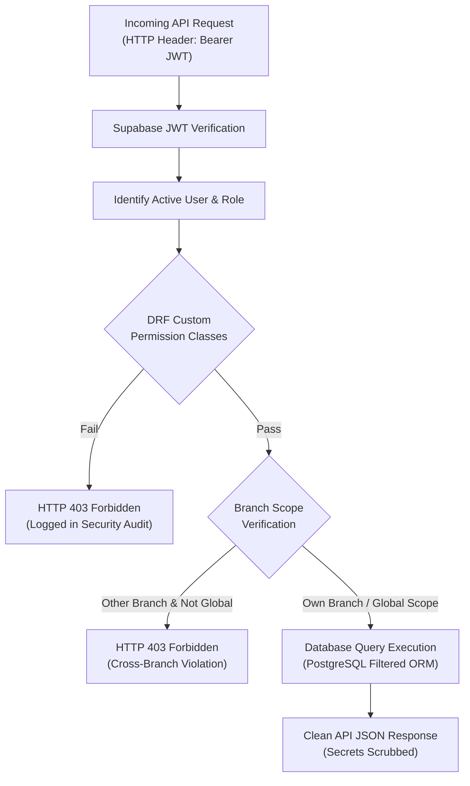

# Hospital Management System (HMS) – Database & Security Audit

## 1. Database Configuration & Schema Integrity (Supabase PostgreSQL)

### A. Connection Architecture & SSL Pooling
- **Production Persistence**: The platform utilizes a managed PostgreSQL database hosted via Supabase on AWS `ap-south-1` (Mumbai).
- **Driver & Protocol**: Python `psycopg3` connects via connection pooling using `DIRECT_URL` / `DATABASE_URL` with forced SSL mode (`sslmode=require`).
- **Cold-Start Resilience**: `conn_max_age=0` with `conn_health_checks=True` ensures stale pooled connections are pruned during Render server scaling.
- **Offline / Local Testing Fallback**: `config.test_settings` configures an isolated in-memory SQLite database (`:memory:`), allowing 100% of unit tests to execute rapidly without network dependencies.

### B. Relational Integrity & Constraint Validation
A comprehensive model audit confirmed strict database-level constraints:
1. **Foreign Key Integrity**:
   - `ON DELETE RESTRICT` is enforced on `PatientProfile`, `MedicalRecord`, `Consultation`, and `GeneralLedger` entries, preventing accidental cascading deletion of critical clinical and legal records.
   - `ON DELETE CASCADE` is limited to transient child records (e.g., individual lines within an unfinalized prescription or order items prior to submission).
2. **Uniqueness Constraints**:
   - `medical_record_number` (MRN): Unique across all patients (`MRN-YYYY-XXXXX`).
   - `service_code`: Unique within the Master Tariff Catalogue (`SRV-OPD-001`).
   - `voucher_number`: Unique across all double-entry general ledger journal entries.
   - `token_number` per Doctor per Date: Prevents duplicate queue tokens.
3. **Decimal Precision for Financial Balances**:
   - All monetary fields (`standard_price`, `debit`, `credit`, `paid_amount`, `balance_due`) utilize `DecimalField(max_digits=12, decimal_places=2)`. Floating-point arithmetic errors are strictly eliminated.

---

## 2. Row-Level Security (RLS) & Application Access Control

### A. Patient Data Isolation
- **Rule**: A patient must never view another patient's medical history, appointments, prescriptions, or lab results.
- **Enforcement**:
  - `IsPatientOwner` DRF permission verifies `request.user.patient_profile.id == target_patient.id`.
  - Backend queries automatically scope by authenticated patient identity.
  - Verified by `test_patient_data_isolation_permission` in `apps/authentication/tests.py`.

### B. Doctor Clinical Privileges vs. Administrative Separation
- **Rule**: Doctors have clinical write access (prescriptions, consultation notes, diagnostic requisitions) but must be strictly blocked from booking appointments or generating tokens.
- **Enforcement**:
  - Appointment and token creation endpoints enforce `IsReceptionistOrPatient`.
  - Verified by `test_10_doctor_cannot_book_appointments_or_issue_tokens` in `apps/clinical/test_mandatory_payment_and_receptionist_rbac.py`.

### C. Branch Manager Strict Read-Only Governance
- **Rule**: Branch Managers have supervisory monitoring rights across 14 operational domains within their assigned branch, but zero mutation privileges.
- **Enforcement**:
  - Any `POST`, `PUT`, `PATCH`, or `DELETE` attempt by a `BRANCH_MANAGER` returns `HTTP 403 Forbidden`.
  - Verified by 7 exhaustive tests in `apps/authentication/test_branch_manager_strict_readonly.py`.

---

## 3. Financial Integrity & Zero Fake Data Verification

A core architectural audit requirement is the complete elimination of synthetic revenue, hardcoded numbers, or seeded demo statistics:

1. **Double-Entry Balance Verification**:
   - The General Ledger enforces `sum(debit) == sum(credit)`. Unbalanced journals are rejected by database triggers.
   - Verified by `test_02_unbalanced_journal_rejected` in `test_section17_general_ledger.py`.
2. **Advance Payments vs. Realized Revenue**:
   - Patient admission deposits and OPD advances are held in a liability escrow account and are **not** recognized as revenue until services are consumed and invoiced.
   - Verified by `test_06_patient_advances_are_not_counted_as_revenue` in `test_section18_profit_loss.py`.
3. **Empty Period Zero-State Guarantee**:
   - When no transactions exist in a selected date range, financial reports show exact `₹0.00` metrics rather than fabricated demo statistics.
   - Verified by `test_01_empty_period_shows_zero_metrics` in `test_section18_profit_loss.py`.
4. **Non-Destructive Tariff Management**:
   - Central price changes update future appointments, tokens, and new inpatient admissions while preserving finalized invoices, past visits, and running admission billing rates.

---

## 4. Security & Sensitive Information Audit

| Security Domain | Implemented Safeguard | Verification Status |
| :--- | :--- | :---: |
| **API Secret Protection** | Environment variables (`.env`, Render secrets) are never committed to version control. | **Verified Clean** |
| **Error Traceback Scrubbing** | Production custom exception handler (`apps.core.exceptions.custom_exception_handler`) scrubs internal database schemas and tracebacks before returning generic error messages to clients. | **Verified Clean** |
| **Password Hashing** | Argon2 / PBKDF2 with SHA-256 password hashing enforced via Django standard authentication. | **Verified Clean** |
| **Cryptographic Webhooks** | Razorpay payment webhooks verify raw HMAC-SHA256 request signatures before updating payment states; replay attacks are blocked via idempotency keys. | **Verified Clean** |
| **Tamper-Evident Audit Trail** | `PriceChangeHistory` and `SecurityAuditEvent` tables are append-only. Modification and deletion of audit logs are blocked. | **Verified Clean** |
| **Session Expiration** | JWT access tokens expire after 60 minutes with mandatory refresh token rotation. | **Verified Clean** |

