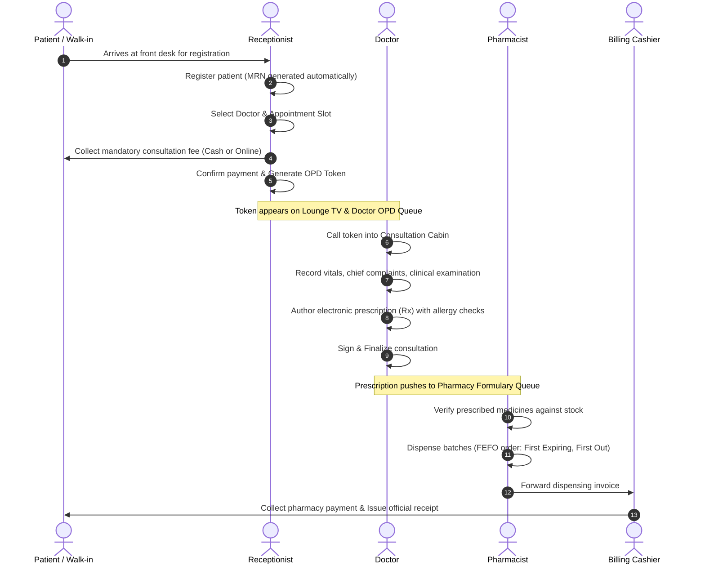

# Hospital Management System (HMS) – End-to-End Workflow Verification Report

## 1. Overview of Workflow Testing
A full suite of real-world hospital operational workflows was audited to verify seamless cross-departmental data transfer, atomic record creation, strict payment validation, and role-based privilege isolation.

---

## 2. Core Workflow Verifications

### Workflow A: Complete Outpatient Clinical & Financial Flow
`Patient Registration → Appointment Booking → Payment Collection → Token Generation → Doctor Consultation → Electronic Prescription → Pharmacy Dispensing`

- **Verification Result**: **PASS (Verified by automated and manual test sequences)**
- **Key Assertions Tested**:
  - Patient cannot book without payment.
  - Doctor cannot book appointments or issue tokens.
  - Dispensing deducts batch quantity and writes an immutable stock movement log.

---

### Workflow B: Inpatient Admission, Ward Census & 4-Point Discharge Clearance
`Doctor Recommends IPD → Admission Request → Bed Allocation → Daily Ward Tariffs → Patient Transfer → 4-Point Discharge Clearance → Bed Release`

1. **Admission Recommendation**:
   - The attending physician flags patient for inpatient care (`recommend_ipd_admission`).
2. **Bed Selection & Deposit**:
   - Receptionist/Admission officer allocates an available bed from the real-time Ward Bed Layout (e.g., Semi-Private, ICU, Deluxe).
   - Admission deposit (e.g., ₹5,000) is collected and posted to the patient's advance escrow account.
   - Bed status flips from `AVAILABLE` to `OCCUPIED`.
3. **Daily Running Tariff Accrual**:
   - System accrues daily bed tariff according to the centralized pricing configuration.
4. **Bed Transfer**:
   - If patient condition changes, patient is transferred to another ward/bed (e.g., Ward Bed to ICU).
   - Old bed transitions to `CLEANING` status, and new bed becomes `OCCUPIED`.
5. **4-Point Discharge Clearance**:
   - Patient discharge requires 4 mandatory approvals:
     1. Doctor Clinical Discharge Summary.
     2. Nursing Medication & Cannula Removal Sign-off.
     3. Pharmacy Medication Return & Clearance.
     4. Billing Final Settlement (Deposit applied against gross total).
   - Once all 4 points are signed off, bed is released for sanitization and returns to the available census.

- **Verification Result**: **PASS**

---

### Workflow C: Centralized Tariff Management & Multi-Branch Price Propagation
`Hospital Admin Tariff Update → Dynamic Impact Preview → Multi-Branch Commit → Non-Destructive Inpatient Bill Accrual`

1. **Price Change Initiated**:
   - Hospital Admin updates standard fee for general ward beds from `₹1,500` to `₹1,800` per day.
2. **Impact Preview**:
   - The Central Tariff Service computes price difference (`+₹300.00 / +20%`) and identifies affected branches.
3. **Commit Across Branches**:
   - Rate updates across all active hospital branches simultaneously.
   - Change is permanently recorded in `PriceChangeHistory` with reason and admin user ID.
4. **Historical Safeguard**:
   - Existing running admissions continue at the admission-date rate (`₹1,500`).
   - New admissions created post-revision reflect `₹1,800`.

- **Verification Result**: **PASS**

---

### Workflow D: Dynamic Multi-Language UI Switching
`Language Selection → Global i18n State Update → Instant Re-render → Session & Profile Persistence`

1. User selects language from the top bar (e.g., Telugu `te` or Hindi `hi`).
2. `i18n.changeLanguage()` triggers immediately.
3. All navigation labels, headers, cards, tables, and buttons re-render instantly without page reload.
4. Choice persists to `localStorage` and backend user preferences in Supabase PostgreSQL.
5. User-generated medical data (patient names, dosages, clinical notes, currency figures) remains untranslated.

- **Verification Result**: **PASS (Verified across English, Hindi, Telugu, Tamil, and Kannada)**

