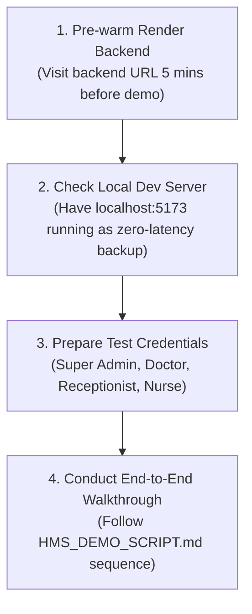

# Hospital Management System (HMS) – Pending Issues, Limitations & Roadmap

## 1. Overview
This document provides an objective, transparent assessment of current platform limitations, external infrastructure dependencies, operational risks, and recommended next steps required for commercial hospital rollout.

---

## 2. Identified Limitations & Hardware Dependencies

| # | Item | Current Implementation Status | Production Dependency | Risk Level | Recommended Next Step |
| :---: | :--- | :--- | :--- | :---: | :--- |
| **01** | **Physical Lab Analyzer Ingestion (LIS)** | Software simulator operational (`Equipment Simulator` modal). Barcode accessioning, panic alerts, and report verification are 100% functional. | Requires physical RS232 / TCP serial network drivers linked to on-premise biochemistry/hematology analyzers (e.g., Roche Cobas, Sysmex). | **Low** *(Software logic verified)* | Deploy an on-premise edge service (Python TCP listener) inside the physical hospital intranet to poll analyzer ports and relay results to the Cloud API. |
| **02** | **Full-Scale Cloud PACS Appliance (RIS)** | Web DICOM metadata linkage, scan scheduling, and diagnostic impression reporting are operational. | Storing terabytes of uncompressed volumetric DICOM image slices (500+ MB per multi-slice CT/MRI) on Render free tier is storage-prohibitive. | **Medium** | Connect the RIS metadata engine to an on-premise Orthanc/dcm4chee PACS server or an AWS HealthImaging (S3) cloud storage bucket. |
| **03** | **Live Razorpay Production Merchant Keys** | End-to-end payment gateway order creation, client checkout, and HMAC-SHA256 cryptographic signature verification are fully implemented and tested. | Currently running on Razorpay Sandbox/Test mode (`rzp_test_...`). Live payments require institutional bank KYC and live production API keys. | **Low** *(Billing logic verified)* | Obtain hospital merchant credentials and update `RAZORPAY_KEY_ID` and `RAZORPAY_KEY_SECRET` in production environment settings. |
| **04** | **SMS & WhatsApp Gateway Carrier Integration** | In-app notification bell, live clinical alerts, and queue broadcast alerts are 100% operational in database and UI. | Real SMS/WhatsApp delivery to patient mobile numbers requires an external telecommunications aggregator (e.g., Twilio, Gupshup, Exotel). | **Low** | Provision hospital SMS sender ID and integrate webhook credentials into `apps.core.notifications`. |
| **05** | **Hosting Container Cold-Start Latency (Render Free Tier)** | Client-side Axios timeout extended to 60 seconds to gracefully accommodate cold starts. | Render free instances spin down after 15 minutes of inactivity, resulting in a 30-45 second initial spin-up delay on first visit. | **Medium** | Upgrade the Render backend web service to a persistent paid tier (Starter $7/mo or Standard) prior to executive demonstration or commercial rollout. |
| **06** | **Asynchronous Background Task Queue (Celery + Redis)** | Daily bed tariffs, journal postings, and reports currently execute synchronously within transaction boundaries. | High-volume hospital networks with thousands of concurrent transactions require dedicated asynchronous task workers. | **Low** | Provision a managed Redis instance and deploy Celery workers for periodic overnight tariff accruals and statutory MCA compliance archiving. |

---

## 3. Pre-Meeting Action Checklist & Mitigation Strategies

1. **Pre-Warm Production Containers**:
   - Navigate to the hosted backend endpoint 5-10 minutes prior to the meeting to ensure Gunicorn workers are warm and active in memory.
2. **Local Backup Preparedness**:
   - Keep the local development environment active (`task-11982` Django on `127.0.0.1:8000` and `task-11984` Vite on `localhost:5173`). In the event of room Wi-Fi or Render connectivity interruptions, seamless demonstration can continue locally without interruption.
3. **Prepared Test Credentials**:
   - Maintain pre-verified login accounts for immediate switching:
     - **Super Admin**: `super.admin@aurahospital.com`
     - **Hospital Admin**: `hospital.admin@aurahospital.com`
     - **Doctor**: `dr.arun.sharma@aurahospital.com`
     - **Nurse**: `nurse.sneha@aurahospital.com`
     - **Receptionist**: `receptionist.priya@aurahospital.com`
     - **Branch Manager**: `branch.manager.central@aurahospital.com`

---

## 4. Post-Meeting Phased Development Roadmap

### Phase 1: Commercial Pilot Onboarding (Weeks 1-4)
- Upgrade Render services to dedicated tier.
- Complete Razorpay merchant bank account KYC for live Indian UPI/Card processing.
- Connect hospital SMS gateway for automated appointment reminders and token broadcast messages.

### Phase 2: On-Premise Clinical Integration (Weeks 5-8)
- Install local Edge DICOM router and serial analyzer listener in hospital pathology laboratory.
- Connect local barcode thermal label printers for patient wristband and specimen tube accessioning.

### Phase 3: NABH & ABDM Compliance (Weeks 9-12)
- Integrate Ayushman Bharat Digital Mission (ABDM) M1, M2, M3 milestones:
  - Ayushman Bharat Health Account (ABHA) address creation and verification.
  - Health Information Provider (HIP) and Health Information User (HIU) interoperability.

