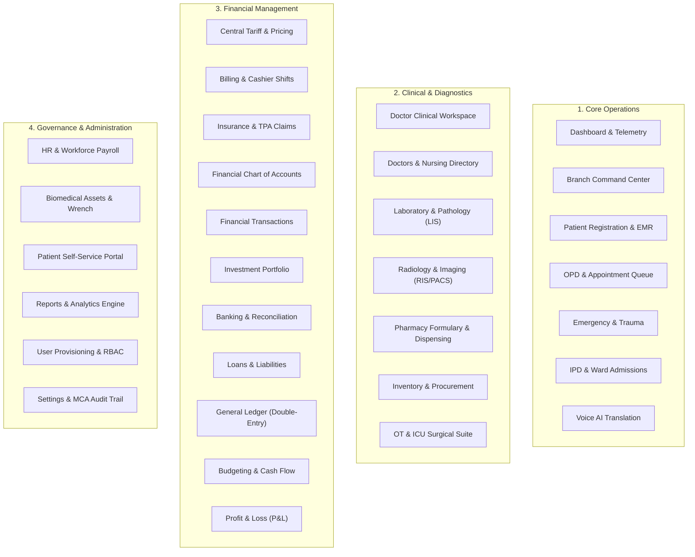

# Hospital Management System (HMS) – Project Overview & Business Mandate

## 1. Executive Summary & Purpose
The AURA Hospital Management System (HMS) is an enterprise-grade, multi-tenant, multi-specialty clinical and operational platform engineered for multi-branch healthcare networks. The system digitizes the entire patient care continuum—from initial digital self-registration and OPD appointment booking to outpatient consultation, diagnostic accessioning, medication dispensing, inpatient admissions, and multi-department accounting.

The platform is designed around three fundamental pillars:
1. **Patient-Centric Care & Zero Wait Friction**: Streamlined queuing via real-time Waiting Lounge digital displays, token displays, and automated slot allocations.
2. **Clinical Safety & Separation of Duties**: Strict clinical governance ensuring doctors focus purely on diagnostics and treatment without administrative booking responsibilities, while receptionists and billing staff handle payments and scheduling.
3. **Financial Integrity & Multi-Branch Auditing**: 100% dynamic, live operational data eliminating fake/seeded revenue, powered by double-entry General Ledger reconciliation and MCA-compliant tamper-evident audit logging.

---

## 2. Target User Personas & Organizational Roles
The HMS enforces strict 3D Role-Based Access Control (RBAC) across 21 discrete hospital roles:

| Category | Role Identifier | Primary Responsibilities & Scope |
| :--- | :--- | :--- |
| **Executive Leadership** | `SUPER_ADMIN` | Network-wide governance, global branch provisioning, RBAC policy enforcement, system health monitoring. |
| | `HOSPITAL_ADMIN` | Central pricing authority, global tariff configuration, hospital service catalogue administration. |
| | `BRANCH_MANAGER` | Branch-specific operational oversight, live telemetry monitoring across 14 operational domains (Strict Read-Only). |
| | `MEDICAL_DIRECTOR` | Clinical governance, quality metrics, morbidity/mortality auditing, physician credentialing. |
| **Clinical Staff** | `DEPARTMENT_HEAD` | Departmental shift rosters, workload telemetry, staff requisitions, biomedical asset monitoring. |
| | `DOCTOR` / `SPECIALIST` | Clinical consultation desk, EMR documentation, electronic prescriptions (Rx), diagnostic requisitioning, inpatient rounds. |
| | `NURSE` | Ward census management, MAR medication administration, vital signs tracking, care plan execution, shift handovers. |
| **Allied Health** | `LAB_TECHNICIAN` / `PATHOLOGIST` | Specimen accessioning, automated analyzer ingestion, result verification, panic alert escalation. |
| | `RADIOLOGY_TECHNICIAN` | Modality scan scheduling, PACS/DICOM study linking, radiologist structured impression sign-off. |
| | `PHARMACIST` | FEFO batch dispensing, prescription verification, stock movement tracking, drug expiry alerts. |
| **Front Office & Billing** | `RECEPTIONIST` | Patient registration, mandatory payment collection, OPD token generation, doctor schedule lookup. |
| | `BILLING_EXECUTIVE` / `CASHIER` | Outpatient/inpatient invoicing, shift closing reconciliation, payment gateway tracking, refund management. |
| | `INSURANCE_COORDINATOR` | TPA pre-authorization, cashless claim submission, dispute settlement, corporate package billing. |
| **Supply Chain & Finance** | `INVENTORY_MANAGER` | Central stores inventory, reorder level tracking, asset maintenance registers. |
| | `PROCUREMENT_OFFICER` | Multi-category requisitions, vendor quotation comparative statements, PO lifecycle, GRN stock postings. |
| | `FINANCE_MANAGER` / `ACCOUNTANT` | Chart of accounts, double-entry General Ledger, Cash/Bank books, trial balances, P&L reporting. |
| | `INVESTMENT_MANAGER` | Fixed deposit registers, institutional bond portfolios, accrued interest accounting. |
| **Patients** | `PATIENT` | Self-service portal: appointments, digital prescriptions, lab reports, billing history, voice translation. |

---

## 3. High-Level Modular Scope (27 Core Modules)
The application architecture is partitioned into 27 hospital modules grouped into 4 functional clusters:

---

## 4. Key Business Objectives & Problem Statements Solved

### A. Eradication of Synthetic/Fake Data
- **Problem**: Healthcare demos and legacy systems often display static, mock, or seeded numbers that do not reconcile.
- **Solution**: Complete system-wide dynamic synchronization. Every metric displayed across dashboards, P&L statements, and bed grids is computed directly from verified database records.

### B. Strict Operational Separation of Duties
- **Problem**: In disorganized hospitals, doctors or unauthorized staff often book appointments or override billing without verified payment receipts.
- **Solution**: Automated enforcement:
  1. Only Receptionists and Patients can book appointments or generate tokens upon confirmed payment.
  2. Doctors are strictly restricted from booking appointments, maintaining clinical impartiality.
  3. Branch Managers have 100% read-only visibility into operational metrics without write permissions, preventing unauthorized operational modifications.

### C. Centralized Tariff Governance Across Multi-Branch Networks
- **Problem**: In multi-branch hospital chains, price revisions across consultation fees, bed tariffs, and lab tests suffer from manual delays and branch discrepancies.
- **Solution**: The Hospital Admin manages a centralized Master Tariff. Price revisions automatically propagate to all active branches simultaneously with non-destructive historic invoice safeguards.

### D. Multilingual Healthcare Access
- **Problem**: Healthcare staff and patients across India communicate in diverse languages, while clinical systems remain English-only.
- **Solution**: Full dynamic UI language synchronization across **English, Hindi, Telugu, Tamil, and Kannada** with 100% key parity (1,013 leaf keys per language).

