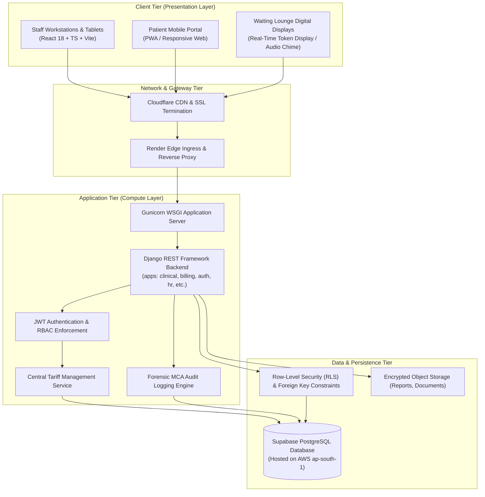
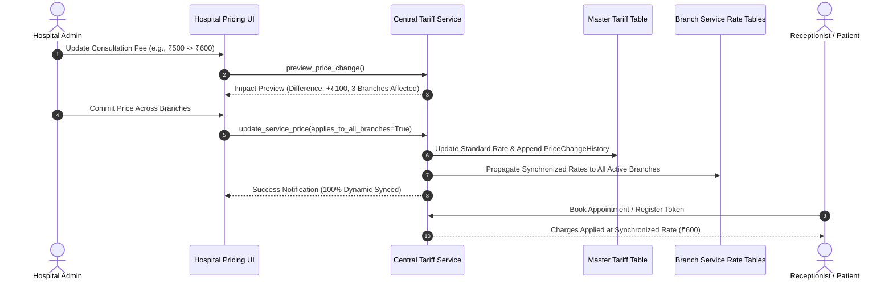

# Hospital Management System (HMS) – System Architecture

## 1. High-Level Architecture Overview
The AURA Hospital Management System is built on a decoupled, cloud-native client-server architecture designed for reliability, strict data isolation, and high clinical responsiveness.

---

## 2. Technology Stack Breakdown

| Layer | Technology | Version | Key Libraries & Purpose |
| :--- | :--- | :--- | :--- |
| **Frontend** | React + TypeScript | React 18.3, TS 5.6 | Single Page Application (SPA), type safety, custom hooks. |
| | Vite | Vite 8.3 | Ultra-fast bundling, HMR, production minification (`rolldown`). |
| | Styling | Tailwind CSS v4 | Utility-first CSS, clean healthcare white-background UI design. |
| | Icons | Lucide React | Modern clinical & operational vector icon set. |
| | Internationalization | i18next + react-i18next | Dynamic 5-language UI switching (`en`, `hi`, `te`, `ta`, `kn`). |
| | Networking | Axios | Axios instance with JWT interceptor and 60s cold-start timeout. |
| **Backend** | Python | 3.11 / 3.12 | Core programming environment. |
| | Django | 5.1.15 | Enterprise web framework, ORM, migrations, security middleware. |
| | REST Framework | DRF 3.15 | Serializers, ViewSets, API routing, pagination, error handlers. |
| | Database Driver | psycopg3 | PostgreSQL 3 client with binary protocol and pooling. |
| | Payment Gateway | Razorpay SDK | Cryptographic HMAC-SHA256 signature verification & webhooks. |
| **Database** | PostgreSQL (Supabase) | 15.x | High-performance relational database with RLS & pooling. |
| | In-Memory Testing | SQLite 3 | `:memory:` SQLite backend for isolated unit testing. |
| **Deployment** | Render.com | Blueprint v1 | Web Service (Python) + Static Site (Vite) via `render.yaml`. |

---

## 3. Data Isolation & Branch Multitenancy Architecture
The system supports multiple physical branches (e.g., AURA Central Multi-Specialty, Suburban Branch, East Annex) under a unified corporate schema:

1. **Branch Association**:
   - Primary operational records (`Appointment`, `InpatientAdmission`, `Invoice`, `LaboratoryOrder`, `StockItem`) include a direct foreign key to `Branch`.
2. **Branch Manager Scoping**:
   - Users with the `BRANCH_MANAGER` role are locked to their assigned `branch_id`. Queries strictly filter `where branch_id = user.branch_id`.
   - Any query attempting to access another branch's records is rejected with `HTTP 403 Forbidden`.
3. **Multi-Branch Governance Roles**:
   - `SUPER_ADMIN`, `HOSPITAL_ADMIN`, and `INVESTMENT_MANAGER` possess global multi-branch authority and can toggle branch scopes dynamically or execute network-wide operations.

---

## 4. Centralized Tariff & Dynamic Pricing Architecture
Centralized tariff governance allows the Hospital Admin to control pricing across the entire hospital chain from a single master configuration:

**Non-Destructive Historic Safeguard**:
Existing running admissions, finalized invoices, and completed receipts reference the historical rate locked at invoice generation time. Ongoing admissions continue at their admission-date tariff. Future appointments, tokens, and new inpatient admissions immediately reflect the updated rate.

---

## 5. Security & Authentication Architecture

### A. JWT Authentication & Bearer Tokens
1. User logs in with email and password via Supabase Auth or DRF login endpoint.
2. An asymmetric JWT token containing user identity and expiration claims is issued.
3. Every subsequent HTTP request delivers the token in the `Authorization: Bearer <token>` header.
4. Django DRF authentication middleware validates the cryptographic signature and extracts the active `User` and `StaffProfile`.

### B. 3D Role-Based Access Control (RBAC)
Access control evaluates three dimensions:
- **Role Permission**: Does the user's role possess the action flag (e.g., `can_issue_prescription`)?
- **Branch Scope**: Is the target resource within the user's assigned branch?
- **Maker-Checker Separation**: Does the operation involve a sensitive financial or administrative mutation? Self-approval of invoices, loans, or leave requests is strictly blocked by the system.

### C. Row-Level Security (RLS) & Foreign Key Constraints
- Supabase PostgreSQL models enforce referential integrity (`ON DELETE RESTRICT` for patient medical records and financial journals).
- Patient records cannot be viewed by other patients (`IsPatientOwner` policy).
- MCA audit trails are tamper-evident: `PriceChangeHistory` and `SecurityAuditEvent` records are append-only; update and delete operations are rejected at the database level.

